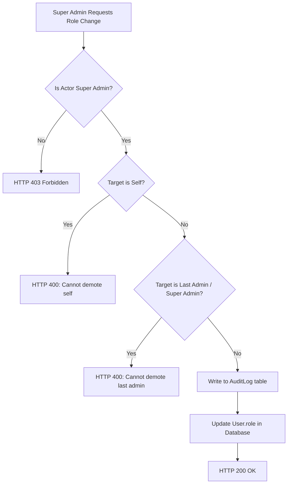

# PLUTO vProctor — Administrator User Manual

**Document Version:** 1.0  
**Product Version:** 0.1.0  
**Target Audience:** System Administrators, Talent Acquisition Managers, Technical Recruiters, Examiners  
**Last Updated:** November 2026  

---

## Table of Contents
1. [Administrator Roles & Access Control](#1-administrator-roles--access-control)
2. [Administrator Authentication & Login](#2-administrator-authentication--login)
3. [Admin Console Overview & Navigation](#3-admin-console-overview--navigation)
4. [Candidate Account Governance](#4-candidate-account-governance)
5. [Searching & Filtering Accounts](#5-searching--filtering-accounts)
6. [Inspecting Candidate Profiles & Uploaded Resumes](#6-inspecting-candidate-profiles--uploaded-resumes)
7. [Reviewing Candidate Interview Histories](#7-reviewing-candidate-interview-histories)
8. [Role Management & Super-Admin Safeguards](#8-role-management--super-admin-safeguards)
9. [Question-Set Management Lifecycle](#9-question-set-management-lifecycle)
10. [Creating Custom Question Sets](#10-creating-custom-question-sets)
11. [Editing & Modifying Question Sets](#11-editing--modifying-question-sets)
12. [Safe Deletion & Conflict Handling](#12-safe-deletion--conflict-handling)
13. [Importing Question Sets from JSON Files](#13-importing-question-sets-from-json-files)
14. [Scheduling & Configuring Interview Rooms](#14-scheduling--configuring-interview-rooms)
15. [Candidate Invitations & Join Codes](#15-candidate-invitations--join-codes)
16. [Lobby & Waiting Room Governance](#16-lobby--waiting-room-governance)
17. [Live Interview Control Bar](#17-live-interview-control-bar)
18. [Managing Interview Questions: Next, Skip, Pause & Resume](#18-managing-interview-questions-next-skip-pause--resume)
19. [Concluding Interviews & Processing Triggers](#19-concluding-interviews--processing-triggers)
20. [Reviewing Completed Rooms](#20-reviewing-completed-rooms)
21. [Accessing Candidate Reports & Official PDF Dossiers](#21-accessing-candidate-reports--official-pdf-dossiers)
22. [Streaming Candidate Video Recordings](#22-streaming-candidate-video-recordings)
23. [Platform-Wide Analytics & Metrics](#23-platform-wide-analytics--metrics)
24. [Audit Logs & Role-Change Traceability](#24-audit-logs--role-change-traceability)
25. [Troubleshooting Administrative Operations](#25-troubleshooting-administrative-operations)

---

## 1. Administrator Roles & Access Control

PLUTO vProctor enforces strict multi-tiered Role-Based Access Control (RBAC) across three distinct tiers:

| Role Name | Scope & Authority | Primary Permissions | Key Restrictions |
|---|---|---|---|
| **`candidate`** | Self-Service | Conduct self-practice, upload personal resumes, view own recommendations, roadmaps, and reports, join hosted rooms. | Strictly blocked from all `/api/admin/*` endpoints (`403 Forbidden`). Cannot access other candidates' data. |
| **`admin`** | Operational Recruiter / Proctor | Schedule and manage interview rooms, manage own question sets, view all candidate profiles, inspect histories, stream recordings, view reports, access analytics. | Cannot modify user roles. Cannot edit or delete question sets owned by other administrators. |
| **`super_admin`** | Enterprise System Governance | Full platform authority: manage all rooms, question sets across all users, govern user roles, view security audit trails, inspect system health. | Subject to automated safety locks: cannot self-demote, cannot demote the last active admin or super-admin. |

---

## 2. Administrator Authentication & Login

To maintain security separation, administrators authenticate via a dedicated administration portal:

1. Navigate to `/admin/login` in your browser.
2. Enter your administrative email and password.
3. Click **"Sign In to Admin Console"**.
4. **Security Enforcement:**
   - Standard candidates attempting to log in via `/admin/login` are authenticated, but the route guard immediately intercepts their non-admin role and redirects them back to the candidate portal (`/`).
   - Successful admin login issues an in-memory access token, sets an HTTP-only secure refresh cookie (`pluto_refresh_token`), and sets the CSRF double-submit token (`pluto_csrf_token`).
   - You will land directly on the **Admin Console** at `/admin`.

---

## 3. Admin Console Overview & Navigation

The Admin Console (`AdminConsolePage.jsx`) is organized into five primary administrative modules:

```text
[ PLUTO vProctor Admin Console ]
├── 1. Room Manager (Schedule, Active Rooms, Question Sets)
├── 2. Candidate Governance (Accounts, Profiles, Resumes, Roles)
├── 3. Completed Interviews Browser (Platform-wide history, Dossiers, Videos)
├── 4. Analytics & Insights (Pipeline funnels, Scores, Proctoring metrics)
└── 5. System Health & Presets (Hardware, Ollama status, Detection presets)
```

- **Top Bar Stats:** Real-time metrics displaying Total Registered Accounts, Total Completed Interviews, Active Scheduled Rooms, and System Status.
- **Role Badge:** Clearly identifies whether you are currently logged in as an `ADMIN` or `SUPER_ADMIN`.
- **Navigation Tabs:** One-click switching between Rooms, Question Sets, Accounts, Completed Interviews, and System Analytics.

---

## 4. Candidate Account Governance

Click the **"Accounts"** tab in the Admin Console to access the centralized candidate management interface.

- **Account Cards:** Every registered user is represented by an informative card showing:
  - Full Name and Email Address.
  - Role Badge (`CANDIDATE`, `ADMIN`, or `SUPER_ADMIN`).
  - Account Status (`Active` / `Inactive`).
  - Total Completed Interviews count.
  - Profile Completion Status badge (`Profile Active` vs `Profile Incomplete`).
  - Registration Timestamp.
- **Action Buttons:** Every account card features three dedicated actions:
  - **"Inspect"**: Opens the Candidate Profile & Resume modal.
  - **"History"**: Opens the complete Interview History drawer.
  - **"Change Role"**: Opens the Super-Admin Role Mutation dialog.

---

## 5. Searching & Filtering Accounts

The Accounts interface provides instant, client-side filtering without page reloads:

1. **Search Bar:** Type in the search input to filter users simultaneously by name or email. Matching is case-insensitive.
2. **Role Filter Dropdown:** Select from:
   - `All Roles` (displays all registered users)
   - `candidate` (filters to job candidates only)
   - `admin` (filters to recruiters and operational admins)
   - `super_admin` (filters to enterprise administrators)
3. Results update instantly as you type or change filters.

---

## 6. Inspecting Candidate Profiles & Uploaded Resumes

To review a candidate's background before or after an interview:

1. Locate the candidate in the Accounts tab.
2. Click the **"Inspect"** button.
3. The **Candidate Profile & Resume Modal** opens (`GET /api/admin/users/{uid}`):
   - **Personal Info:** Phone number, geographic location, and bio.
   - **Links:** Direct links to LinkedIn, GitHub, and external portfolio URLs.
   - **Target Career Roles:** Roles the candidate is actively pursuing.
   - **Verified Skills:** Complete list of technical and soft skills claimed on profile.
   - **Resume Documents:** List of all uploaded resumes with filename, upload date, file size, active status badge, and a **"Download Original"** link.

---

## 7. Reviewing Candidate Interview Histories

To evaluate a candidate's progress and longitudinal interview performance:

1. Locate the candidate in the Accounts tab and click **"History"**.
2. The **Candidate Session History Modal** opens (`GET /api/admin/users/{uid}/history`):
   - Displays all sessions completed by the candidate (both self-practice and hosted recruiter sessions).
   - **Mode Badge:** Distinguishes `Self Practice` from `Hosted Recruiter Room`.
   - **Date & Duration:** Exact completion timestamp and interview length.
   - **Performance Stamp:** Overall Score (0–100) and Letter Grade (A/B/C/D).
   - **Direct Dossier Link:** Click **"View Report"** to open the candidate's comprehensive evaluation report in a new tab.
   - **Recording Playback:** Click **"Play Video"** to stream the session video recording directly inside an inline modal.

---

## 8. Role Management & Super-Admin Safeguards

Role modification allows enterprise administrators to promote candidates to interviewers or manage administrative staff.



### 8.1 Performing a Role Change
1. Ensure you are signed in as a **Super Administrator** (role badge shows `SUPER_ADMIN`).
2. In the Accounts tab, locate the user and click **"Change Role"**.
3. In the modal:
   - Select the target role: `candidate`, `admin`, or `super_admin`.
   - Enter a **Justification Reason** (minimum 5 characters, e.g. *"Promoted to Technical Recruiter for Backend Team"*).
4. Click **"Confirm Role Change"**.

### 8.2 Automated Safety Safeguards
- **Self-Demotion Lock:** Super-admins cannot demote their own account.
- **Last Active Administrator Lock:** If an admin is the only active administrator on the platform, demoting them to a candidate is strictly blocked to prevent administrative lockout.
- **Last Active Super-Administrator Lock:** If a super-admin is the sole super-administrator, demoting them is strictly blocked.
- **Audit Trail:** Every change is permanently recorded in `audit_logs` with actor ID, target user ID, old role, new role, and reason.

---

## 9. Question-Set Management Lifecycle

PLUTO vProctor enables administrators to create and manage custom question banks tailored for specific roles and seniority levels. Access this via the **"Question Sets"** tab in the Room Manager.

- **Question Set Cards:** Display Set Title, Description, Item Count, Target Domain, and Owner.
- **Lifecycle Actions:**
  - **Create New Set:** Interactive question builder or JSON raw import.
  - **Edit Set:** Reorder, modify, or add questions.
  - **Import JSON:** Upload existing `.json` question libraries.
  - **Delete Set:** Remove unused sets with conflict safeguards.

---

## 10. Creating Custom Question Sets

1. Navigate to Room Manager $\to$ **Question Sets** tab.
2. Click **"Create Question Set"**.
3. In the builder:
   - **Title:** Descriptive title (e.g., *Senior Distributed Systems Evaluation*).
   - **Description:** Overview of the assessment's target domain and difficulty.
   - **Target Domain:** Select domain (e.g., `Distributed Systems`, `Backend`, `DevOps`).
4. **Add Questions Interactively:**
   - **Question Text:** The exact question prompt read to the candidate (5 to 2,000 characters).
   - **Difficulty:** `junior`, `mid`, `senior`, or `lead`.
   - **Target Skills:** Comma-separated list of competencies tested (e.g., `Raft, Paxos, Consensus, Replication`).
   - **Ideal Answer Criteria:** Key concepts expected in a high-scoring answer.
   - **Time Limit:** Recommended answer duration in seconds (default: 180s).
5. Click **"Save Question Set"**. The set is persisted (`POST /api/admin/question-sets`) and immediately available in the Room Scheduler dropdown.

---

## 11. Editing & Modifying Question Sets

1. On any question set card owned by you (or any set if you are a super-admin), click the **Edit (Pencil)** icon.
2. The **Edit Question Set Modal** opens pre-populated with existing questions (`PUT /api/admin/question-sets/{id}`).
3. You can:
   - Modify the title or description.
   - Update individual question text, criteria, or time limits.
   - Reorder questions using the arrow buttons.
   - Add new questions to the set.
4. Click **"Save Changes"**. The backend validates all items, updates the SHA-256 content checksum, increments the schema version, and logs the change to the audit trail.

---

## 12. Safe Deletion & Conflict Handling

1. Click the **Delete (Trash)** icon on a question set card.
2. A confirmation dialog appears detailing the impact of deletion.
3. **Active Room Protection (409 Conflict):**
   - If the question set is actively assigned to an ongoing room (`LOBBY`, `LIVE`, or `PAUSED`), deletion is **strictly blocked** with `HTTP 409 Conflict`. You must first conclude or cancel the active room.
4. **Historical Room Data Preservation:**
   - If the question set is referenced by previously completed rooms, deletion safely sets the foreign key `question_set_id` to `NULL`.
   - **No Historical Data Loss:** The completed rooms, their copied questions, transcripts, and candidate evaluation dossiers remain 100% intact.

---

## 13. Importing Question Sets from JSON Files

You can bulk-import question sets from structured `.json` files:

1. Click **"Import JSON File"** in the Question Sets view.
2. Select a `.json` file from your computer (maximum file size: 2 MB).
3. **Accepted Formats:**
   - Standard Object format:
     ```json
     {
       "name": "Backend Python Mastery",
       "description": "Core concurrency, GIL, and FastAPI architecture",
       "questions": [
         {
           "question_text": "Explain how Python's GIL affects CPU-bound multi-threaded programs.",
           "difficulty": "senior",
           "domain": "Python",
           "skills": ["python", "threading", "concurrency"],
           "ideal_criteria": "Mentions bytecode execution, single-core limitation, multiprocessing alternatives",
           "time_limit_sec": 180
         }
       ]
     }
     ```
   - Raw Question Array format (a simple array of question objects).
4. The **Import Preview Modal** validates syntax and schema, displaying question count, sample questions, and letting you adjust the name before committing.
5. Click **"Confirm Import"** to persist the question set.

---

## 14. Scheduling & Configuring Interview Rooms

To set up an interview room for a candidate:

1. Navigate to Room Manager $\to$ **"Schedule Room"** tab.
2. Fill in the room configuration:
   - **Interview Title:** Name of the session (e.g., *Jane Doe — Senior Full Stack Round 1*).
   - **Question Set:** Select from your question sets, or choose **"System Dynamic Selection"** to let the Knapsack MMR algorithm select questions dynamically.
   - **Proctoring Preset:**
     - **Standard:** Balanced tolerances for general technical assessments.
     - **Strict:** Tighter gaze ($\pm 10\%$) and head tilt tolerances ($\pm 15^\circ$) for high-stakes certification.
     - **Lenient:** Relaxed tolerances for junior or conversational practice.
   - **Duration Limit:** Maximum allowed interview duration in minutes (e.g., 45 minutes).
   - **Assigned Candidate:** Optionally select an existing candidate account to restrict room access exclusively to that user.
3. Click **"Create Interview Room"** (`POST /api/admin/rooms`).
4. The room transitions to `SCHEDULED` status and displays the access credentials.

---

## 15. Candidate Invitations & Join Codes

Upon room creation, PLUTO vProctor generates two high-entropy invitation artifacts:

1. **9-Character Room Code:** Formatted as `XXX-XXX-XXX` (e.g., `K7M-99P-Q2X`). The candidate can enter this code at `/rooms/join`.
2. **Direct Invite URL:** Contains a 256-bit cryptographically secure URL token:
   ```text
   http://localhost:5173/rooms/join?code=K7M-99P-Q2X&token=f893...4a
   ```
3. Click the **"Copy Invite Link"** or **"Copy Code"** button to copy credentials to your clipboard and send them to the candidate.

---

## 16. Lobby & Waiting Room Governance

1. In the **"Active Rooms"** tab, locate the scheduled room.
2. When the candidate opens the link, the room transitions from `SCHEDULED` to `LOBBY`.
3. The Admin Room Manager card indicates:
   - Candidate Connection Status (`Connected in Lobby` / `Waiting for Candidate`).
   - Candidate Device Verification (Camera & Microphone verified).
4. When you are ready to begin, click **"Start / Admit Candidate"**.
5. The room transitions to `LIVE`, and both parties enter the interactive session.

---

## 17. Live Interview Control Bar

Inside the Live Interview Room (`LiveInterviewRoom.jsx`), the interviewer has complete control over the evaluation lifecycle:

- **Dual-Stream Video Interface:**
  - Candidate live video feed with real-time proctoring telemetry overlay.
  - Interviewer webcam feed streamed via WebRTC peer-to-peer connection.
- **Current Question Display:** Shows the active question text, domain, target skills, and answer timer.
- **Real-Time Proctoring Feed:** Streams live events (e.g., *Gaze Centered*, *Head Turned Left*, *Speech Detected*).
- **Control Bar:** Host controls located at the bottom of the screen.

---

## 18. Managing Interview Questions: Next, Skip, Pause & Resume

The host control bar provides four primary question management operations:

1. **Advance Question ("Next Question"):**
   - Click when the candidate has completed their answer.
   - Saves the current question's audio transcript, timestamps, and proctoring telemetry.
   - Advances both the interviewer and candidate screens to the next question ordinal.
2. **Skip Question ("Skip"):**
   - Bypasses the current question without scoring penalties if technical difficulties or time constraints occur.
3. **Pause Interview ("Pause"):**
   - Used if the candidate experiences network lag, audio issues, or needs a brief pause.
   - Prompts the interviewer for a brief reason (e.g., *"Candidate audio reconnect"*).
   - Freezes the question timer and mutes telemetry deductions during the paused interval.
4. **Resume Interview ("Resume"):**
   - Unfreezes the session, resumes the countdown timer, and restarts proctoring tracking.

---

## 19. Concluding Interviews & Processing Triggers

When all questions have been answered or the allocated duration has elapsed:

1. Click **"End Interview"** in the host control bar.
2. A confirmation prompt confirms the conclusion of the session.
3. **Automated Teardown & Analysis:**
   - The candidate's `MediaRecorder` finalizes the WebM video recording and uploads it to `POST /api/interview/{id}/recording`.
   - WebRTC media peer connections are cleanly disconnected.
   - The room transitions from `LIVE` to `PROCESSING`.
   - The server launches parallel video and audio analysis pipelines in background workers.
   - Upon scoring completion, the room automatically marks its status as `COMPLETED`.

---

## 20. Reviewing Completed Rooms

In `AdminRoomManager.jsx` under the **"Active & Completed Rooms"** list:

- Completed rooms are prominently styled with a green conclusion banner.
- The room card displays:
  - Assigned Candidate Name and Email.
  - Final Overall Score (0–100) and Letter Grade Stamp.
  - Completion Date and Session ID.
- **Immediate Action Buttons:**
  - **"View Candidate Evaluation Report"**: Direct deep link to `/report/:sessionId`.
  - **"PDF Dossier"**: Direct download of the official evaluation document.
  - **"Play Recording"**: Inline video playback of the session.

---

## 21. Accessing Candidate Reports & Official PDF Dossiers

Administrators have authorized access to view all evaluation dossiers across the platform:

1. Click **"View Evaluation Report"** on any completed room card or candidate history row.
2. The system renders the comprehensive dossier (`/report/:sessionId`):
   - Executive Readiness Grade and Total Score.
   - 4 Category Scoring breakdown (Technical, Communication, Integrity, Resume).
   - 5-Axis Competency Radar Chart.
   - Monotonic Deduction Timeline with exact violation timestamps.
   - Per-question answers with Faster-Whisper transcripts.
3. Click **"Download PDF Dossier"** to export a clean, high-resolution PDF for candidate hiring files or compliance archives.

---

## 22. Streaming Candidate Video Recordings

To audit proctoring alerts or review technical answers firsthand:

1. In either the **Admin Room Manager** or the **Completed Interviews** browser tab, click **"Play Recording"**.
2. An inline modal video player opens:
   - Streams the recording directly from the server via `GET /api/interview/{sessionId}/video`.
   - Supports play, pause, volume, full-screen, and seeking.
   - Includes HTTP `206 Partial Content` range-request support for fast, bufferless seeking across long interviews.

---

## 23. Platform-Wide Analytics & Metrics

Click the **"Analytics"** tab in the Admin Console to inspect macro-level evaluation trends:

- **Hiring Pipeline Metrics:** Total candidates screened, pass rates, average completion times.
- **Score Distribution:** Histogram of candidate scores across technical roles.
- **Proctoring Anomaly Distribution:** Breakdown of most common infractions (Gaze divergence vs Head tilt vs Speech pace).
- **Question Efficacy:** Identifies questions with high discrimination power versus questions that may be ambiguous.

---

## 24. Audit Logs & Role-Change Traceability

Enterprise governance requires an immutable record of all administrative privileges:

- Every role modification performed via `POST /api/admin/users/{uid}/role` writes directly to the `audit_logs` database table.
- **Recorded Attributes:**
  - `id`: Auto-incrementing audit log identifier.
  - `timestamp`: UTC ISO 8601 timestamp.
  - `actor_user_id`: ID of the Super Admin who performed the action.
  - `action`: `user.role_changed`.
  - `target_id`: User ID of the affected candidate or administrator.
  - `details`: JSON payload capturing `old_role`, `new_role`, and the mandatory human-supplied `reason`.
- These logs cannot be edited or deleted through the application interface.

---

## 25. Troubleshooting Administrative Operations

| Issue | Root Cause | Resolution Procedure |
|---|---|---|
| **Cannot demote administrator to candidate** | Target is the last active admin on the system | Create or promote another administrator first before demoting this account. |
| **"Question Set In Use" (409 Conflict)** | Question set is actively assigned to a room in `LOBBY` or `LIVE` status | Conclude or cancel the active room before deleting the question set. |
| **Candidate cannot join with Room Code** | Code mistyped, expired, or assigned to a different candidate account | Verify code in Active Rooms tab. Ensure the candidate logs in with the matching assigned email. |
| **"Recording Unavailable" banner** | Candidate closed browser tab before upload finished, or video pipeline failed | Inspect server console for upload errors. Check if `.webm` file exists in `storage/recordings/`. |
| **Candidate video stream is black / frozen** | WebRTC ICE connection failed due to firewall / NAT | Ensure candidate is on Chrome/Edge. In corporate networks, configure TURN server in `.env`. |
