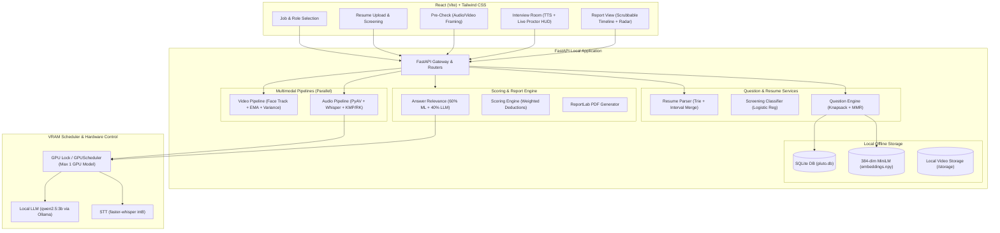

# PLUTO vProctor: System Architecture

## 1. Architectural Overview

PLUTO vProctor is architected as an **entirely offline, local-first mock-interview and multimodal proctoring system**. It operates within strict consumer workstation constraints (specifically a single 6 GB VRAM GPU on Windows) without any external cloud API dependencies.

---

## 2. Hardware Resource Constraints & Model Scheduling

PLUTO vProctor is calibrated for machines with **6 GB VRAM**:

1. **GPU Model Exclusivity:**
   - Loading `qwen2.5:3b` in 16-bit or 4-bit precision consumes 2.2–3.8 GB VRAM.
   - `faster-whisper` (small/base) consumes ~1.5–2.0 GB VRAM.
   - Running both concurrently on 6 GB VRAM risks CUDA Out-Of-Memory (OOM) crashes.
   - **Solution (`GPUScheduler`):** An asyncio mutex lock enforces that Ollama and Whisper never occupy GPU memory simultaneously. Whisper runs with CPU `int8` fallback or acquires the lock exclusively during audio processing.
2. **CPU-Only Embeddings:**
   - MiniLM embeddings (`all-MiniLM-L6-v2`) run exclusively on CPU in 64-item batches, consuming negligible RAM (~80 MB) and 0 bytes VRAM.
3. **Chunked Media Decoding via PyAV:**
   - Instead of loading multi-gigabyte video/audio streams into RAM, PyAV decodes `.webm` containers frame-by-frame and sample-by-sample directly into NumPy arrays.

---

## 3. Data Flow & Algorithmic Modules

### A. Resume Parsing & Screening
1. **Text Extraction:** Native PDF / DOCX byte extraction.
2. **Skill Extraction:** Hand-written `Trie` and fuzzy Levenshtein dictionary over `skills_taxonomy.json`.
3. **Experience Calculation:** Calendar date regex extraction followed by hand-implemented `Interval Merging` to eliminate overlapping employment periods.
4. **Machine Learning Screening:** Synthetic-trained Logistic Regression classifier evaluating skill match, experience ratio, and education rank.

### B. Dynamic Question Engine
1. **Candidate Retrieval:** Inverted Index mapping job required skills to candidate questions.
2. **Ranking:** Hand-written `MinHeap` Top-K selector ($K=25$).
3. **Diversification:** Hand-written Maximal Marginal Relevance (`MMR`) with $\lambda = 0.7$ over MiniLM cosine similarity.
4. **Budgeting:** Hand-written 0/1 Dynamic Programming `Knapsack` packing questions into a strict 12-minute budget (720 seconds).
5. **Ordering:** Custom `Merge Sort` prioritizing introductory warm-up questions first, followed by technical explanations, and concluding with scenario questions.

### C. Multimodal Proctoring Pipelines
- **Video Pipeline:**
  - Face tracking & Eye Bounding Boxes.
  - Exponential Moving Average (`EMA`) smoothing over eye aspect ratios.
  - `SlidingWindowStats` for head and body motion variance.
  - `Interval Merging` to coalesce look-away intervals exceeding 2.0 seconds into deduplicated penalty records.
- **Audio Pipeline:**
  - Container demuxing to 16 kHz mono PCM via PyAV.
  - `faster-whisper` transcription into timestamped segments.
  - Multi-word and single-word filler detection via `KMP` and `Rabin-Karp` pattern matching against curated filler lexicons.
  - Speaking pace calculation (WPM) and pause detection (>1.2s and >3.5s).

### D. Scoring & Report Engine
- **Answer Relevance:** 60/40 blend of Logistic Regression relevance classifier (TF-IDF, BM25, MiniLM cosine, keyword overlap) and `qwen2.5:3b` rubric with deterministic fallback.
- **Weighted Deductions:** Category-level scoring deductions with custom `Merge Sort` timestamp ordering and `Binary Search` interval lookup.
- **Report Generation:** Structured Pydantic LLM executive summary + ReportLab export to PDF.
