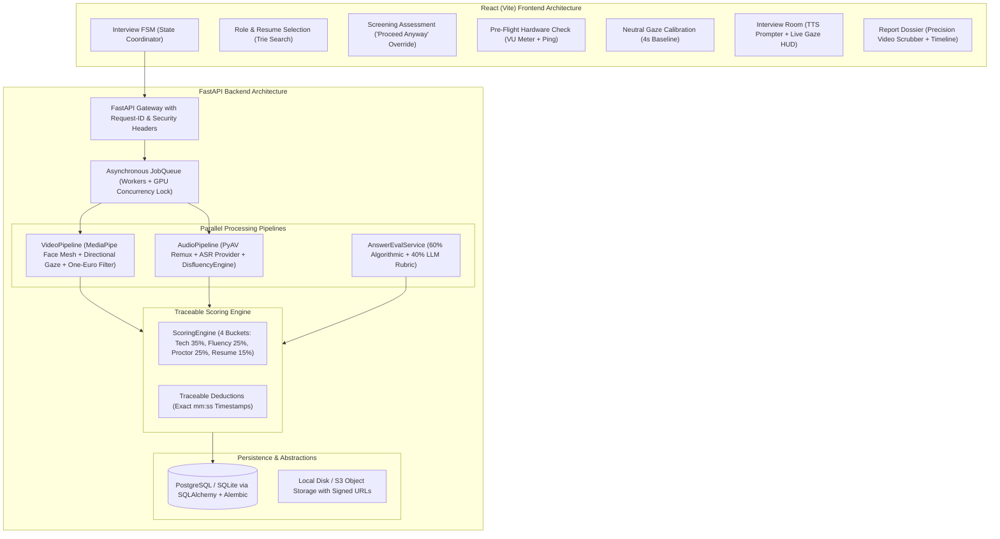

# PLUTO vProctor: Production System Architecture

## 1. Architectural Overview

PLUTO vProctor is a production-grade, multimodal AI video interview and automated proctoring platform. It blends local edge inference (MediaPipe 478-landmark iris mesh, Faster-Whisper, and SentenceTransformers) with pluggable hosted provider interfaces (Deepgram, AssemblyAI, cloud LLMs), designed to run securely under strict consumer workstation constraints (Windows, 6 GB VRAM) as well as containerized cloud stacks (Docker Compose, PostgreSQL, Redis).

---

## 2. Nine Core Product Capabilities

1. **Role & Company Selection with Trie Autocomplete:** Instant fuzzy prefix search across 50+ job listings.
2. **Resume Parsing & Skill Fit Scoring:** Extracts claimed skills, years of experience, and calculates deterministic match percentages.
3. **Screening Gate with "Proceed Anyway" Override:** Provides transparent gap analysis while allowing candidates to demonstrate competence directly.
4. **Time-Bounded Knapsack Question Selection & MMR Diversification:** Allocates questions within a 12-minute budget while eliminating redundancy.
5. **AI Interviewer Prompter with Audio Waveform & Distance Guide:** Delivers questions via TTS, visual prompter, and real-time audio waveform.
6. **Continuous Eye Contact Monitoring with Directional Look-Away Tagging:** Differentiates `LOOK_DOWN` (reading notes) from `LOOK_SIDE` and `LOOK_UP` with 15+ FPS One-Euro adaptive filtering.
7. **Parallel Multimodal Processing:** Synchronously or asynchronously processes video frames and audio tracks via worker queues.
8. **Disfluency & Fluency Engine:** Classifies acoustic filled-pauses ("umm", "uh"), lexical hesitation phrases, silent pauses (>1.5s), and speaking rate (WPM).
9. **Traceable Timeline Report with Synchronized Video Scrubber:** Complete score reconstruction where every point deduction links directly to a verifiable timestamp in the session video.

---

## 3. GPU Memory Budget & VRAM Scheduler

On workstations with $\le 6$ GB VRAM (e.g. RTX 3060 / 4050), concurrency conflicts cause CUDA out-of-memory errors:

| Component | Execution Device | Memory Footprint |
| :--- | :--- | :--- |
| **MediaPipe Face Mesh** | CPU (XNNPACK Delegate) | 0 MB VRAM |
| **Faster-Whisper (small)** | CPU (int8 quantization) | 0 MB VRAM |
| **Sentence-Transformers** | CPU (`all-MiniLM-L6-v2`) | 0 MB VRAM |
| **Ollama LLM (`qwen2.5:3b`)** | GPU (single active instance) | $\approx 2.4$ GB VRAM |
| **Global GPU Lock** | Mutex guard (`_GPU_LOCK`) | Strictly prevents dual model allocation |

---

## 4. Security & Data Protection Architecture

- **Correlation Tracking:** `X-Request-ID` attached to all incoming and outgoing requests with latency tracking.
- **Security Headers:** Strict enforcement of `X-Content-Type-Options: nosniff`, `X-Frame-Options: DENY`, `X-XSS-Protection: 1; mode=block`.
- **MIME Sniffing & Upload Validation:** Resumes capped at 10 MB (validating `%PDF` / `PK\x03\x04` headers); session recordings capped at 500 MB (validating EBML headers).
- **Privacy Compliance (GDPR/CCPA):** Dedicated `DELETE /api/interview/{sid}` endpoint performing cascading physical deletion of video recordings, audio WAVs, transcripts, and database rows.
