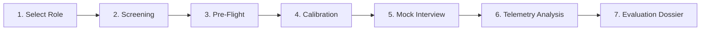
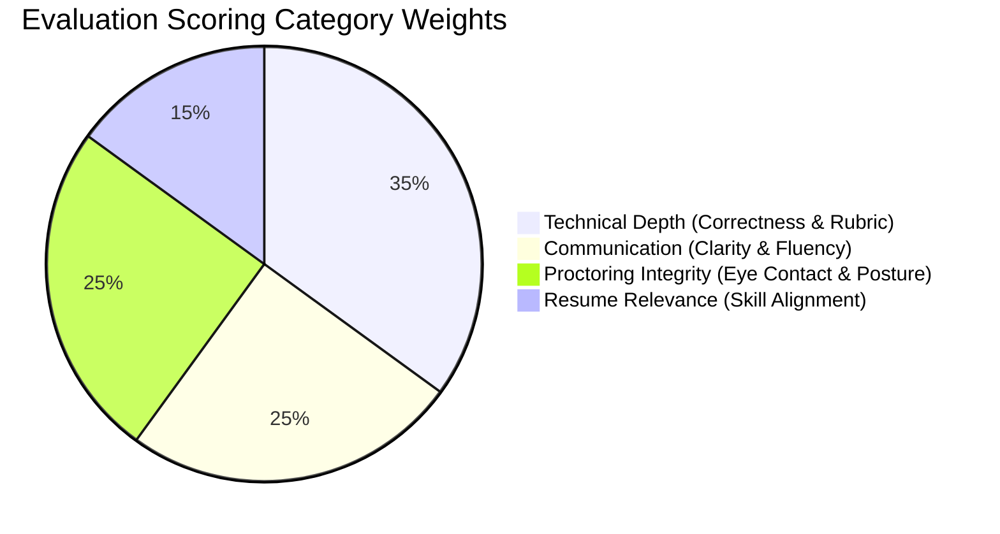

# PLUTO vProctor — Candidate User Manual

**Document Version:** 1.0  
**Product Version:** 0.1.0  
**Target Audience:** Job Candidates, Students, Self-Practice Learners  
**Last Updated:** November 2026  

---

## Table of Contents
1. [Introduction to PLUTO vProctor](#1-introduction-to-pluto-vproctor)
2. [System Requirements & Pre-Flight Checklist](#2-system-requirements--pre-flight-checklist)
3. [Accessing the Application](#3-accessing-the-application)
4. [Candidate Registration and Authentication](#4-candidate-registration-and-authentication)
5. [Password Recovery and Secure Logout](#5-password-recovery-and-secure-logout)
6. [Managing Your Candidate Profile](#6-managing-your-candidate-profile)
7. [Uploading and Managing Resumes](#7-uploading-and-managing-resumes)
8. [Understanding Extracted Resume Information](#8-understanding-extracted-resume-information)
9. [Browsing Job Recommendations](#9-browsing-job-recommendations)
10. [Understanding Job Match Scores & Skills Gap](#10-understanding-job-match-scores--skills-gap)
11. [Self-Practice Interview Experience (7-Step Wizard)](#11-self-practice-interview-experience-7-step-wizard)
12. [Joining Administrator-Hosted Recruiter Interviews](#12-joining-administrator-hosted-recruiter-interviews)
13. [Camera and Microphone Permissions](#13-camera-and-microphone-permissions)
14. [Interview Participation and Proctoring Guidelines](#14-interview-participation-and-proctoring-guidelines)
15. [Understanding Evaluation Reports & Scoring Dossiers](#15-understanding-evaluation-reports--scoring-dossiers)
16. [Downloading and Exporting Evaluation Reports](#16-downloading-and-exporting-evaluation-reports)
17. [Using the Skill-Development Roadmap](#17-using-the-skill-development-roadmap)
18. [Candidate Dashboard & Performance Statistics](#18-candidate-dashboard--performance-statistics)
19. [Troubleshooting Common Candidate Issues](#19-troubleshooting-common-candidate-issues)
20. [Privacy, Data Retention & Erasure Rights](#20-privacy-data-retention--erasure-rights)

---

## 1. Introduction to PLUTO vProctor

**PLUTO vProctor** (*Personalized Learning & Unified Test Operations — Virtual Proctor*) is an intelligent, multimodal AI evaluation platform designed to help you prepare for technical and behavioral interviews, as well as participate in live, proctored evaluations hosted by recruiters.

The platform provides:
- **Dual-Mode Interviewing:** Practice at your own pace in an autonomous offline practice session, or join a live, structured room hosted by an administrator or recruiter.
- **Multimodal Proctoring Telemetry:** Advanced computer vision (MediaPipe iris and head pose tracking) and speech analysis (Faster-Whisper and disfluency detection) measure gaze focus, posture stability, articulation, and filler words.
- **Explainable Monotonic Scoring:** Transparent, audit-grade evaluation reports scoring your answers across technical depth, communication, proctoring integrity, and resume relevance.
- **Pre-Interview Career Discovery:** Instant matching against a catalog of technical roles using your resume or profile skills, without requiring interview participation.
- **Personalized Skill Roadmaps:** Dynamic growth curves and practice milestone drills based on your past performance.

---

## 2. System Requirements & Pre-Flight Checklist

Before beginning an interview or practice session, ensure your computer and environment satisfy the following requirements:

| Component | Minimum Specification | Recommended Specification |
|---|---|---|
| **Web Browser** | Google Chrome 110+, Chromium Edge 110+ | Google Chrome (latest stable release) |
| **Operating System** | Windows 10/11, macOS 12+, Ubuntu 20.04+ | Windows 11 or modern macOS |
| **Camera** | Built-in or external 720p USB webcam | 1080p webcam with auto-exposure |
| **Microphone** | Standard internal laptop microphone | Headset or dedicated directional USB mic |
| **Network** | 1.5 Mbps upload / download | 10+ Mbps low-latency broadband |
| **Lighting** | Evenly lit room; light source facing you | Diffused desk lighting; no backlighting |
| **Display** | 1280 x 720 resolution | 1920 x 1080 (Full HD) resolution |

> [!IMPORTANT]
> Mobile browsers (iOS Safari, Android Chrome) are not currently supported for proctored video sessions. Please use a desktop computer or laptop with a working keyboard, mouse/trackpad, and webcam.

---

## 3. Accessing the Application

In your local development or institutional deployment:
1. Open Google Chrome or Microsoft Edge.
2. Navigate to the application URL:
   ```text
   http://localhost:5173
   ```
   *(Or the custom IP address and port provided by your organization, e.g. `http://192.168.1.50:5173`).*
3. The application will initialize the client session. If authentication is enabled, you will be directed to the Candidate Authentication portal (`/login`). If offline mode is enabled (`AUTH_ENABLED=False`), you will land directly on the Self-Practice Role Selection screen.

---

## 4. Candidate Registration and Authentication

When authentication is enabled on the server, you must have a registered account to access your profile, resume library, recommendations, roadmaps, and hosted rooms.

### 4.1 Creating an Account
1. From the login screen, click **"Register"** or navigate directly to `/register`.
2. Fill out the registration form:
   - **Full Name:** Your complete legal or professional name (e.g., `Jane Doe`).
   - **Email Address:** A valid email address used for login and notifications.
   - **Password:** Minimum 8 characters. Choose a strong, unique password.
   - **Confirm Password:** Re-enter the exact password.
3. Click **"Create Candidate Account"**.
4. Upon successful registration, you will be automatically logged in and redirected to your dashboard or the self-practice homepage.

### 4.2 Logging In
1. Navigate to `/login`.
2. Enter your registered email address and password.
3. Click **"Sign In"**.
4. The system validates your credentials via Argon2id password verification, sets a secure HTTP-only refresh cookie (`pluto_refresh_token`), issues a short-lived in-memory JWT access token, and sets a CSRF double-submit protection cookie (`pluto_csrf_token`).

---

## 5. Password Recovery and Secure Logout

### 5.1 Password Recovery Flow
If you forget your password:
1. Click **"Forgot Password?"** on the login page, or navigate to `/forgot-password`.
2. Enter your registered email address and submit the request.
3. If an account matches the email address, a password reset token is generated by the server. *(In local development, the reset link or token is output to the server console log).*
4. Navigate to `/reset-password?token=<your_reset_token>`.
5. Enter your new password (minimum 8 characters) and confirm it.
6. Click **"Reset Password"**. The token is consumed and cannot be reused.

### 5.2 Secure Logout
1. Click your name or the **"Logout"** button in the top navigation bar.
2. The client calls `POST /api/auth/logout`, invalidating your session on the server, clearing your refresh cookie, and wiping the in-memory access token.
3. You will be redirected to `/login`.

---

## 6. Managing Your Candidate Profile

Your candidate profile stores your contact information, target careers, and technical competencies. This information is used to personalize interview questions and compute universal job recommendations.

1. Click **"Profile"** in the navigation bar, or navigate to `/profile`.
2. Edit your profile attributes:
   - **Full Name & Contact:** Phone number, geographic location (City, Country).
   - **Social & Portfolio Links:** LinkedIn profile URL, GitHub profile URL, personal website or portfolio link.
   - **Target Career Roles:** Primary job titles you are targeting (e.g., `Full Stack Engineer`, `DevOps Specialist`).
   - **Professional Bio:** Brief 2–3 sentence overview of your background and technical interests.
   - **Skills:** Add or remove skill chips (e.g., `Python`, `React`, `Docker`, `SQL`, `FastAPI`). Type a skill name and press Enter or click the plus button.
3. Click **"Save Profile"**.
4. Changes are immediately saved to the database (`PUT /api/candidate/profile`) and will be reflected across your job recommendations and interview prompts.

---

## 7. Uploading and Managing Resumes

PLUTO vProctor features a **Multi-Resume Library** allowing you to maintain different resumes tailored for distinct roles (e.g., Backend Engineering vs. Machine Learning).

### 7.1 Accessing the Resume Library
Click **"Resumes"** in the top navigation bar, or navigate to `/resumes`.

### 7.2 Uploading a Resume
1. In the **"Upload New Resume"** section, click the file selection dropzone or drag and drop your file.
2. **Supported Formats:**
   - PDF (`.pdf`)
   - Microsoft Word (`.docx`)
   - Plain Text (`.txt`)
   - Maximum file size: **5 MB**.
3. The server inspects the file's binary magic bytes to verify authenticity (e.g., `%PDF-` header for PDF, PK zip header for DOCX) to prevent malicious file uploads.
4. Optionally assign a custom label (e.g., `SWE Backend 2026`).
5. Click **"Upload & Parse Resume"**.

### 7.3 Managing Stored Resumes
- **Set as Active:** Click the star or **"Set Active"** button next to a resume to designate it as your primary resume for recommendations and practice sessions.
- **Download:** Click **"Download"** to retrieve the original uploaded document.
- **Delete:** Click **"Delete"** to permanently remove the resume from the server.
- **Launch Interview:** Click **"Start Practice"** directly from a resume card to select a target job and launch screening immediately.

---

## 8. Understanding Extracted Resume Information

When you upload a resume, PLUTO vProctor automatically parses and extracts structured text:

1. **Contact Details:** Automatically identifies your name, email address, phone number, and social links.
2. **Detected Skills:** Cross-references the text against the platform's competency dictionary to identify programming languages, frameworks, databases, and DevOps tools.
3. **Experience & Education:** Summarizes work history and academic degrees.
4. **Extraction Review & Editing:**
   - You can review the extracted text and detected skills directly in the resume details modal.
   - If a specific skill was not detected due to non-standard resume formatting, you can manually add the skill to your Candidate Profile (`/profile`).

---

## 9. Browsing Job Recommendations

PLUTO vProctor provides **Pre-Interview Job Recommendations** that analyze your skills against the platform's job catalog without requiring you to take an interview first.

1. Click **"Recommendations"** in the navigation bar, or navigate to `/recommendations`.
2. The page queries `GET /api/candidate/recommendations`.
3. If you have an active uploaded resume, recommendations are computed from the resume's parsed skills. If you have not uploaded a resume, recommendations are seamlessly computed from the skills listed in your Candidate Profile.
4. Job cards are sorted in descending order of match quality.

---

## 10. Understanding Job Match Scores & Skills Gap

Each recommended job card provides clear, actionable feedback:

- **Match Score (0–100%):** A composite score computed via BM25 keyword relevance, skill intersection ratios, and vector semantic similarity.
  - **80% – 100% (High Alignment):** Your background strongly matches the core technical requirements.
  - **60% – 79% (Moderate Alignment):** You possess the core fundamentals, but lack some preferred tools or domain experience.
  - **Below 60% (Growth Opportunity):** Significant skill gap; recommended for targeted study before applying.
- **Matching Skills (Green Badges):** Competencies listed in the job specification that were verified in your profile or resume.
- **Missing Skills (Amber / Red Badges):** Tools and concepts required for the position that were not detected in your profile.
- **"Why This Matches":** An explainable summary highlighting the primary alignment factors.
- **"Practice for This Role":** Clicking this button immediately loads the job into the Self-Practice wizard so you can begin targeted mock interviews.

---

## 11. Self-Practice Interview Experience (7-Step Wizard)

Self-practice allows you to conduct a full, automated mock interview at any time.



### Step 1: Role Selection & Resume Upload (`select`)
- Choose your target job role from the dropdown menu (e.g., *Senior Backend Engineer*, *Frontend Developer*).
- Select an existing resume from your library, upload a new resume file, or proceed with your profile skills.
- Enter or verify your candidate display name.
- Click **"Submit for Screening"**.

### Step 2: Screening Fit & Consent (`screening`)
- Review your screening alignment score against the selected role.
- If your resume matches the role's baseline qualifications, you will see a green **"Approved"** badge.
- Read the automated proctoring disclosure (informing you that camera and microphone telemetry will be captured and evaluated locally).
- Check the **"I Consent to Multimodal Proctoring"** checkbox.
- Click **"Proceed to System Check"**.

### Step 3: Pre-Flight System Check (`precheck`)
- The browser requests camera and microphone access.
- Confirm your webcam feed is clear and unobstructed.
- Speak into your microphone to verify that the audio volume meter reacts to your voice.
- Review the proctoring recommendations (sit upright, ensure good lighting, minimize background noise).
- Click **"Proceed to Calibration"**.

### Step 4: Neutral Gaze Calibration (`calibration`)
- Position your face inside the bounding guide displayed on screen.
- Look directly at the center target dot for 5 seconds.
- The system captures your baseline iris coordinates and head pitch/yaw angles using MediaPipe FaceMesh. This custom baseline ensures you will not be penalized for natural screen positioning or camera offset.
- Once calibration succeeds, click **"Start Interview"**.

### Step 5: Live Mock Interview (`interview`)
- The AI prompter displays and reads questions using text-to-speech (TTS).
- A countdown timer shows the recommended time for each response.
- Answer naturally while looking at your screen.
- The live proctoring HUD monitors your gaze and head stability in real time.
- When you finish your answer, click **"Next Question"** or **"Submit Answer"**.
- After the final question, click **"Finish & Evaluate"**.

### Step 6: Telemetry Analysis (`processing`)
- The browser packages and uploads your session video recording (`.webm`).
- The backend launches parallel evaluation pipelines:
  - **Video Pipeline:** Runs gaze divergence analysis, head rotation estimation, and posture stability tracking.
  - **Audio Pipeline:** Transcribes speech via Faster-Whisper, flags disfluencies (fillers, pauses), and computes words-per-minute pace.
  - **Scoring Engine:** Algorithmic evaluation against ground-truth rubrics using a monotonic deduction system.
- Real-time progress bars indicate processing status.

### Step 7: Evaluation Dossier (`report`)
- The comprehensive evaluation report is displayed upon completion.
- You can review your scores, video timeline, and actionable feedback.

---

## 12. Joining Administrator-Hosted Recruiter Interviews

When participating in a live interview scheduled by an organization, recruiter, or school:

### 12.1 Joining via Invite Link or Room Code
1. If the host provided a direct URL (e.g. `http://localhost:5173/rooms/join?code=ABC-123-XYZ` or with an invite token `?token=...`), click the link to open the join page.
2. Alternatively, navigate to `/rooms/join` from the navigation bar.
3. Enter the **9-character room code** (formatted as `XXX-XXX-XXX`).
4. If you are logged in, your account name is automatically attached. If you are an unauthenticated guest, enter your full display name.
5. Click **"Join Room"**.

### 12.2 Waiting Room / Lobby
1. After joining, you enter the secure **Waiting Room** (`/rooms/<roomId>`).
2. While waiting:
   - Preview your camera feed.
   - Test your microphone level.
   - Review room details (Interview Title, Host Name, Proctoring Preset).
3. The waiting room polls the room status every 2 seconds.
4. When the host admits you and starts the session, the room automatically transitions into the **Live Interview Room**.

---

## 13. Camera and Microphone Permissions

PLUTO vProctor requires access to your camera and microphone to stream media and capture proctoring telemetry.

### Granting Permissions in Google Chrome / Chromium Edge
1. When prompted by your browser, click **"Allow"** for both camera and microphone.
2. If you accidentally clicked "Block":
   - Click the **Tune / Lock icon** in the browser address bar (to the left of the URL).
   - Locate **Camera** and **Microphone** and switch their settings from "Block" to **"Allow"**.
   - Refresh the page (`F5` or `Ctrl+R`).
3. Ensure no other application (e.g., Zoom, Teams, Skype, Discord) is actively using your camera.

---

## 14. Interview Participation and Proctoring Guidelines

During both self-practice and hosted interviews, keep the following proctoring guidelines in mind to achieve high integrity scores:

1. **Maintain Gaze on Screen:**
   - Looking directly at the screen or webcam maintains your gaze within the calibrated tolerance box ($\pm 15\%$ horizontal, $\pm 12\%$ vertical).
   - Brief natural glances away are permitted; sustained looking off-screen ($> 2.5$ consecutive seconds) flags a gaze diversion deduction.
2. **Head Pose & Posture:**
   - Keep your head facing forward. Tilting left/right ($> 25^\circ$) or pitching up/down ($> 20^\circ$) triggers posture warnings.
3. **Lighting & Face Visibility:**
   - Avoid strong light sources behind you (e.g., an open window).
   - Keep your entire face visible inside the camera frame.
4. **Speech Clarity & Pacing:**
   - Speak at a moderate, conversational pace ($90 - 180$ words per minute).
   - Avoid excessive filler words (*"um"*, *"like"*, *"you know"*).
5. **No Secondary Devices or Persons:**
   - The computer vision engine will flag penalties if additional faces enter the camera frame or if no face is detected for extended periods.

---

## 15. Understanding Evaluation Reports & Scoring Dossiers

Upon interview completion, PLUTO vProctor generates a detailed, tamper-evident evaluation dossier accessible via direct link (`/report/:sessionId`).



### 15.1 Score Summary & Readiness Stamp
- **Overall Score (0–100):** Weighted combination of all four evaluation categories.
- **Letter Grade:**
  - **A (85.0 – 100.0):** Outstanding proficiency across technical answers and communication.
  - **B (70.0 – 84.9):** Qualified candidate; meets all core role requirements.
  - **C (55.0 – 69.9):** Partial qualification; requires targeted practice in specific domains.
  - **D (0.0 – 54.9):** Significant gaps in technical depth or proctoring compliance.
- **Readiness Label:** Clear human-readable summary (*"Strongly Qualified"*, *"Ready with minor revision"*, *"Needs targeted preparation"*, or *"Not ready"*).

### 15.2 The 4 Scoring Categories
1. **Technical Depth (35% Weight):** Evaluates answer correctness, depth, terminology, and concept coverage against ground-truth rubrics.
2. **Communication (25% Weight):** Evaluates articulation, structure, disfluency rate, and speech pace.
3. **Proctoring Integrity (25% Weight):** Evaluates eye contact consistency, head stability, and camera presence. Starts at 100 points and deducts points for detected infractions.
4. **Resume Relevance (15% Weight):** Measures alignment between claimed resume skills and demonstrated answers.

### 15.3 5-Axis Competency Radar Chart
Visualizes your balance across:
- Technical Accuracy
- Clarity & Articulation
- Environmental Integrity
- Response Structure
- Domain Alignment

### 15.4 Monotonic Deduction Timeline & Video Scrubber
- Every point deduction is listed with an exact timestamp, duration, rule code, and explanation (e.g., `[01:14] Gaze off-screen: 3.2s (-1.5 pts)`).
- **Clickable Video Scrubbing:** Clicking any timestamp in the deduction list immediately jumps the synchronized video player to that exact second of your recording so you can review your behavior.

---

## 16. Downloading and Exporting Evaluation Reports

You can download an official, formatted copy of your interview evaluation:

1. Open your evaluation report (`/report/:sessionId`).
2. Click the **"Download PDF Dossier"** button at the top of the report.
3. The server generates an official PDF document via `/api/report/:sessionId/pdf` containing:
   - Candidate Name and Session ID
   - Target Role and Completion Timestamp
   - Overall Score, Grade Stamp, and Readiness Summary
   - Category Breakdown Table
   - Itemized Proctoring Audit Log
4. You can also print the webpage directly using your browser's Print function (`Ctrl+P` / `Cmd+P`). The report stylesheet automatically optimizes for clean page breaks and high-contrast printing.

---

## 17. Using the Skill-Development Roadmap

The **Learning Roadmap** turns your interview results into a personalized study plan.

1. Click **"Roadmap"** in the top navigation bar, or navigate to `/roadmap`.
2. **Overall Readiness Grade:** Displays your current cumulative grade across all completed sessions.
3. **Growth Curve:** A historical chart tracking your score trajectory over time.
4. **Domain Mastery Breakdown:** Identifies your strongest competencies and highlights domains needing improvement.
5. **Targeted Milestone Drills:** Generates concrete, step-by-step study objectives (e.g., *"Practice System Design concurrency questions"*, *"Review SQL index optimization"*).

---

## 18. Candidate Dashboard & Performance Statistics

Click **"Dashboard"** in the top navigation bar to access your candidate overview:

- **Total Completed Interviews:** Count of all self-practice and hosted interviews completed.
- **Average Performance Score:** Your mean score across all evaluations.
- **Proctoring Integrity Average:** Average integrity score showing your consistency in remote interview environments.
- **Recent Interview History:** Quick-access list of past sessions with direct links to view previous evaluation dossiers.

---

## 19. Troubleshooting Common Candidate Issues

| Symptom | Likely Cause | Diagnostic & Resolution Steps |
|---|---|---|
| **"Camera Access Denied" error** | Browser blocked webcam permissions | Click lock icon in browser URL bar $\to$ set Camera to **Allow** $\to$ refresh page. |
| **"Microphone Not Detected"** | Audio input device not selected or muted | Verify mic is unmuted in OS settings $\to$ select correct input in browser settings. |
| **Calibration fails repeatedly** | Face is off-center or backlighting is too strong | Sit centered $\approx 60\text{ cm}$ from screen, ensure light illuminates your face, look at the red center dot. |
| **"Room Not Found" error** | Invalid 9-character code or expired room | Double-check code formatting (`XXX-XXX-XXX`) $\to$ contact host for a fresh code. |
| **Video recording not playing in report** | Browser codec incompatibility or recording upload interrupted | Ensure you use Chrome/Edge $\to$ check browser console for WebM playback errors. |
| **"Session Expired / Please Login"** | JWT access token expired | Refresh page to trigger silent token refresh, or re-enter credentials at `/login`. |

---

## 20. Privacy, Data Retention & Erasure Rights

PLUTO vProctor is designed with privacy-first, on-device AI principles:

1. **Local-Only Processing:** Video analysis, speech transcription, and scoring occur entirely on the host server running the application. No audio or video data is transmitted to third-party public clouds.
2. **Transparent Storage:** Session video recordings are stored locally on the host file system in `storage/recordings/` and resumes in `storage/resumes/`.
3. **Permanent Data Erasure (GDPR Right to be Forgotten):**
   - You have the absolute right to permanently delete your interview recordings and data at any time.
   - On any evaluation report page, click **"Delete Session Data"** to permanently erase the session video recording from disk, remove extracted audio chunks, and cascade-delete all associated database records (`DELETE /api/interview/{sessionId}`).
   - Resumes can be deleted at any time from your Resume Library (`/resumes`), which permanently removes the document from disk and unlinks it from your profile.
