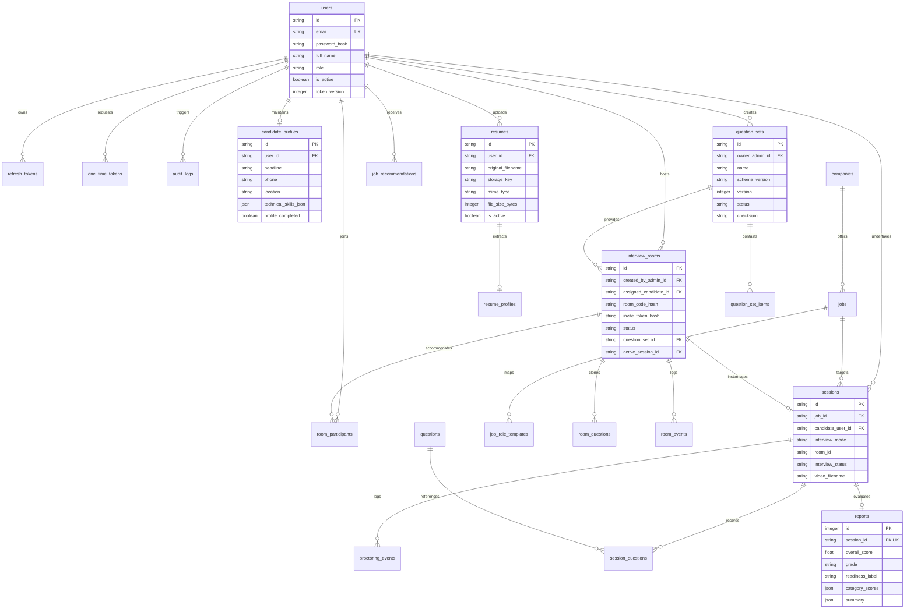

# PLUTO vProctor — Complete Database Schema & Entity-Relationship Specification

**Document Version:** 1.0  
**Product Version:** 0.1.0  
**Database Engine:** SQLite 3 (WAL mode) / PostgreSQL Compatible  
**ORM Framework:** SQLAlchemy 2.0  
**Total Entities:** 22 Tables  
**Last Updated:** November 2026  

---

## Table of Contents
1. [Architectural Overview & Data Invariants](#1-architectural-overview--data-invariants)
2. [Complete Mermaid Entity-Relationship (ER) Diagram](#2-complete-mermaid-entity-relationship-er-diagram)
3. [Identity, Accounts & Governance Subsystem](#3-identity-accounts--governance-subsystem)
   - 3.1 [`users`](#31-users)
   - 3.2 [`refresh_tokens`](#32-refresh_tokens)
   - 3.3 [`one_time_tokens`](#33-one_time_tokens)
   - 3.4 [`audit_logs`](#34-audit_logs)
4. [Candidate Career & Resume Subsystem](#4-candidate-career--resume-subsystem)
   - 4.1 [`candidate_profiles`](#41-candidate_profiles)
   - 4.2 [`resumes`](#42-resumes)
   - 4.3 [`resume_profiles`](#43-resume_profiles)
   - 4.4 [`job_recommendations`](#44-job_recommendations)
5. [Jobs, Roles & Catalog Subsystem](#5-jobs-roles--catalog-subsystem)
   - 5.1 [`companies`](#51-companies)
   - 5.2 [`jobs`](#52-jobs)
   - 5.3 [`job_role_templates`](#53-job_role_templates)
   - 5.4 [`questions`](#54-questions)
6. [Assessment & Question-Set Subsystem](#6-assessment--question-set-subsystem)
   - 6.1 [`question_sets`](#61-question_sets)
   - 6.2 [`question_set_items`](#62-question_set_items)
7. [Hosted Interview Rooms & Real-Time Orchestration](#7-hosted-interview-rooms--real-time-orchestration)
   - 7.1 [`interview_rooms`](#71-interview_rooms)
   - 7.2 [`room_participants`](#72-room_participants)
   - 7.3 [`room_questions`](#73-room_questions)
   - 7.4 [`room_events`](#74-room_events)
8. [Interview Sessions, Telemetry & Evaluation Reports](#8-interview-sessions-telemetry--evaluation-reports)
   - 8.1 [`sessions`](#81-sessions)
   - 8.2 [`session_questions`](#82-session_questions)
   - 8.3 [`proctoring_events`](#83-proctoring_events)
   - 8.4 [`reports`](#84-reports)
9. [Index Strategy & Deletion / Cascade Behavior](#9-index-strategy--deletion--cascade-behavior)

---

## 1. Architectural Overview & Data Invariants

PLUTO vProctor uses an audit-grade relational schema designed to maintain strict data integrity across both autonomous self-practice and recruiter-hosted rooms.

### Core Data Invariants:
1. **Catalog Preservation:** 1,799 verified technical questions in `questions` and 12 baseline engineering jobs in `jobs` form the platform benchmark and are never dropped or mutated during runtime operations.
2. **Historical Session Preservation:** 14 historical legacy sessions are permanently retained. When question sets are deleted, foreign keys on historical rooms are safely nullified (`question_set_id = NULL`), leaving copied `room_questions`, transcripts, and reports completely intact.
3. **Session Immutability:** Once an interview report is generated in `reports`, its overall score, grade, and deduction records in `proctoring_events` are append-only.
4. **Data Isolation:** All candidate documents (`resumes`, `candidate_profiles`, `job_recommendations`, `sessions`) enforce user-level ownership checks (`user_id`).

---

## 2. Complete Mermaid Entity-Relationship (ER) Diagram

---

## 3. Identity, Accounts & Governance Subsystem

### 3.1 `users`
Authenticated user accounts (Candidates, Admins, Super Admins).
- **Table Name:** `users`
- **Columns:**
  - `id` (VARCHAR(64), Primary Key): Unique prefixed UUID (e.g. `usr_...`).
  - `email` (VARCHAR(255), Unique, Not Null, Indexed): Canonical lowercase login email.
  - `password_hash` (VARCHAR(512), Not Null): Argon2id password hash.
  - `full_name` (VARCHAR(128), Not Null): Candidate or administrator display name.
  - `role` (VARCHAR(32), Not Null, Indexed, Default: `'candidate'`): `candidate`, `admin`, or `super_admin`.
  - `is_active` (BOOLEAN, Not Null, Default: `True`): Account activation flag.
  - `email_verified` (BOOLEAN, Not Null, Default: `False`): Email verification status.
  - `failed_login_attempts` (INTEGER, Not Null, Default: `0`): Failed attempt counter for lockout.
  - `locked_until` (DATETIME, Nullable): Timestamp when login lockout expires.
  - `token_version` (INTEGER, Not Null, Default: `1`): Global token revocation version.
  - `last_login_at` (DATETIME, Nullable): Most recent login timestamp.
  - `created_at` (DATETIME, Default: UTC now): Creation timestamp.
  - `updated_at` (DATETIME, Default: UTC now): Last mutation timestamp.

### 3.2 `refresh_tokens`
Long-lived refresh token rotation families.
- **Table Name:** `refresh_tokens`
- **Columns:**
  - `id` (VARCHAR(64), Primary Key): Unique token record identifier.
  - `user_id` (VARCHAR(64), Foreign Key $\to$ `users.id`, Not Null, Indexed): Account owner.
  - `token_hash` (VARCHAR(64), Unique, Not Null, Indexed): SHA-256 hash of plaintext token.
  - `rotation_family_id` (VARCHAR(64), Not Null, Indexed): UUID tracking token rotation sequence.
  - `expires_at` (DATETIME, Not Null, Indexed): Absolute expiration timestamp.
  - `revoked_at` (DATETIME, Nullable): Revocation timestamp if consumed or compromised.
  - `replaced_by_id` (VARCHAR(64), Nullable): Link to succeeding token in rotation family.
  - `user_agent` (VARCHAR(255), Nullable): Client user agent string.
  - `ip_address` (VARCHAR(64), Nullable): Request IP address.
  - `created_at` (DATETIME, Default: UTC now): Issuance timestamp.

### 3.3 `one_time_tokens`
Cryptographic single-use tokens for password resets and email verification.
- **Table Name:** `one_time_tokens`
- **Columns:**
  - `id` (VARCHAR(64), Primary Key): Unique identifier.
  - `user_id` (VARCHAR(64), Foreign Key $\to$ `users.id`, Not Null): Targeted account.
  - `purpose` (VARCHAR(32), Not Null, Indexed): `password_reset` or `email_verify`.
  - `token_hash` (VARCHAR(64), Unique, Not Null, Indexed): SHA-256 hash of single-use secret.
  - `expires_at` (DATETIME, Not Null, Indexed): Expiration timestamp.
  - `used_at` (DATETIME, Nullable): Timestamp when token was successfully consumed.
  - `created_at` (DATETIME, Default: UTC now): Issuance timestamp.

### 3.4 `audit_logs`
Immutable enterprise security and administrative event ledger.
- **Table Name:** `audit_logs`
- **Columns:**
  - `id` (VARCHAR(64), Primary Key): Unique audit record identifier.
  - `actor_user_id` (VARCHAR(64), Foreign Key $\to$ `users.id`, Nullable): Acting user ID.
  - `actor_role` (VARCHAR(32), Nullable): Role of actor at execution time.
  - `action` (VARCHAR(128), Not Null, Indexed): e.g. `user.role_changed`, `room.created`.
  - `resource_type` (VARCHAR(64), Not Null, Indexed): e.g. `user`, `room`, `question_set`.
  - `resource_id` (VARCHAR(64), Nullable): Identifier of affected resource.
  - `details_json` (JSON, Nullable): Structured metadata (old/new values, reasons).
  - `ip_address` (VARCHAR(64), Nullable): Client IP address.
  - `created_at` (DATETIME, Default: UTC now, Indexed): Event occurrence timestamp.

---

## 4. Candidate Career & Resume Subsystem

### 4.1 `candidate_profiles`
Structured candidate background and competencies.
- **Table Name:** `candidate_profiles`
- **Columns:**
  - `id` (VARCHAR(64), Primary Key): Unique identifier.
  - `user_id` (VARCHAR(64), Foreign Key $\to$ `users.id`, Unique, Not Null, Indexed): Linked user.
  - `headline` (VARCHAR(255), Nullable): Professional title.
  - `phone` (VARCHAR(32), Nullable): Contact phone number.
  - `location` (VARCHAR(128), Nullable): Geographic location.
  - `education_level` (VARCHAR(64), Nullable): Highest degree obtained.
  - `education_details_json` (JSON, Nullable): Structured institutions and majors.
  - `experience_years` (FLOAT, Not Null, Default: `0.0`): Total years of experience.
  - `experience_summary_json` (JSON, Nullable): Previous positions and achievements.
  - `technical_skills_json` (JSON, Nullable): Array of verified skill strings.
  - `preferred_roles_json` (JSON, Nullable): Array of target career titles.
  - `portfolio_links_json` (JSON, Nullable): Map of GitHub, LinkedIn, and website URLs.
  - `bio` (TEXT, Nullable): Summary description.
  - `profile_completed` (BOOLEAN, Not Null, Default: `False`): Onboarding completion status.
  - `created_at` (DATETIME, Default: UTC now)
  - `updated_at` (DATETIME, Default: UTC now)

### 4.2 `resumes`
Binary documents uploaded to the candidate's resume library.
- **Table Name:** `resumes`
- **Columns:**
  - `id` (VARCHAR(64), Primary Key): Unique resume identifier.
  - `user_id` (VARCHAR(64), Foreign Key $\to$ `users.id`, Not Null, Indexed): Candidate owner.
  - `original_filename` (VARCHAR(255), Not Null): Original client filename.
  - `storage_key` (VARCHAR(255), Not Null): Relative storage path under `storage/resumes/`.
  - `mime_type` (VARCHAR(128), Not Null): Validated MIME type (`application/pdf`, etc.).
  - `file_size_bytes` (INTEGER, Not Null): Binary size in bytes ($\le 5\text{ MB}$).
  - `sha256_hash` (VARCHAR(64), Not Null, Indexed): Content hash for deduplication.
  - `raw_text` (TEXT, Nullable): Full extracted text layer.
  - `is_active` (BOOLEAN, Not Null, Default: `True`): Primary active selection flag.
  - `created_at` (DATETIME, Default: UTC now)
  - `updated_at` (DATETIME, Default: UTC now)

### 4.3 `resume_profiles`
Structured entity extraction derived from a specific uploaded resume.
- **Table Name:** `resume_profiles`
- **Columns:**
  - `id` (VARCHAR(64), Primary Key): Unique identifier.
  - `resume_id` (VARCHAR(64), Foreign Key $\to$ `resumes.id`, Unique, Not Null, Indexed)
  - `user_id` (VARCHAR(64), Foreign Key $\to$ `users.id`, Not Null, Indexed)
  - `extracted_data_json` (JSON, Not Null): Raw extracted contact, skills, and experience.
  - `edited_data_json` (JSON, Nullable): Candidate manual modifications.
  - `field_provenance_json` (JSON, Nullable): Parser confidence scores per field.
  - `confirmed_by_user` (BOOLEAN, Not Null, Default: `False`)
  - `confirmed_at` (DATETIME, Nullable)
  - `created_at` (DATETIME, Default: UTC now)
  - `updated_at` (DATETIME, Default: UTC now)

### 4.4 `job_recommendations`
Pre-interview job recommendations calculated for candidates.
- **Table Name:** `job_recommendations`
- **Columns:**
  - `id` (VARCHAR(64), Primary Key): Unique identifier.
  - `user_id` (VARCHAR(64), Foreign Key $\to$ `users.id`, Not Null, Indexed)
  - `source_type` (VARCHAR(32), Not Null): `resume` or `profile`.
  - `target_type` (VARCHAR(32), Not Null): `job` or `role_template`.
  - `target_id` (VARCHAR(64), Not Null, Indexed): Foreign identifier of recommended role.
  - `title` (VARCHAR(255), Not Null): Job title.
  - `match_score` (FLOAT, Not Null): Percentage alignment (0.0 to 100.0).
  - `matched_skills_json` (JSON, Not Null): Overlapping competencies.
  - `missing_skills_json` (JSON, Not Null): Missing required competencies.
  - `explanation` (TEXT, Not Null): Human-readable matching summary.
  - `created_at` (DATETIME, Default: UTC now)

---

## 5. Jobs, Roles & Catalog Subsystem

### 5.1 `companies`
Hiring partner organizations.
- **Table Name:** `companies`
- **Columns:**
  - `id` (VARCHAR(64), Primary Key): e.g. `comp_cybernova_01`.
  - `name` (VARCHAR(128), Not Null)
  - `industry` (VARCHAR(128), Not Null)
  - `description` (TEXT, Nullable)

### 5.2 `jobs`
Technical job specifications.
- **Table Name:** `jobs`
- **Columns:**
  - `id` (VARCHAR(64), Primary Key): e.g. `swe_backend`.
  - `title` (VARCHAR(128), Not Null)
  - `company` (VARCHAR(128), Not Null)
  - `company_id` (VARCHAR(64), Foreign Key $\to$ `companies.id`, Nullable)
  - `required_skills` (JSON, Nullable): Mandatory skill strings.
  - `preferred_skills` (JSON, Nullable): Bonus skill strings.
  - `min_experience_years` (INTEGER, Nullable)
  - `education_levels` (JSON, Nullable)
  - `skill_weights` (JSON, Nullable)
  - `question_domains` (JSON, Nullable)
  - `pass_threshold` (FLOAT, Nullable, Default: `0.60`)

### 5.3 `job_role_templates`
Normalized competency blueprints for technical job tiers.
- **Table Name:** `job_role_templates`
- **Columns:**
  - `id` (VARCHAR(64), Primary Key)
  - `slug` (VARCHAR(128), Unique, Not Null)
  - `title` (VARCHAR(255), Not Null)
  - `level` (VARCHAR(32), Not Null): `entry`, `mid`, `senior`, `lead`.
  - `domain` (VARCHAR(128), Not Null)
  - `required_skills_json` (JSON, Not Null)
  - `preferred_skills_json` (JSON, Not Null)
  - `min_experience_years` (FLOAT, Not Null)
  - `education_levels_json` (JSON, Nullable)
  - `description` (TEXT, Nullable)
  - `mapped_job_id` (VARCHAR(64), Foreign Key $\to$ `jobs.id`, Nullable)
  - `is_active` (BOOLEAN, Not Null, Default: `True`)
  - `created_at` (DATETIME, Default: UTC now)
  - `updated_at` (DATETIME, Default: UTC now)

### 5.4 `questions`
Ground-truth catalog of 1,799 verified technical questions.
- **Table Name:** `questions`
- **Columns:**
  - `id` (VARCHAR(64), Primary Key): e.g. `q_swe_concurrency_01`.
  - `question` (TEXT, Not Null): Full question prompt.
  - `answer` (TEXT, Not Null): Ground-truth model answer.
  - `split` (VARCHAR(16), Not Null): `train`, `val`, `test`.
  - `source_folder` (VARCHAR(32), Nullable)
  - `type` (VARCHAR(32), Not Null): `conceptual`, `coding`, `scenario`.
  - `spoken_ok` (BOOLEAN, Not Null, Default: `True`): Suitable for TTS audio prompter.
  - `skills` (JSON, Nullable): Associated skill tags.
  - `domain` (VARCHAR(64), Not Null, Indexed)
  - `cluster_id` (INTEGER, Nullable, Indexed): Semantic cluster for diversity budgeting.
  - `difficulty` (INTEGER, Nullable): 1 (Junior) to 4 (Lead).
  - `expected_keywords` (JSON, Nullable): Key concepts used for BM25 scoring.
  - `ideal_answer_summary` (TEXT, Nullable): LLM rubric criteria.
  - `est_seconds` (INTEGER, Nullable, Default: `180`): Duration budget.

---

## 6. Assessment & Question-Set Subsystem

### 6.1 `question_sets`
Custom administrator-curated question banks.
- **Table Name:** `question_sets`
- **Columns:**
  - `id` (VARCHAR(64), Primary Key): e.g. `qs_a8f9c102...`.
  - `owner_admin_id` (VARCHAR(64), Foreign Key $\to$ `users.id`, Not Null, Indexed): Author admin.
  - `name` (VARCHAR(255), Not Null): Assessment title.
  - `description` (TEXT, Nullable)
  - `source_filename` (VARCHAR(255), Nullable): Original filename if imported.
  - `schema_version` (VARCHAR(32), Not Null, Default: `'1.0'`): Schema specification.
  - `version` (INTEGER, Not Null, Default: `1`): Content mutation version.
  - `status` (VARCHAR(32), Not Null, Default: `'ACTIVE'`): `ACTIVE` or `ARCHIVED`.
  - `checksum` (VARCHAR(64), Nullable): SHA-256 hash of items.
  - `created_at` (DATETIME, Not Null)
  - `updated_at` (DATETIME, Not Null)

### 6.2 `question_set_items`
Ordered individual questions inside a question set.
- **Table Name:** `question_set_items`
- **Columns:**
  - `id` (VARCHAR(64), Primary Key): e.g. `qsi_1082...`.
  - `question_set_id` (VARCHAR(64), Foreign Key $\to$ `question_sets.id`, Not Null, Indexed)
  - `source_question_id` (VARCHAR(64), Nullable): Link to master catalog if derived.
  - `question_text` (TEXT, Not Null): Prompt read to candidate.
  - `domain` (VARCHAR(128), Not Null)
  - `difficulty` (VARCHAR(32), Not Null): `junior`, `mid`, `senior`, `lead`.
  - `target_skills_json` (JSON, Not Null): Array of competencies evaluated.
  - `ideal_criteria_json` (JSON, Not Null): Rubric criteria.
  - `ordinal` (INTEGER, Not Null): Presentation sequence position (1-based).
  - `metadata_json` (JSON, Nullable): Custom properties (e.g. `time_limit_sec`).
  - `created_at` (DATETIME, Not Null)

---

## 7. Hosted Interview Rooms & Real-Time Orchestration

### 7.1 `interview_rooms`
Recruiter-hosted interview rooms.
- **Table Name:** `interview_rooms`
- **Columns:**
  - `id` (VARCHAR(64), Primary Key): e.g. `rm_9f82c102...`.
  - `created_by_admin_id` (VARCHAR(64), Foreign Key $\to$ `users.id`, Not Null, Indexed)
  - `assigned_candidate_id` (VARCHAR(64), Foreign Key $\to$ `users.id`, Nullable, Indexed)
  - `room_code_hash` (VARCHAR(64), Not Null, Indexed): SHA-256 hash of 9-character code.
  - `invite_token_hash` (VARCHAR(64), Not Null, Indexed): SHA-256 hash of 256-bit token.
  - `title` (VARCHAR(255), Not Null): Session name.
  - `status` (VARCHAR(32), Not Null, Indexed): `DRAFT`, `SCHEDULED`, `LOBBY`, `LIVE`, `PAUSED`, `PROCESSING`, `COMPLETED`, `CANCELLED`.
  - `scheduled_at` (DATETIME, Nullable)
  - `expires_at` (DATETIME, Nullable)
  - `duration_seconds` (INTEGER, Not Null, Default: `2700`)
  - `mode` (VARCHAR(32), Not Null, Default: `'hosted'`): `hosted` or `hybrid`.
  - `proctoring_preset` (VARCHAR(32), Not Null, Default: `'standard'`): `standard`, `strict`, `lenient`.
  - `current_sequence_version` (INTEGER, Not Null, Default: `0`): FSM monotonic version.
  - `current_question_ordinal` (INTEGER, Not Null, Default: `0`): 1-based question counter.
  - `question_set_id` (VARCHAR(64), Foreign Key $\to$ `question_sets.id`, Nullable)
  - `active_session_id` (VARCHAR(64), Foreign Key $\to$ `sessions.id`, Nullable, Indexed)
  - `started_at` (DATETIME, Nullable)
  - `ended_at` (DATETIME, Nullable)
  - `timezone` (VARCHAR(64), Not Null, Default: `'UTC'`)
  - `metadata_json` (JSON, Nullable)
  - `created_at` (DATETIME, Not Null)
  - `updated_at` (DATETIME, Not Null)

### 7.2 `room_participants`
Occupancy and connection state for room participants.
- **Table Name:** `room_participants`
- **Columns:**
  - `id` (VARCHAR(64), Primary Key)
  - `room_id` (VARCHAR(64), Foreign Key $\to$ `interview_rooms.id`, Not Null, Indexed)
  - `user_id` (VARCHAR(64), Foreign Key $\to$ `users.id`, Not Null, Indexed)
  - `role` (VARCHAR(32), Not Null): `host`, `candidate`, `evaluator`.
  - `status` (VARCHAR(32), Not Null): `invited`, `lobby`, `connected`, `disconnected`.
  - `joined_at` (DATETIME, Nullable)
  - `left_at` (DATETIME, Nullable)
  - `reconnect_count` (INTEGER, Not Null, Default: `0`)
  - `device_checks_json` (JSON, Nullable): Camera/mic pre-flight check telemetry.
  - `created_at` (DATETIME, Not Null)
  - `updated_at` (DATETIME, Not Null)

### 7.3 `room_questions`
Cloned question instances locked to a room to preserve historical integrity.
- **Table Name:** `room_questions`
- **Columns:**
  - `id` (VARCHAR(64), Primary Key)
  - `room_id` (VARCHAR(64), Foreign Key $\to$ `interview_rooms.id`, Not Null, Indexed)
  - `source_question_id` (VARCHAR(64), Nullable)
  - `question_text` (TEXT, Not Null)
  - `domain` (VARCHAR(128), Not Null)
  - `difficulty` (VARCHAR(32), Not Null)
  - `target_skills_json` (JSON, Not Null)
  - `ideal_criteria_json` (JSON, Not Null)
  - `ordinal` (INTEGER, Not Null)
  - `status` (VARCHAR(32), Not Null, Default: `'pending'`): `pending`, `active`, `completed`, `skipped`.
  - `time_limit_seconds` (INTEGER, Not Null, Default: `180`)
  - `asked_at` (DATETIME, Nullable)
  - `completed_at` (DATETIME, Nullable)

### 7.4 `room_events`
Ordered event stream for state reconstruction.
- **Table Name:** `room_events`
- **Columns:**
  - `id` (VARCHAR(64), Primary Key)
  - `room_id` (VARCHAR(64), Foreign Key $\to$ `interview_rooms.id`, Not Null, Indexed)
  - `actor_user_id` (VARCHAR(64), Foreign Key $\to$ `users.id`, Nullable)
  - `event_type` (VARCHAR(64), Not Null, Indexed): e.g. `room.started`, `question.advanced`.
  - `payload_json_redacted` (JSON, Nullable)
  - `sequence_no` (INTEGER, Not Null): Monotonically increasing per room.
  - `created_at` (DATETIME, Not Null)

---

## 8. Interview Sessions, Telemetry & Evaluation Reports

### 8.1 `sessions`
Execution instance of an interview (Practice or Hosted).
- **Table Name:** `sessions`
- **Columns:**
  - `id` (VARCHAR(64), Primary Key): e.g. `sess_a8f9c102...`.
  - `job_id` (VARCHAR(64), Foreign Key $\to$ `jobs.id`, Not Null, Indexed)
  - `candidate_user_id` (VARCHAR(64), Foreign Key $\to$ `users.id`, Nullable, Indexed): Null for unauthenticated offline runs.
  - `candidate_name` (VARCHAR(128), Nullable)
  - `interview_mode` (VARCHAR(32), Not Null, Default: `'self_practice'`): `self_practice` or `hosted`.
  - `room_id` (VARCHAR(64), Nullable, Indexed): Linked hosted room ID if applicable.
  - `resume_filename` (VARCHAR(256), Nullable)
  - `resume_text` (TEXT, Nullable)
  - `parsed_resume` (JSON, Nullable)
  - `screening_fit` (FLOAT, Nullable)
  - `screening_status` (VARCHAR(32), Nullable): `APPROVED` or `REJECTED`.
  - `screening_details` (JSON, Nullable)
  - `interview_status` (VARCHAR(32), Nullable, Default: `'CREATED'`): `CREATED`, `IN_PROGRESS`, `COMPLETED`, `FAILED`.
  - `video_filename` (VARCHAR(256), Nullable): Video file relative to `storage/recordings/`.
  - `created_at` (DATETIME, Default: UTC now)
  - `updated_at` (DATETIME, Default: UTC now)

### 8.2 `session_questions`
Questions presented during an interview session with candidate answers.
- **Table Name:** `session_questions`
- **Columns:**
  - `id` (INTEGER, Primary Key, Auto-increment)
  - `session_id` (VARCHAR(64), Foreign Key $\to$ `sessions.id`, Not Null, Indexed)
  - `question_id` (VARCHAR(64), Foreign Key $\to$ `questions.id`, Nullable, Indexed)
  - `order_index` (INTEGER, Not Null): Presentation order index (0-based).
  - `is_warmup` (BOOLEAN, Nullable, Default: `False`)
  - `is_follow_up` (BOOLEAN, Nullable, Default: `False`)
  - `custom_question_text` (TEXT, Nullable)
  - `transcript` (TEXT, Nullable): Speech-to-text transcript of answer.
  - `start_time_sec` (FLOAT, Nullable): Timestamp within session recording.
  - `end_time_sec` (FLOAT, Nullable): Timestamp within session recording.
  - `answer_score` (JSON, Nullable): Rubric evaluation breakdown.

### 8.3 `proctoring_events`
Individual proctoring infractions detected during session.
- **Table Name:** `proctoring_events`
- **Columns:**
  - `id` (INTEGER, Primary Key, Auto-increment)
  - `session_id` (VARCHAR(64), Foreign Key $\to$ `sessions.id`, Not Null, Indexed)
  - `question_id` (VARCHAR(64), Nullable)
  - `t_start` (FLOAT, Not Null): Start offset in seconds.
  - `t_end` (FLOAT, Not Null): End offset in seconds.
  - `category` (VARCHAR(64), Not Null, Indexed): `gaze`, `posture`, `speech`, `presence`.
  - `type` (VARCHAR(64), Not Null): e.g. `LOOK_SIDE`, `HEAD_PITCH`, `FILLED_PAUSE`.
  - `severity` (VARCHAR(32), Nullable): `low`, `medium`, `high`.
  - `points_deducted` (FLOAT, Nullable): Exact score deduction.
  - `reason` (TEXT, Not Null): Human-readable explanation.

### 8.4 `reports`
Comprehensive evaluation dossier for a completed session.
- **Table Name:** `reports`
- **Columns:**
  - `id` (INTEGER, Primary Key, Auto-increment)
  - `session_id` (VARCHAR(64), Foreign Key $\to$ `sessions.id`, Unique, Not Null, Indexed)
  - `overall_score` (FLOAT, Not Null): Final grade score (0.0 to 100.0).
  - `grade` (VARCHAR(8), Nullable, Default: `'B'`): `A`, `B`, `C`, or `D`.
  - `readiness_label` (VARCHAR(64), Nullable, Default: `'Ready with minor revision'`)
  - `category_scores` (JSON, Nullable): Map of the 4 scoring buckets.
  - `summary` (JSON, Nullable): Key strengths, growth areas, and radar metrics.
  - `created_at` (DATETIME, Default: UTC now)

---

## 9. Index Strategy & Deletion / Cascade Behavior

### 9.1 Primary Index Optimization
To support low-latency queries during real-time interviews:
- `users(email)`: B-Tree index for login credential lookup.
- `refresh_tokens(token_hash, rotation_family_id)`: Composite index for fast token rotation validation.
- `interview_rooms(room_code_hash, invite_token_hash)`: Fast hash matching during candidate room entry.
- `proctoring_events(session_id, t_start)`: Composite index for monotonic timeline rendering and video seeking.

### 9.2 Cascade & Deletion Architecture
- **Cascade Deletion on User Purge:** When a candidate invokes their GDPR data erasure right, deleting the `User` record cascades to `candidate_profiles`, `resumes`, `resume_profiles`, `job_recommendations`, and `refresh_tokens`.
- **Question-Set Deletion (Safe Nullification):** Deleting a `question_set` nullifies `interview_rooms.question_set_id` while leaving historical `room_questions`, `sessions`, and `reports` completely intact. Ongoing active rooms (`LOBBY`, `LIVE`, `PAUSED`) actively block deletion with `HTTP 409 Conflict`.
- **Session Erasure:** Calling `DELETE /api/interview/{sid}` deletes the video recording file from `storage/recordings/` and deletes the `sessions` row, cascading to `session_questions`, `proctoring_events`, and `reports`.
