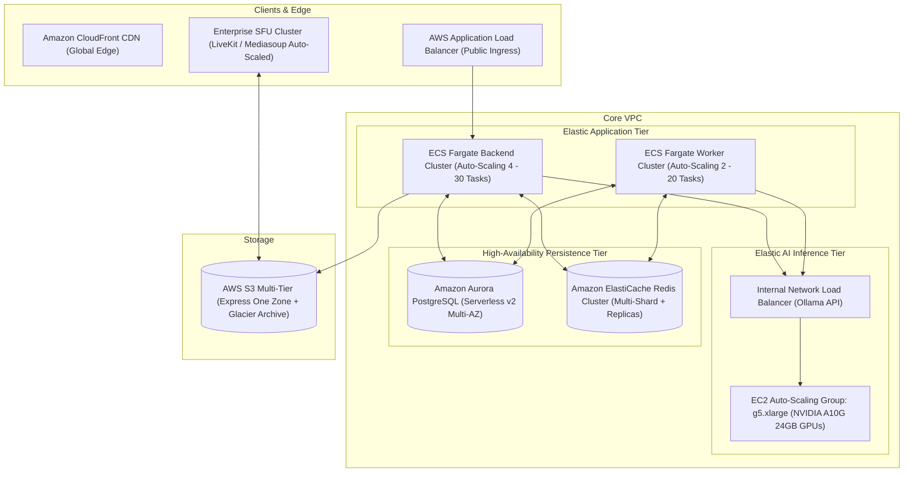

# PLUTO vProctor — Deployment Architecture Options & Topology Specification

**Document Version:** 1.0  
**Status:** Pre-Deployment Architecture Decision Record  
**Platform Version:** 0.1.0 (Release Candidate 1)  
**Date:** November 2026  

---

## 1. Executive Summary & Compute Placement Principles

This document formalizes the deployment topology options for PLUTO vProctor. It establishes strict compute placement rules based on hardware requirements and presents three distinct architectural topologies:
- **Option A:** Single-Host EC2 Docker Compose (Controlled Staging & Low-Cost Verification).
- **Option B:** Split AWS Architecture with Managed Services & Decoupled AI Compute (Recommended Production).
- **Option C:** High-Concurrency Auto-Scaling Enterprise Cloud Topology (Future Scale).

### 1.1 Fundamental Compute Placement Rule
A critical architectural boundary governs the deployment of PLUTO vProctor:

> [!IMPORTANT]
> **GPU Workload Placement Constraint:**  
> AWS ECS Fargate provides **CPU-only serverless containers**. AWS Fargate does **NOT** support NVIDIA GPUs or CUDA acceleration.  
> Therefore, **Ollama with Qwen2.5:3b CANNOT run on ECS Fargate**. The LLM inference daemon must run either on a dedicated EC2 instance equipped with an NVIDIA GPU (e.g. `g4dn` or `g5` family) or an ECS cluster backed by EC2 GPU Capacity Providers.

### 1.2 Subsystem Compute Classification

```text
[ PLUTO vProctor Compute Classification ]
├── CPU-Only Workloads (Fargate / Standard EC2 Compatible)
│   ├── Frontend Nginx Web Server (Stateless static delivery)
│   ├── FastAPI ASGI Backend (Uvicorn event loop, REST endpoints, WebSocket signaling)
│   ├── Background Worker Daemon (Job queue consumer, report compilation)
│   ├── Faster-Whisper ASR (CTranslate2 int8 CPU execution, ~0.25x–0.35x RTF)
│   ├── FFmpeg / PyAV (Audio slicing and transcoding into 16kHz mono WAV)
│   ├── MediaPipe Facial Analysis (Client-side WASM/WebGL; server-side audit in Python)
│   ├── PostgreSQL 16 (Relational DB engine)
│   └── Redis 7 (In-memory cache, task queue, and WebSocket pub/sub)
│
└── GPU-Dependent Workloads (Requires EC2 GPU Capacity / NVIDIA CUDA)
    └── Ollama Daemon + Qwen2.5:3b Instruct LLM (GGUF 4-bit, 2.5 GiB VRAM active footprint)
```

---

## 2. Architectural Comparison of Compute Orchestration Models

Before detailing the topologies, the three primary compute models are evaluated:

| Evaluation Criterion | Model 1: ECS Fargate (API/Worker) + Dedicated EC2 GPU (AI) | Model 2: ECS on EC2 (Consolidated Cluster) | Model 3: Single EC2 Docker Compose (Controlled Staging) |
|---|---|---|---|
| **Architectural Philosophy** | Decoupled serverless application tier + dedicated GPU AI host. | Single ECS cluster with heterogeneous EC2 instances (CPU + GPU). | Colocated multi-container stack on a single GPU instance. |
| **Operational Overhead** | **Low:** No OS patching or node management for API/Worker; only 1 EC2 instance for AI. | **High:** Full OS, AMI, Docker, and ECS agent lifecycle management across all nodes. | **Minimal:** Standard `docker-compose.yml` workflow identical to local development. |
| **Fault Isolation** | **Complete:** API and web traffic cannot crash or starve the AI instance, and vice-versa. | **Partial:** Shared ECS cluster control plane; task placement constraints required. | **None:** A runaway task or OOM event affects all services simultaneously. |
| **Scaling Flexibility** | **Independent:** Scale API/Worker tasks dynamically in seconds; scale AI nodes separately. | **Coupled:** Must scale EC2 Auto Scaling Groups behind ECS capacity providers. | **Zero:** Strictly vertical scaling on one machine; zero horizontal elasticity. |
| **Network Complexity** | Moderate: Internal VPC routing between Fargate tasks and private EC2 AI IP. | Moderate: Internal bridge or `awsvpc` networking on EC2. | Minimal: Docker bridge network on `localhost`. |
| **Cost Profile** | Pay-as-you-go Fargate vCPU/RAM + reserved/on-demand EC2 GPU. | Base cost of multiple running EC2 instances (CPU + GPU instances). | Lowest initial cost (1 instance total, e.g. 1x `g4dn.xlarge`). |
| **Production Suitability** | **Recommended for Production.** | Viable for large enterprise teams with dedicated DevOps. | **Strictly Staging / Non-Production.** |

---

## 3. GPU Sizing & Hardware Constraints (`g4dn.xlarge`)

### 3.1 Hardware Specifications
The AWS `g4dn.xlarge` instance provides:
- **vCPU:** 4 vCPUs (Intel Cascade Lake 8259CL, up to 3.1 GHz).
- **System Memory:** 16 GiB RAM.
- **GPU Accelerator:** 1x NVIDIA T4 (Turing architecture, 2,560 CUDA cores, 320 Tensor cores).
- **GPU VRAM:** 16 GiB GDDR6 (320 GB/s memory bandwidth).
- **Instance Storage:** 125 GiB NVMe SSD (temporary scratch volume).
- **Network Bandwidth:** Up to 25 Gbps.

### 3.2 Resource Sharing & Contention Analysis

```mermaid
flowchart TD
    subgraph g4dn.xlarge Hardware Boundary [g4dn.xlarge: 4 vCPU | 16 GiB RAM | 1x NVIDIA T4 16 GiB VRAM]
        subgraph GPU Allocation [NVIDIA T4 16 GiB VRAM]
            VRAM_MOD["Qwen2.5:3b Weights (~2.0 GiB)"]
            VRAM_CTX["Active Context Slots KV-Cache (0.5 - 2.0 GiB)"]
            VRAM_FREE["Unallocated / Safety Buffer (~12.0 GiB)"]
        end

        subgraph System RAM Allocation [16 GiB System RAM]
            RAM_OS["Ubuntu OS & Docker Runtime (~1.5 GiB)"]
            RAM_AI["Ollama System Footprint (~1.5 GiB)"]
            RAM_PG["PostgreSQL Buffer Pool (~2.0 - 3.0 GiB)"]
            RAM_REDIS["Redis In-Memory Store (~0.5 GiB)"]
            RAM_API["FastAPI / Uvicorn Processes (~1.5 GiB)"]
            RAM_WORKER["Worker + Whisper ASR (~2.0 - 3.0 GiB)"]
            RAM_HEADROOM["Remaining Headroom (< 3.0 GiB)"]
        end

        subgraph CPU Allocation [4 vCPUs]
            CPU_SYS["OS & Networking (0.5 vCPU)"]
            CPU_API["Uvicorn ASGI Event Loop & WebSockets (1.0 vCPU)"]
            CPU_ASR["Faster-Whisper int8 ASR Transcoding (1.5 - 2.5 vCPU Burst)"]
            CPU_DB["PostgreSQL Worker Threads (0.5 - 1.0 vCPU)"]
        end
    end
```

### 3.3 Bottlenecks & Limitations
1. **Ollama Sequential Execution Bottleneck:**  
   By default, Ollama executes inference requests sequentially. If multiple candidates submit interview answers simultaneously, responses queue up unless parallel context slots are configured via `OLLAMA_NUM_PARALLEL`. While the 16 GiB VRAM can support multiple context slots, the T4's 320 GB/s memory bandwidth throttles token throughput when processing concurrent generation streams.
2. **System Memory Pressure (When Colocated in Staging):**  
   Under Option A (colocated), system RAM is tightly budgeted (16 GiB total). If a candidate uploads a large resume while a 30-minute audio file is being transcribed by Faster-Whisper, RAM usage can spike, risking Linux Out-Of-Memory (OOM) killer terminating critical processes.
3. **CPU Core Starvation (When Colocated):**  
   With only 4 vCPUs, running real-time WebSocket signaling, database queries, and CPU-based Faster-Whisper transcription concurrently will cause thread contention and audio processing latency.

> [!WARNING]
> **Empirical Validation Requirement:**  
> While the `g4dn.xlarge` instance is architecturally adequate on paper for 1 to 3 concurrent sessions, **it cannot be declared suitable for 5, 10, or 20 concurrent interviews without empirical workload measurements**. For enterprise concurrency, larger instances (such as `g4dn.2xlarge` with 8 vCPU / 32 GiB RAM or `g5.xlarge` with an NVIDIA A10G 24 GiB GPU) must be evaluated.

---

## 4. Option A: Single-Host EC2 Docker Compose (Controlled Staging)

### 4.1 Topology Overview
Option A runs all containerized services on a single `g4dn.xlarge` instance using Docker Compose. It serves as an isolated staging sandbox for pre-production validation.

```mermaid
flowchart TD
    subgraph Internet
        Browser["Candidate / Recruiter Browser"]
    end

    subgraph AWS VPC (Single Public Subnet)
        subgraph EC2 Instance: g4dn.xlarge [Ubuntu 22.04 LTS with NVIDIA Container Toolkit]
            NGINX["Nginx Container (Port 80/443 - SSL Termination & Static FE)"]
            FASTAPI["FastAPI Backend Container (Port 8000)"]
            WORKER["Background Worker Container"]
            POSTGRES[("PostgreSQL Container (Port 5432)")]
            REDIS[("Redis Container (Port 6379)")]
            OLLAMA["Ollama Container (Port 11434 --gpus all)"]
            EBS[("EBS gp3 100 GB (Persistent DB & Media Storage)")]
        end
    end

    Browser -->|HTTPS 443 / WSS| NGINX
    NGINX -->|Reverse Proxy /api/ & /ws/| FASTAPI
    FASTAPI <-->|Local Bridge| POSTGRES
    FASTAPI <-->|Local Bridge| REDIS
    FASTAPI -->|Local Bridge| OLLAMA
    FASTAPI -->|Write Media| EBS

    WORKER <-->|Local Bridge| REDIS
    WORKER <-->|Local Bridge| POSTGRES
    WORKER -->|Local Bridge| OLLAMA
    WORKER -->|Transcode/Process| EBS

    POSTGRES -->|Persist Data| EBS
```

### 4.2 Network & Security Configuration
- **Network Boundaries:** Single EC2 instance in a public subnet with Elastic IP.
- **Security Group Rules:**
  - *Ingress:* Port 80 (HTTP redirect), Port 443 (HTTPS), Port 22 (SSH from admin IP only).
  - *Egress:* Outbound 443 to Google STUN (`stun:stun.l.google.com:19302`) and HuggingFace (initial model pull).
- **Persistent Storage:** 100 GB EBS gp3 volume mounted to `/var/lib/docker/volumes` to persist PostgreSQL database records and uploaded audio/video files.

### 4.3 Evaluation of Option A
- **Pros:** Lowest setup complexity, fastest deployment, exact parity with local `docker-compose.yml`, lowest cloud bill (~$150 - $220/month).
- **Cons:** **Single Point of Failure (SPOF)** across all services; instance reboot causes total outage; zero auto-scaling; CPU and memory contention.
- **Verdict:** **Strictly recommended for controlled staging testing; unfit for production.**

---

## 5. Option B: Split AWS Architecture (Recommended Production)

### 5.1 Topology Overview
Option B decouples stateless web/API traffic, stateful managed persistence, and heavy GPU AI inference into separate, purpose-built AWS tiers.

```mermaid
flowchart TD
    subgraph Public Internet
        Users["Candidates & Recruiters (WebRTC / HTTPS)"]
    end

    subgraph AWS Cloud Perimeter
        ALB["Application Load Balancer (Public Subnet - ACM TLS Termination)"]
        NAT["NAT Gateway (Outbound Internet for Private Subnets)"]
        TURN["EC2 Coturn / Managed TURN (Public Subnet - UDP/TCP 3478, 5349)"]
    end

    subgraph AWS VPC: 10.0.0.0/16
        subgraph Private Application Subnet (10.0.1.0/24 & 10.0.2.0/24)
            subgraph ECS Fargate Cluster
                BE1["FastAPI Backend Task 1"]
                BE2["FastAPI Backend Task 2"]
                WRK1["Background Worker Task 1"]
            end
        end

        subgraph Private AI Compute Subnet (10.0.10.0/24)
            EC2_GPU["EC2 g4dn.xlarge (Ollama + Qwen2.5:3b GPU Inference)"]
        end

        subgraph Private Database Subnet (10.0.20.0/24 & 10.0.21.0/24)
            RDS[("AWS RDS PostgreSQL 16 (Multi-AZ db.t4g.small)")]
            CACHE[("AWS ElastiCache Redis 7 (cache.t4g.micro)")]
        end
    end

    subgraph Managed Cloud Storage Tier
        S3_FE["AWS S3 (Frontend Static Website)"]
        CF["AWS CloudFront CDN"]
        S3_MEDIA[("AWS S3 (Recordings & Resumes - KMS Encrypted)")]
    end

    Users -->|HTTPS (Static App)| CF --> S3_FE
    Users -->|HTTPS / WSS (API & Signaling)| ALB
    Users <-->|P2P Audio/Video| Users
    Users -.->|Relay Media (Symmetric NAT)| TURN

    ALB -->|Port 8000| BE1
    ALB -->|Port 8000| BE2

    BE1 & BE2 <-->|Port 5432| RDS
    BE1 & BE2 <-->|Port 6379| CACHE
    BE1 & BE2 -->|Internal HTTP 11434| EC2_GPU
    BE1 & BE2 -->|Presigned Uploads| S3_MEDIA

    WRK1 <-->|Port 6379 (Dequeue)| CACHE
    WRK1 <-->|Port 5432| RDS
    WRK1 -->|Port 11434| EC2_GPU
    WRK1 -->|Process Media| S3_MEDIA

    BE1 & BE2 & EC2_GPU -->|Outbound Updates| NAT
```

### 5.2 Network Boundaries & Security Groups

| Security Group | Attached Resources | Ingress Rules | Egress Rules |
|---|---|---|---|
| **`sg-alb`** | Public Application Load Balancer | `0.0.0.0/0:443` (HTTPS), `0.0.0.0/0:80` (HTTP redirect) | Outbound to `sg-fargate:8000` |
| **`sg-fargate`** | ECS Fargate Tasks (API & Workers) | `sg-alb:8000` (FastAPI Uvicorn) | Outbound to `sg-rds:5432`, `sg-redis:6379`, `sg-ollama:11434`, and `0.0.0.0/0:443` via NAT |
| **`sg-ollama`** | EC2 GPU Instance (`g4dn.xlarge`) | `sg-fargate:11434` (Ollama HTTP API) | Outbound to `0.0.0.0/0:443` via NAT for model downloads |
| **`sg-rds`** | AWS RDS PostgreSQL | `sg-fargate:5432` only | None (isolated database subnet) |
| **`sg-redis`** | AWS ElastiCache Redis | `sg-fargate:6379` only | None (isolated cache subnet) |
| **`sg-turn`** | Coturn Relay Server (Public) | `0.0.0.0/0:3478` (UDP/TCP), `0.0.0.0/0:5349` (TURNS TLS), `0.0.0.0/0:49152-65535` (UDP Relay) | `0.0.0.0/0` (Media relay to peers) |

### 5.3 Storage, Backups & Recovery
- **Database (RDS):** Automated daily snapshots with 35-day retention. Point-In-Time Recovery (PITR) enabled. Multi-AZ deployment provides automatic synchronous standby failover within 60 seconds.
- **Media Storage (S3):** Default AWS KMS encryption (`aws:kms`). S3 Versioning enabled. S3 Lifecycle rules automatically transition raw audio/video files to Glacier Flexible Retrieval after 90 days.
- **Cache & Queue (Redis):** Daily snapshotting enabled; Redis acts as transient queue/cache—if total failure occurs, uncompleted background jobs can be re-dispatched via database reconciliation.

### 5.4 Single Points of Failure & Scaling Constraints
- **Ollama EC2 GPU Instance:** In Option B, a single `g4dn.xlarge` runs the AI daemon. If this instance fails, LLM evaluations fail fast and fallback scoring rules activate. Scaling constraint: Limited by single T4 GPU throughput.
- **Fargate API & Worker Tier:** Zero SPOF. Automatically scales between 2 and 10 tasks based on CPU/memory utilization and ALB request queue depth.

---

## 6. Option C: High-Concurrency Auto-Scaling Enterprise Cloud Topology

### 6.1 Topology Overview
Option C is engineered for national enterprise scale (hundreds of simultaneous video interviews). It introduces an **Auto-Scaling GPU Inference Cluster** behind an internal network load balancer, an enterprise SFU (Selective Forwarding Unit) media bridge cluster, and Aurora Multi-AZ clustering.



### 6.2 Key Differentiators of Option C
1. **Auto-Scaled GPU Pool:** GPU instances (`g5.xlarge` with NVIDIA A10G GPUs) scale out automatically via CloudWatch custom metrics tracking Ollama queue latency.
2. **Selective Forwarding Unit (SFU):** Replaces pure P2P WebRTC with an auto-scaled SFU cluster, eliminating client bandwidth constraints during multi-party recruiter/panel interviews.
3. **Aurora Serverless v2:** Dynamically scales database ACUs (Aurora Capacity Units) during peak morning/afternoon hiring drives and scales down overnight.

---

## 7. Comparative Architecture Matrix

| Architectural Feature | Option A: Single EC2 Compose | Option B: Split AWS Architecture | Option C: Enterprise Auto-Scaling |
|---|---|---|---|
| **Target Stage** | Controlled Staging / Validation | Standard Production (V1) | High-Concurrency Enterprise (V2) |
| **Max Concurrent Interviews** | 1 – 3 sessions (estimated) | 10 – 25 sessions (estimated) | 100+ sessions (elastic) |
| **High Availability (HA)** | None (Single node) | Yes (Multi-AZ RDS & Fargate) | Complete High Availability across all tiers |
| **Recovery Time Objective (RTO)**| 1 – 4 hours (rebuild instance) | < 5 minutes (failover) | < 30 seconds (automatic healing) |
| **Recovery Point Objective (RPO)**| Up to 24 hours (daily snapshot)| < 5 minutes (RDS PITR) | Zero data loss (Aurora continuous sync) |
| **Monthly Cost Estimate** | ~$150 – $220 / month | ~$450 – $750 / month | ~$1,800 – $4,500+ / month |
| **Operational Maintenance** | Manual container management | Managed AWS infrastructure | Requires dedicated SRE / DevOps team |

---

## 8. Summary of Architectural Recommendations

1. **Staging Recommendation:** Deploy **Option A** (`g4dn.xlarge` single instance with Docker Compose) to perform initial integration tests, measure actual memory consumption, and validate live WebRTC NAT traversal across public networks.
2. **Production Recommendation:** Graduate to **Option B** before onboarding production candidates. Deploy ECS Fargate for API and worker workloads, AWS RDS for PostgreSQL, AWS ElastiCache for Redis, AWS S3 for recordings, and isolate Ollama on a dedicated EC2 GPU instance.
3. **Long-Term Evolution:** Maintain Option C as the architectural roadmap when concurrent interview volume exceeds 25 simultaneous rooms.
