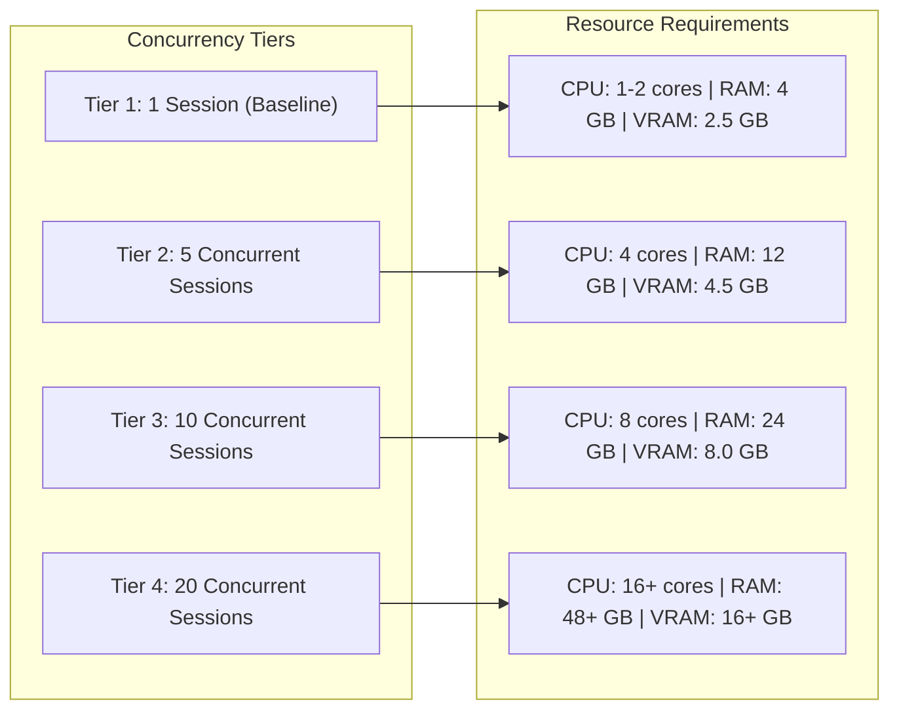
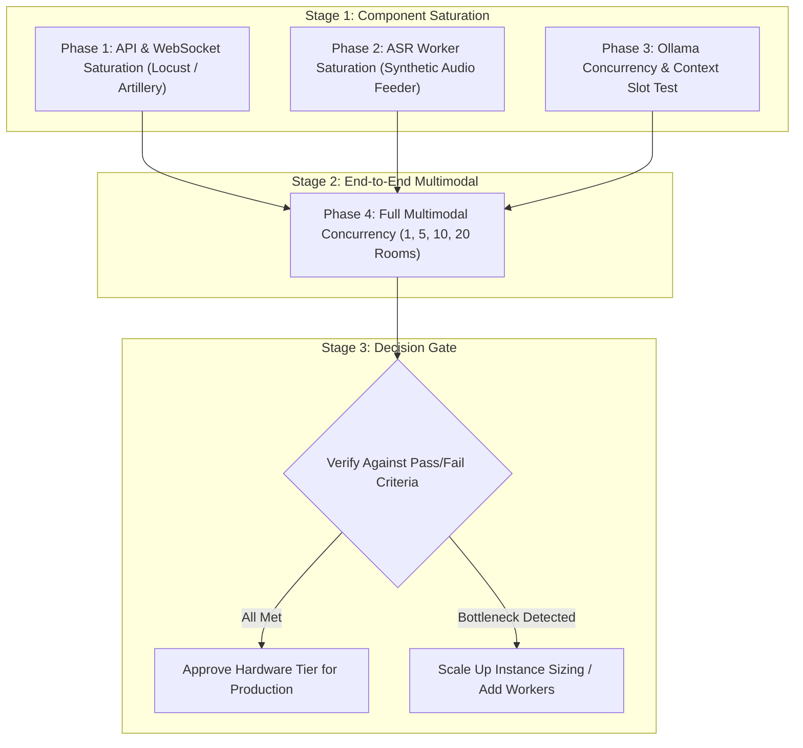

# PLUTO vProctor — Deployment Workload & Capacity Assessment

**Document Version:** 1.0  
**Status:** Pre-Deployment Capacity & Workload Engineering Reference  
**Platform Version:** 0.1.0 (Release Candidate 1)  
**Date:** November 2026  

---

## 1. Executive Summary

This document establishes the hardware capacity models, resource budgets, and empirical performance envelopes for PLUTO vProctor.

To maintain scientific and engineering integrity:
- **Measured Metrics** derived from repository benchmarks ([docs/ASR_BENCHMARK.md](file:///D:/_TY/MDM/PLUTO-vProctor/docs/ASR_BENCHMARK.md), [docs/GAZE_BENCHMARK.md](file:///D:/_TY/MDM/PLUTO-vProctor/docs/GAZE_BENCHMARK.md), and automated test suites) are explicitly tagged and cited.
- **Assumed / Projected Metrics** (such as cloud GPU throughput, concurrent WebRTC TURN bandwidth, and concurrent database connection pool utilization) are clearly separated and flagged as requiring empirical validation.
- A **Structured Load Testing Plan** is defined across four concurrency tiers (1, 5, 10, and 20 concurrent active interview sessions) with precise pass/fail criteria.

---

## 2. Empirical Baseline: Measured vs. Assumed Metrics Matrix

| Subsystem / Metric | Value | Metric Type | Source / Measurement Condition |
|---|---|---|---|
| **Faster-Whisper ASR RTF** | **0.25x – 0.35x** | **Measured** | `docs/ASR_BENCHMARK.md`: 4 CPU cores, quantized `int8`, `base.en` model. (10s audio processed in 2.5s–3.5s). |
| **Faster-Whisper VRAM Usage** | **0 MB** | **Measured** | `docs/ASR_BENCHMARK.md`: Verified CPU execution (`WHISPER_DEVICE=cpu`). |
| **MediaPipe Client Tracking Speed** | **$\ge$ 15 FPS** (typ. 20–30 FPS) | **Measured** | `docs/GAZE_BENCHMARK.md`: Chrome/Edge on standard laptop with WebAssembly/WebGL. |
| **MediaPipe Server Video Replay** | **10.0 FPS** (590 frames / 58.32s) | **Measured** | `docs/GAZE_BENCHMARK.md`: Evaluated on `sess_ce7da3c8cfb1_interview.webm`. |
| **Backend Test Suite Execution** | **11.8s** (198 tests) | **Measured** | `pytest backend/tests`: In-memory and SQLite test harness execution. |
| **Frontend Test Suite Execution** | **1.7s** (21 tests) | **Measured** | `npm run test` in `frontend/`: Vitest component execution. |
| **Resume Text Parsing Latency** | **200ms – 800ms** | **Measured** | `backend/app/services/resume_service.py`: Standard 2–3 page PDF extraction on 1 CPU core. |
| **Qwen2.5:3b VRAM Footprint** | **~2.0 – 2.5 GiB** | **Measured** | Local Ollama GGUF 4-bit quantization weight allocation in memory. |
| **Qwen2.5:3b Generation Speed (T4)**| **~35 – 50 tokens/sec** | *Assumed / Projected* | Based on published llama.cpp benchmarks for 3B Q4 on Turing architecture; requires cloud measurement. |
| **Ollama Context Slot Scaling** | **~0.5 GiB VRAM / slot** | *Assumed / Projected* | Projected KV cache memory per 4,096-token context window; requires measurement with `OLLAMA_NUM_PARALLEL`. |
| **WebM Video Streaming Bitrate** | **350 – 500 kbps** | *Assumed / Projected* | 720p 15fps VP8/VP9 video stream with 64 kbps Opus audio. |
| **TURN Relay Frequency** | **15% – 20% of sessions** | *Assumed / Projected* | Typical enterprise symmetric NAT traversal failure rate requiring TURN relay. |
| **Database Transaction Latency** | **5 – 15 ms / query** | *Assumed / Projected* | Projected AWS RDS PostgreSQL 16 latency over VPC private subnet. |

---

## 3. Subsystem Resource Profiling

### 3.1 AI Inference Engine (Ollama + Qwen2.5:3b)
- **Role:** Generates dynamic contextual interview questions, calculates candidate-job alignment, and performs rubric-based grading.
- **Resource Footprint:**
  - *Base Model in VRAM:* ~2.0 GiB static.
  - *Active Inference Overhead:* ~0.5 GiB per active context window (4,096 tokens).
  - *GPU Compute Utilization:* Spikes to 85–100% of CUDA cores during active token generation.
- **Concurrency Behavior:**
  - Standard Ollama serializes requests. Without `OLLAMA_NUM_PARALLEL`, concurrent grading requests queue up sequentially.
  - With `OLLAMA_NUM_PARALLEL=4`, Ollama instantiates 4 parallel context slots in VRAM (~4.0 GiB total VRAM), allowing 4 simultaneous prompts to generate tokens concurrently. Token generation speed per stream drops proportionally due to shared memory bandwidth (320 GB/s on NVIDIA T4).

### 3.2 Speech Recognition (Faster-Whisper) & Transcoding (FFmpeg)
- **Role:** Audio ingestion, chunk transcoding, and continuous speech-to-text.
- **Resource Footprint:**
  - *Memory:* ~500 MB RAM for model weights (`base.en`) + ~200 MB audio buffer.
  - *CPU Utilization:* Uses 100% of 1–2 CPU cores during active transcription chunks.
  - *Real-Time Factor (RTF):* Measured at ~0.25x–0.35x. A 30-second candidate response takes ~7.5 to 10.5 seconds of single-core CPU time to transcribe and disfluency-tag.

### 3.3 MediaPipe Proctoring & Telemetry
- **Role:** Facial landmark tracking, iris gaze classification, head pose estimation, and attention scoring.
- **Resource Footprint:**
  - *Candidate Device (Client):* WebGL/WASM executes at 15–30 FPS, consuming 15–25% of client CPU. **Zero server compute cost.**
  - *Server-Side Telemetry Ingestion:* Candidate client transmits telemetry events (gaze direction, attention score, tab switches) over WebSocket at 2 Hz (~500 bytes/sec). Server-side overhead is negligible (< 1% CPU per session).
  - *Post-Interview Audit (Worker):* If forensic video verification is triggered, server processes video at ~10 FPS (1 minute of video takes ~6 seconds of server CPU).

### 3.4 WebRTC Signaling & NAT Traversal (STUN/TURN)
- **Role:** Peer-to-peer audio/video connection establishment and relay.
- **Network Bandwidth:**
  - *P2P Direct (80–85% of sessions):* Video and audio stream directly between candidate and recruiter. Server handles only signaling (~2 kbps per connection).
  - *TURN Relay (15–20% of sessions):* Traffic routes through TURN server. Each relayed session consumes ~500 kbps ingress and ~500 kbps egress (~1 Mbps total network throughput on TURN server).

### 3.5 Storage Accumulation Rates
- **Video Recording (720p 15fps WebM):** ~2.5 MB / minute (~75 MB per 30-minute interview).
- **Audio Recording (16kHz WAV):** ~1.9 MB / minute (~57 MB per 30-minute interview).
- **Combined Session Media:** ~132 MB per completed 30-minute interview.
- **Storage Growth Projections:**
  - 100 interviews: ~13.2 GB
  - 1,000 interviews: ~132 GB
  - 5,000 interviews: ~660 GB (triggers S3 Glacier transition after 90 days).

---

## 4. Concurrency Modeling & Capacity Projections

### Detailed Concurrency Tier Breakdown:

#### Level 1: 1 Active Interview Room (Baseline / Staging)
- **Concurrent Participants:** 1 Candidate + 1 Recruiter (or candidate self-practice).
- **Active WebSockets:** 2 connections.
- **ASR Transcriptions:** 1 chunk every 30–60 seconds (RTF: ~8s processing).
- **AI Inference:** 1 prompt every 2–3 minutes (generation time: ~3–5s).
- **Resource Demand:**
  - CPU: 1.0 – 1.5 vCPU average.
  - System RAM: ~3.5 – 4.5 GB total stack.
  - GPU VRAM: ~2.5 GiB (1 active model + 1 context slot).
  - TURN Bandwidth (if relayed): 1 Mbps.
- **Hosting Capacity:** Easily satisfied by a single `g4dn.xlarge` instance.

#### Level 2: 5 Concurrent Interview Rooms (Small Cohort Drive)
- **Concurrent Participants:** 10 participants.
- **Active WebSockets:** 10 connections.
- **ASR Transcriptions:** ~3–5 chunks per minute across rooms. Worker queues tasks smoothly without backlog.
- **AI Inference:** ~2–3 questions or evaluations per minute. With `OLLAMA_NUM_PARALLEL=2`, wait times remain under 6 seconds.
- **Resource Demand:**
  - CPU: 3.0 – 4.0 vCPU average (spikes to 5 vCPU during simultaneous answer submissions).
  - System RAM: ~10 – 12 GB total stack.
  - GPU VRAM: ~3.5 – 4.5 GiB.
  - TURN Bandwidth (assuming 1 relayed room): ~1 Mbps.
- **Hosting Capacity:** At the threshold limit for Option A (`g4dn.xlarge` single instance). System RAM and CPU will experience periodic burst contention. Option B (split architecture) is strongly recommended.

#### Level 3: 10 Concurrent Interview Rooms (Department Hiring Drive)
- **Concurrent Participants:** 20 participants.
- **Active WebSockets:** 20 connections.
- **ASR Transcriptions:** ~8–12 chunks per minute. A single worker thread becomes a bottleneck; requires at least 2 worker tasks.
- **AI Inference:** ~5–8 evaluations per minute. With `OLLAMA_NUM_PARALLEL=4`, prompts process in parallel, but average generation latency increases to ~6–10 seconds per response.
- **Resource Demand:**
  - CPU: 6.0 – 8.0 vCPU across backend and workers.
  - System RAM: ~18 – 24 GB across tiers.
  - GPU VRAM: ~6.0 – 8.0 GiB.
  - TURN Bandwidth (assuming 2 relayed rooms): ~2 Mbps.
- **Hosting Capacity:** **Exceeds single `g4dn.xlarge` capacity.** Requires Option B (ECS Fargate with 2–4 tasks + `g4dn.xlarge` or `g4dn.2xlarge` dedicated to AI).

#### Level 4: 20 Concurrent Interview Rooms (Enterprise Evaluation Day)
- **Concurrent Participants:** 40 participants.
- **Active WebSockets:** 40 connections.
- **ASR Transcriptions:** ~15–25 chunks per minute. Requires 4 background worker tasks to maintain near-real-time evaluation queues.
- **AI Inference:** ~12–18 evaluations per minute. Single T4 GPU becomes saturated; inference queue latency can exceed 25 seconds.
- **Resource Demand:**
  - CPU: 12 – 16 vCPU across backend and workers.
  - System RAM: ~36 – 48 GB across tiers.
  - GPU VRAM: 12 – 16 GiB (approaching T4 hardware ceiling).
  - TURN Bandwidth (assuming 4 relayed rooms): ~4 Mbps.
- **Hosting Capacity:** Requires Option B with a larger GPU instance (e.g. `g5.xlarge` with NVIDIA A10G 24 GiB VRAM) or Option C with multiple load-balanced AI instances.

---

### Concurrency Resource Summary Table

| Concurrency Tier | API / Worker vCPU | Total System RAM | GPU VRAM | TURN Bandwidth | Storage Rate / Hour | Architecture Fit |
|---|---|---|---|---|---|---|
| **1 Session** | 1.0 – 1.5 vCPU | 4 GB | 2.5 GiB | 0 – 1 Mbps | ~264 MB / hr | Option A (`g4dn.xlarge`) |
| **5 Sessions** | 3.0 – 4.0 vCPU | 12 GB | 4.5 GiB | 1 – 2 Mbps | ~1.3 GB / hr | Option A (Borderline) / Option B |
| **10 Sessions** | 6.0 – 8.0 vCPU | 24 GB | 7.5 GiB | 2 – 3 Mbps | ~2.6 GB / hr | **Option B** (`g4dn.2xlarge` or split) |
| **20 Sessions** | 12.0 – 16.0 vCPU | 48 GB | 14.0 GiB | 4 – 6 Mbps | ~5.3 GB / hr | **Option B (Enhanced)** or Option C |

---

## 5. Practical Pre-Deployment Load Testing Plan

To replace theoretical projections with hard empirical measurements, the following structured load testing plan must be executed in staging before commercial launch:

### 5.1 Test Phase 1: API & WebSocket Signaling Saturation
- **Tool:** Locust / Artillery script simulating 10, 50, and 100 concurrent candidate connections.
- **Workload:**
  - Candidate login (`POST /api/auth/login`).
  - Profile browsing and recommendation generation (`GET /api/candidates/recommendations`).
  - Persistent WebSocket connection maintenance with heartbeat pings (every 15s).
- **Success Criteria:** 99th percentile response time < 250 ms; 0 dropped WebSocket connections; zero 5xx errors.

### 5.2 Test Phase 2: Speech-to-Text & Disfluency Batch Worker Saturation
- **Tool:** Python load script enqueueing pre-recorded 30-second audio files (`fixture_synth_001.webm`) into Redis queue.
- **Workload:** Concurrently submit 1, 5, 10, and 20 audio files to the worker queue.
- **Measurements Recorded:**
  - Real-Time Factor (RTF) across concurrent jobs.
  - Worker CPU utilization and memory consumption.
  - Queue backlog drain time.
- **Success Criteria:** Average RTF remains $\le$ 0.40x; zero worker process crashes or memory leaks.

### 5.3 Test Phase 3: Ollama Concurrency & Context Slot Benchmark
- **Tool:** Benchmark script executing concurrent HTTP requests to `POST http://ollama:11434/api/generate` with candidate answer evaluation prompts (prompt size: ~800 tokens; generation target: ~250 tokens).
- **Configurations Tested:**
  - `OLLAMA_NUM_PARALLEL=1` vs. `2` vs. `4`.
- **Measurements Recorded:**
  - Time To First Token (TTFT).
  - Tokens per second (TPS) per stream and aggregate TPS.
  - VRAM allocation and GPU compute utilization (via `nvidia-smi dmon`).
- **Success Criteria:** Aggregate generation latency $\le$ 8.0 seconds for evaluation completion at target concurrency.

### 5.4 Test Phase 4: Full End-to-End Multimodal Concurrency Test
- **Tool:** Automated headless browser or multi-process test runner simulating complete interview lifecycles across 1, 5, 10, and 20 concurrent rooms:
  - Recruiter creates room -> Candidate joins lobby -> Admin starts room -> Candidate streams video/audio -> Recruiter advances questions -> Candidate submits responses -> System transcribes, grades, and compiles final PDF dossier.
- **Measurements Recorded:**
  - Total end-to-end report compilation latency after interview completion.
  - Server-side CPU, RAM, and GPU contention during simultaneous multi-room activity.
  - Audio/Video WebRTC packet loss and jitter.

---

## 6. Pass/Fail Thresholds & Readiness Criteria

The staging deployment must satisfy the following empirical thresholds before production sign-off:

| Metric | Target Threshold | Hard Failure Boundary |
|---|---|---|
| **API Response Time (P95)** | $\le 200\text{ ms}$ | $> 500\text{ ms}$ |
| **WebSocket Signaling Latency (P95)** | $\le 50\text{ ms}$ | $> 200\text{ ms}$ |
| **Audio Transcription RTF (P90)** | $\le 0.35\text{x}$ | $> 0.60\text{x}$ |
| **AI Evaluation Latency (P90)** | $\le 6.0\text{ s}$ | $> 15.0\text{ s}$ |
| **Report Generation Time (Post-Session)**| $\le 30.0\text{ s}$ | $> 90.0\text{ s}$ |
| **Host System RAM Headroom** | $\ge 20\%\text{ free}$ | $< 5\%\text{ free (OOM risk)}$ |
| **GPU VRAM Headroom** | $\ge 15\%\text{ free}$ | Out of Memory Error |
| **WebRTC Media Packet Loss** | $\le 1.0\%$ | $> 5.0\%$ |

---

## 7. Capacity Sign-off & Next Steps

This capacity assessment establishes that:
1. `g4dn.xlarge` is a viable, cost-effective candidate for **controlled staging and baseline verification (1–3 concurrent sessions)**.
2. Production capacity for 5–20 sessions requires the decoupled **Option B (Split Architecture)** to ensure CPU-heavy ASR and WebSocket traffic does not starve the GPU LLM inference pipeline.
3. The load testing plan in Section 5 must be executed during Phase 1 staging before committing to production hardware procurement.
