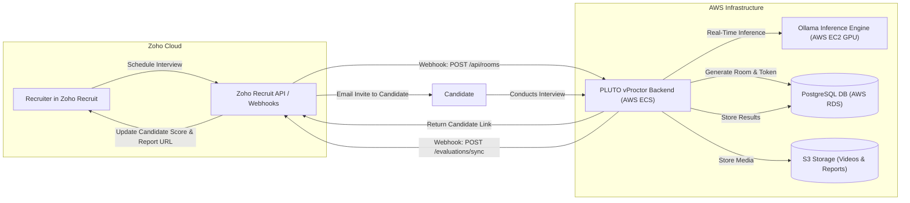

# PLUTO vProctor — Pre-Deployment Readiness & Cloud Architecture Assessment

**Document Version:** 1.1  
**Status:** Pre-Deployment Technical Architecture Report  
**Platform Version:** 0.1.0 (Release Candidate 1)  
**Date:** November 2026  

---

## 1. Executive Summary & Assessment Scope

PLUTO vProctor has passed all autonomous quality gates, completing Phases 1–6 and Batches 1–5 with all 62 product-completion requirements verified, zero hardcoded secrets detected, and full test suite passing (198 backend tests, 21 frontend tests).

Following the formal approval of **Release Candidate 1 (RC1)**, this report delivers an evidence-based pre-deployment architectural assessment. It analyzes the cloud compatibility of the platform across three candidate hosting paradigms:
1. **Amazon Web Services (AWS)** — Native cloud hosting across container, database, storage, and GPU services.
2. **Zoho Catalyst** — Serverless and AppSail container cloud platform.
3. **Hybrid AWS + Zoho Architecture** — Dedicated AWS compute and AI inference combined with Zoho enterprise ecosystem integration.

### Primary Assessment Conclusion:
- **AWS is the Architecturally Compatible Production Platform.** The full PLUTO vProctor stack—including asynchronous FastAPI ASGI, PostgreSQL relational persistence, Redis job queues, S3 presigned media storage, and self-hosted Ollama LLM inference—maps cleanly to standard AWS managed and container services.
- **Pure Zoho Catalyst is Incompatible for Standalone Deployment.** While Zoho Catalyst AppSail can host the FastAPI and Nginx Docker containers, Catalyst's proprietary NoSQL Data Store is incompatible with PLUTO's SQLAlchemy/PostgreSQL ORM; Catalyst's serverless function timeout and memory limits prevent running Ollama or Faster-Whisper; and Catalyst provides no GPU compute tier. Running on Catalyst requires externalizing the database, Redis, and AI inference to third-party clouds.
- **Hybrid AWS + Zoho is Architecturally Sound for Enterprise Integration.** Organizations utilizing Zoho Recruit or Zoho CRM can deploy the core compute and AI engine on AWS, bridging candidate interview schedules and evaluation reports into Zoho via authenticated REST webhooks.

---

## 2. Cloud Platform Compatibility Analysis

### 2.1 Amazon Web Services (AWS) Evaluation

```mermaid
flowchart TD
    subgraph Clients
        Candidate["Candidate Device (Browser WebRTC + MediaPipe)"]
        Admin["Recruiter / Admin (React SPA Console)"]
    end

    subgraph AWS Cloud Perimeter
        ALB["AWS Application Load Balancer (ACM TLS)"]
        CF["AWS CloudFront CDN"]
        S3_FE["AWS S3 (Static Frontend Assets)"]
        TURN["Coturn / Managed TURN (UDP 3478 / 5349)"]
    end

    subgraph AWS VPC Private Subnets
        subgraph ECS Fargate Cluster [CPU-Only Serverless Container Tier]
            BE["FastAPI Backend Tasks (2-4 containers)"]
            WORKER["Background Worker Tasks (2 containers)"]
        end

        subgraph Managed Persistence
            RDS[("AWS RDS PostgreSQL 16 (Multi-AZ)")]
            ELASTI[("AWS ElastiCache Redis 7")]
        end

        subgraph Dedicated AI Compute [GPU-Accelerated EC2 Tier]
            EC2_AI["AWS EC2 g4dn.xlarge (Ollama + Qwen2.5:3b NVIDIA T4 GPU)"]
        end
    end

    subgraph Object Storage
        S3_MEDIA[("AWS S3 (Encrypted Recordings & Resumes)")]
    end

    Admin -->|HTTPS| CF --> S3_FE
    Candidate -->|HTTPS| CF
    Admin -->|API & WSS| ALB --> BE
    Candidate -->|API & WSS| ALB --> BE

    Candidate <-->|P2P Video/Audio| Admin
    Candidate -.->|Relay (Symmetric NAT)| TURN
    Admin -.->|Relay (Symmetric NAT)| TURN

    BE <-->|Async SQL| RDS
    BE <-->|PubSub & Queue| ELASTI
    BE -->|Internal HTTP 11434| EC2_AI
    BE -->|Presigned URLs| S3_MEDIA

    WORKER <-->|Task Dequeue| ELASTI
    WORKER <-->|Transcripts & Scores| RDS
    WORKER -->|Inference| EC2_AI
    WORKER -->|Audio/Video Processing| S3_MEDIA
```

#### Detailed AWS Service Mapping & Readiness:
| PLUTO Component | AWS Target Service | Sizing / Configuration | Architectural Compatibility |
|---|---|---|---|
| **Frontend SPA** | AWS S3 + CloudFront CDN | Static website hosting with global edge caching | **Native Support (Fully Compatible)** |
| **FastAPI Backend** | AWS ECS Fargate | 2 vCPU, 4 GB RAM per task (Auto-scaling 2–8 tasks) | **Native Support (Fully Compatible)** |
| **Database** | AWS RDS for PostgreSQL | PostgreSQL 16, `db.t4g.small` (Multi-AZ in prod) | **Native Support (Fully Compatible)** |
| **Cache & Queue** | AWS ElastiCache for Redis | Redis 7, `cache.t4g.micro` with TLS enabled | **Native Support (Fully Compatible)** |
| **Background Worker** | AWS ECS Fargate Tasks | 2 vCPU, 4 GB RAM worker container | **Native Support (Fully Compatible)** |
| **Ollama & Qwen2.5** | AWS EC2 `g4dn.xlarge` | 4 vCPU, 16 GB RAM, 1x NVIDIA T4 GPU (16 GB VRAM) | **Native Support (Dedicated EC2 GPU Required)** |
| **Recordings & Resumes** | AWS S3 Bucket | KMS encryption (`aws:kms`), Glacier lifecycle rules | **Native Support (Fully Compatible)** |
| **Reverse Proxy / TLS** | AWS Application Load Balancer | ACM SSL, HTTP/2, WebSocket connection pooling | **Native Support (Fully Compatible)** |
| **NAT Traversal** | AWS EC2 Coturn or Twilio TURN | UDP 3478 / 5349 relay | **Native Support (Standard Protocol)** |

**AWS Verdict:** Complete architectural alignment. Zero code refactoring required. Standard infrastructure-as-code (Terraform or AWS CDK) can provision this topology cleanly.

---

### 2.2 Zoho Catalyst Evaluation

Zoho Catalyst is a full-stack serverless platform designed for lightweight business applications. Evaluating PLUTO vProctor against Catalyst capabilities reveals severe architectural boundaries:

#### Detailed Zoho Catalyst Service Mapping:
| PLUTO Component | Zoho Catalyst Feature | Supported? | Technical Roadblock & Analysis |
|---|---|---|---|
| **Frontend SPA** | Catalyst Web Client Hosting | **YES** | Can host Vite static build files with CDN distribution. |
| **FastAPI Backend** | Catalyst AppSail | **PARTIAL** | AppSail supports Docker containers. However, Catalyst enforces request timeouts, and multi-instance WebSocket pub/sub scaling requires external Redis. |
| **Database** | Catalyst Data Store | **NO** | Catalyst Data Store is a proprietary table store accessed exclusively via Catalyst SDK. It does **not** support PostgreSQL wire protocol or SQLAlchemy 2.0 ORM. Connecting PLUTO to Catalyst Data Store would require rewriting all database models and services. |
| **Cache & Task Queue** | Catalyst Cache / Event Queue | **NO** | Catalyst Cache uses proprietary SDK methods (`cache.segment()`), not Redis RESP protocol. PLUTO's `redis-py` async queue cannot communicate with Catalyst Cache. |
| **AI Inference (Ollama)** | Catalyst QuickML / Functions | **NO** | Catalyst does not provide GPU instances or arbitrary persistent daemons with 15+ GB local disk. Serverless functions have execution limits (15s–300s) and memory caps (512 MB–1 GB), making local Ollama + Qwen2.5:3b execution impossible. |
| **Media Storage** | Catalyst File Store | **PARTIAL** | File Store provides proprietary SDK storage; does not natively support standard S3 presigned URL client uploads without custom wrapper endpoints. |

**Zoho Catalyst Verdict:** **Operationally Incompatible for Standalone Deployment.** A "Catalyst-only" deployment would require rewriting the persistence layer (abandoning SQLAlchemy), abandoning local offline AI inference in favor of third-party external APIs, and replacing the Redis pub/sub queue.

---

### 2.3 Hybrid AWS + Zoho Architecture Evaluation

For organizations that mandate Zoho integration (e.g., managing candidate pipelines in **Zoho Recruit** or **Zoho CRM**), a **Hybrid Architecture** provides an enterprise-ready solution:



#### Hybrid Integration Advantages:
1. **Zero Core Refactoring:** The entire PLUTO multimodal AI, WebRTC, and proctoring engine runs on AWS without architectural compromises.
2. **Enterprise HR Workflow:** Recruiter teams trigger interview room creation directly from Zoho Recruit via REST API, and completed scores (Technical Depth, Communication, Proctoring Integrity) sync back into candidate records.
3. **Optimized Cost:** Heavy GPU compute and continuous media pipelines run in AWS VPC, avoiding serverless timeout penalties.

---

## 3. Compute Placement & GPU Hardware Validation

### 3.1 Strict Separation of CPU vs. GPU Compute
- **CPU-Only Services (Fargate Compatible):** Frontend Nginx, FastAPI ASGI backend, Background Worker, Faster-Whisper ASR (`WHISPER_DEVICE=cpu`), FFmpeg transcoding, and MediaPipe server audit.
- **GPU-Dependent Services (EC2 Required):** Ollama daemon with `qwen2.5:3b`.
- **Fargate Incompatibility:** AWS ECS Fargate provides **CPU-only serverless containers**. It does **NOT** support NVIDIA GPUs or CUDA acceleration. Ollama GPU inference cannot run on Fargate.

### 3.2 GPU Sizing Validation (`g4dn.xlarge`)
The AWS `g4dn.xlarge` instance provides 4 vCPU, 16 GiB system RAM, and 1 NVIDIA T4 GPU with 16 GiB VRAM:
- **VRAM Adequacy:** The `qwen2.5:3b` model weights require ~2.0 GiB, with active context KV cache requiring ~0.5 GiB per slot. The 16 GiB VRAM provides ample static capacity for multiple context slots.
- **Concurrency Bottlenecks:** Ollama processes prompts sequentially unless `OLLAMA_NUM_PARALLEL` is configured. The NVIDIA T4 memory bandwidth (320 GB/s) limits token throughput when processing concurrent generation streams.
- **Colocated Resource Contention:** If colocated on a single instance (as in Option A staging), 16 GiB of system RAM and 4 vCPUs must be shared between the OS, PostgreSQL, Redis, FastAPI, Worker, Faster-Whisper, and Ollama, creating potential memory and CPU thread contention.
- **Validation Rule:** While `g4dn.xlarge` is adequate for baseline and low-concurrency testing (1–3 concurrent sessions), **it cannot be declared suitable for 5, 10, or 20 concurrent interviews without workload measurements**.

---

## 4. Subsystem Deployment Classification

| Tier | Subsystems Included | Infrastructure Requirement |
|---|---|---|
| **Tier 1: Managed Cloud Hosting** | Frontend SPA, PostgreSQL Database, Redis Cache/Queue, Object Storage, TLS Routing | AWS S3 + CloudFront, AWS RDS PostgreSQL 16, AWS ElastiCache Redis 7, AWS S3, AWS ALB |
| **Tier 2: Dedicated Compute (Containers)** | FastAPI ASGI Backend, Background Task Worker, Faster-Whisper ASR, FFmpeg | AWS ECS Fargate Tasks (CPU-only, auto-scaling 2–8 containers) |
| **Tier 3: Persistent GPU Compute** | Ollama AI Inference Daemon, Qwen2.5:3b Model Weights | Dedicated AWS EC2 `g4dn.xlarge` (or `g5.xlarge`) with NVIDIA GPU and persistent EBS |

---

## 5. Architectural Recommendations: Staging vs. Production

### 5.1 Staging Recommendation: Option A (Single EC2 Docker Compose)
- **Target Topology:** Single AWS EC2 `g4dn.xlarge` (Ubuntu 22.04 LTS, NVIDIA Container Toolkit) running the complete stack via Docker Compose.
- **Justification:**
  - Mirrors the local development workflow directly.
  - Lowest operational overhead for initial cloud validation.
  - Enables empirical measurement of actual memory footprints, GPU utilization, and real-world WebRTC NAT traversal across public networks.
  - Economical: Estimated cost is ~$150 – $220 / month.
- **Boundary:** Strictly limited to pre-production validation and load testing; unsuitable for live production due to single point of failure (SPOF) risks.

### 5.2 Production Recommendation: Option B (Split AWS Architecture — Target Architecture)
- **Target Topology:**
  - Stateless Application Tier: AWS ECS Fargate (2–4 tasks, auto-scaling) behind Application Load Balancer.
  - Managed Persistence: AWS RDS PostgreSQL 16 (Multi-AZ) + AWS ElastiCache Redis 7.
  - AI Inference Tier: Dedicated AWS EC2 `g4dn.xlarge` in private VPC subnet.
  - Media & Document Storage: AWS S3 with KMS encryption and Glacier lifecycle rules.
  - NAT Traversal: Managed Twilio TURN or Coturn EC2 cluster.
- **Justification:**
  - Eliminates single points of failure across web, database, and cache layers.
  - Complete fault isolation between API requests and heavy AI inference.
  - Independent auto-scaling of web/worker tasks without managing EC2 host instances.
  - Enterprise recovery objectives: RTO < 5 minutes, RPO < 5 minutes (RDS PITR).
- **Mandatory Engineering Prerequisite:**
  - **Option B CANNOT be claimed production-ready today.** The current codebase utilizes an in-process `JobQueue` (`asyncio.Queue`) and process-local `RoomConnectionManager` (`self._rooms` dictionary). Before Option B can be deployed across multiple ECS Fargate containers, the task queue must be refactored to use a distributed broker (Redis streams/Celery) and WebSocket signaling must be refactored to use Redis Pub/Sub channels to enable cross-instance broadcast. Option A in staging operates safely with one backend process without distributed dependencies.

---

## 6. Estimated Operational Complexity & Cost Drivers

### 6.1 Operational Complexity Profile

| Dimension | Staging (Option A: Single EC2) | Production (Option B: Split AWS) |
|---|---|---|
| **Deployment Mechanism** | Single `docker compose up -d` | Terraform / CDK + GitHub Actions CI/CD |
| **Operating System Maintenance**| 1 EC2 host (Ubuntu security patches) | 1 EC2 host (AI instance only); Fargate is serverless |
| **High Availability & Failover** | None (Manual restart on failure) | Automated Multi-AZ failover (RDS & Fargate) |
| **Backup Management** | EBS snapshot cron | AWS Backup + RDS PITR + S3 versioning |
| **Monitoring & Observability** | Docker logs + local cAdvisor | CloudWatch Container Insights + RDS Performance Insights |

### 6.2 Cloud Cost Drivers Breakdown

```text
[ Option B Monthly Production Cost Estimation: ~$450 - $750 / Month ]
├── Dedicated EC2 g4dn.xlarge (AI Node): ~$384/mo (On-Demand) or ~$240/mo (1-yr Savings Plan)
├── AWS ECS Fargate Tasks (2 API + 1 Worker): ~$45 - $90/mo
├── AWS RDS PostgreSQL (db.t4g.small Multi-AZ): ~$50 - $80/mo
├── AWS ElastiCache Redis (cache.t4g.micro): ~$15 - $25/mo
├── AWS Application Load Balancer (ALB): ~$25/mo + LCU usage
├── AWS NAT Gateway (Private Subnet Egress): ~$32/mo + Data Processing
└── AWS S3 & Data Transfer: ~$10 - $30/mo (scales with interview volume)
```

**Key Cost Optimization Opportunities:**
1. Purchase a 1-year Compute Savings Plan for the `g4dn.xlarge` instance, reducing GPU compute costs by ~37%.
2. Utilize Fargate Spot for asynchronous Background Worker tasks, reducing worker container compute costs by up to 70%.
3. Enforce S3 lifecycle rules to transition interview video recordings to Glacier Flexible Retrieval after 90 days.

---

## 7. Unresolved Risks & Decisions Submitted for Approval

Before executing any deployment activities, the following engineering decisions must be reviewed and formally approved by project stakeholders:

1. **Staging Environment Authorization:** Formal approval to deploy **Option A** (`g4dn.xlarge` single-host Docker Compose) in an isolated AWS sandbox account for staging validation.
2. **Domain & DNS Configuration:** Allocation of domain name (e.g., `staging.plutovproctor.com`) and issuance of AWS Certificate Manager (ACM) TLS certificate.
3. **TURN NAT Traversal Provider:** Decision whether to deploy a self-hosted Coturn server on a public EC2 instance or subscribe to a managed TURN service (e.g., Twilio Network Traversal Service / Xirsys) for enterprise symmetric NAT relaying.
4. **Database Initial Sizing:** Decision whether production launches with a cost-optimized Single-AZ `db.t4g.micro` or an enterprise Multi-AZ `db.t4g.small` PostgreSQL instance.
5. **Execution of Pre-Deployment Load Testing Plan:** Agreement to execute the structured load testing plan ([docs/DEPLOYMENT_CAPACITY_ASSESSMENT.md](file:///D:/_TY/MDM/PLUTO-vProctor/docs/DEPLOYMENT_CAPACITY_ASSESSMENT.md)) across 1, 5, 10, and 20 concurrent rooms to empirically validate capacity before opening the platform to production candidates.

---

## 8. Pre-Deployment Sign-off Matrix

| Pre-Deployment Gate | Status | Evidence Document |
|---|---|---|
| **Secret Scanning Verification** | **PASSED** | [docs/SECRET_SCAN_REPORT.md](file:///D:/_TY/MDM/PLUTO-vProctor/docs/SECRET_SCAN_REPORT.md) |
| **Runtime Dependency Inventory** | **COMPLETED** | [docs/DEPLOYMENT_DEPENDENCY_INVENTORY.md](file:///D:/_TY/MDM/PLUTO-vProctor/docs/DEPLOYMENT_DEPENDENCY_INVENTORY.md) |
| **Configuration Reference** | **COMPLETED** | [docs/DEPLOYMENT_CONFIGURATION_REFERENCE.md](file:///D:/_TY/MDM/PLUTO-vProctor/docs/DEPLOYMENT_CONFIGURATION_REFERENCE.md) |
| **Topology Options Specification**| **COMPLETED** | [docs/DEPLOYMENT_ARCHITECTURE_OPTIONS.md](file:///D:/_TY/MDM/PLUTO-vProctor/docs/DEPLOYMENT_ARCHITECTURE_OPTIONS.md) |
| **Workload & Capacity Assessment**| **COMPLETED** | [docs/DEPLOYMENT_CAPACITY_ASSESSMENT.md](file:///D:/_TY/MDM/PLUTO-vProctor/docs/DEPLOYMENT_CAPACITY_ASSESSMENT.md) |
| **Cloud Architecture Assessment** | **COMPLETED** | [docs/PRE_DEPLOYMENT_READINESS_REPORT.md](file:///D:/_TY/MDM/PLUTO-vProctor/docs/PRE_DEPLOYMENT_READINESS_REPORT.md) |
