# PLUTO vProctor: Complete AIML Project Academic Report

> **Project Identity:** PLUTO vProctor — Local, Offline AI Mock-Interview + Multimodal Proctoring Web Application  
> **Target Environment:** 100% Offline Local Windows Workstation (Strict 6 GB VRAM GPU Constraint)  
> **Academic Focus:** Applied Artificial Intelligence, Natural Language Processing, Computer Vision & Algorithmic Engineering  

---

## 1. Abstract & Problem Statement

Technical job interviews are pivotal for employment evaluation but impose heavy resource demands on hiring managers. Candidates often lack access to realistic, unbiased practice environments that simultaneously evaluate technical correctness, verbal communication fluency, and behavioral posture. While cloud-based AI interview tools exist, they introduce significant privacy vulnerabilities, require continuous internet connectivity, incur prohibitive per-candidate API costs, and often rely entirely on unverified generative LLM hallucinations.

**PLUTO vProctor** is an end-to-end, local, offline AI mock-interview and multimodal proctoring system engineered to operate within strict consumer workstation limitations (a single 6 GB VRAM GPU). Crucially:
1. All interview questions originate **exclusively from a verified dataset of 1,799 technical Q&A pairs**—zero questions or answers are artificially hallucinated.
2. Question selection is governed by mathematical optimization: an Inverted Index, Min-Heap Top-K selection, Maximal Marginal Relevance (MMR) diversification, and a 0/1 Dynamic Programming Knapsack ensuring a strict 12-minute time budget.
3. Live proctoring employs parallel vision and audio pipelines executing face tracking, gaze deviation analysis, exponential moving average (EMA) smoothing, motion variance windows, and KMP/Rabin-Karp filler word detection.
4. Answer scoring blends a 60% algorithmic relevance model with a 40% local LLM (`qwen2.5:3b`) rubric equipped with deterministic fallbacks.

---

## 2. System Architecture

```mermaid
graph TD
    subgraph Client["Client Interface (React + Vite + Tailwind CSS)"]
        UI_Role["Job & Role Selection"]
        UI_Resume["Resume Parsing & Screening"]
        UI_Precheck["Hardware Pre-Check (Cam/Mic)"]
        UI_Interview["Interview Room (TTS + HUD)"]
        UI_Report["Report View (Deduction Timeline)"]
    end

    subgraph Server["Backend Core (FastAPI + SQLAlchemy)"]
        Router["API Routing & Middleware"]
        ResumeEngine["Resume Engine (Trie + Interval Merge)"]
        QuestionEngine["Knapsack Question Engine"]
        AnalysisService["Multimodal Analysis Orchestrator"]
        ScoringEngine["Scoring & Report Engine"]
        DB[(SQLite Database pluto.db)]
    end

    subgraph Multimodal["Parallel Pipelines"]
        VisionPipe["Video Pipeline (Face/Gaze + EMA + Variance)"]
        AudioPipe["Audio Pipeline (PyAV + Whisper + KMP/RK)"]
    end

    subgraph LocalModels["Offline Hardware & AI Models"]
        Scheduler["GPU Scheduler (Mutex Lock)"]
        Ollama["Local LLM: qwen2.5:3b (Ollama)"]
        Whisper["STT: faster-whisper (int8)"]
        MiniLM["MiniLM Embeddings (CPU)"]
    end

    Client <--> Router
    Router --> ResumeEngine
    Router --> QuestionEngine
    Router --> AnalysisService
    Router --> ScoringEngine

    QuestionEngine <--> DB
    ResumeEngine <--> DB
    AnalysisService --> VisionPipe
    AnalysisService --> AudioPipe
    VisionPipe --> ScoringEngine
    AudioPipe --> ScoringEngine

    AudioPipe <--> Scheduler
    ScoringEngine <--> Scheduler
    Scheduler <--> Ollama
    Scheduler <--> Whisper
```

---

## 3. Dataset Ingestion & NLP Enrichment

The system ingests and unifies questions across `datasets/data/` and `datasets/data1/`. To ensure scientific integrity, a strict deduplication and defensive ingestion pipeline was constructed:

### 3.1 Dataset Partitioning & Leakage Prevention
- **Total Ingested Questions:** 1,806 raw entries
- **Exact & Near-Duplicate Purge:** MinHash (128 permutations, Jaccard $\ge 0.80$) and embedding cosine similarity ($\ge 0.92$) purged 7 near-duplicates and purged duplicate mirror folders.
- **Surviving Question Bank:** **1,799 unique, high-quality technical Q&A pairs**.
- **Leakage Prevention Priority:** When duplicates appeared across splits, items were strictly allocated in priority `test > val > train` so that test evaluation pairs were never contaminated.
- **Split Distribution:**
  - **Train:** 1,258 questions (69.9%)
  - **Validation:** 269 questions (15.0%)
  - **Test:** 272 questions (15.1%)

### 3.2 Domain & Job Role Coverage
All 12 enterprise job profiles are guaranteed at least 25 usable spoken questions (exceeding requirements by $3.9\times$ to $42\times$):

| Domain | Total Questions | Representative Job Profiles |
|---|---|---|
| **Security** | 868 | Information Security Analyst, Cloud Security Architect |
| **Data Science / ML** | 219 | Machine Learning Engineer, Data Scientist |
| **Databases** | 159 | Database Administrator, Backend Systems Engineer |
| **Operating Systems / Networks** | 155 | Systems Administrator, Network Engineer |
| **Web Development** | 98 | Frontend React Developer, Full Stack Engineer |
| **Cloud** | 81 | Cloud Solutions Architect, AWS Cloud Engineer |
| **DevOps / SRE** | 60 | Site Reliability Engineer, DevOps Automation Lead |
| **Data Structures & Algorithms** | 51 | Core Software Engineer |
| **Blockchain** | 49 | Distributed Ledger Engineer |
| **OOP / Software Design** | 42 | Java Systems Developer |
| **Bioinformatics** | 17 | Computational Biology Specialist |

---

## 4. Hand-Implemented Algorithmic Library

In strict adherence to project specification `docs/spec/06-algorithms.md`, 16 core algorithms were implemented from foundational computer science principles in `backend/app/algorithms/` without relying on black-box external libraries:

| Category | Algorithm | Time Complexity | Space Complexity | Practical Application in PLUTO |
|---|---|---|---|---|
| **String Search** | Knuth-Morris-Pratt (KMP) | $O(N + M)$ | $O(M)$ | Single-word filler word detection in candidate transcripts |
| **String Search** | Rabin-Karp Rolling Hash | $O(N + M)$ avg | $O(1)$ | Multi-word filler phrase matching ("you know", "kind of") |
| **Fuzzy Matching** | Levenshtein Distance (DP) | $O(N \cdot M)$ | $O(\min(N, M))$ | Fuzzy skill alias resolution in resumes |
| **Prefix Search** | Trie with Prefix Search | $O(L)$ query | $O(\Sigma \cdot L)$ | Real-time autocomplete for job roles and skill taxonomy |
| **Ranking** | Min-Heap Top-K Selection | $O(N \log K)$ | $O(K)$ | Top question candidate extraction from thousands of items |
| **Sorting** | Custom Merge Sort | $O(N \log N)$ | $O(N)$ | Deterministic interview question ordering by difficulty |
| **Sorting** | Custom Quick Sort | $O(N \log N)$ avg | $O(\log N)$ | Event sorting in timeline reconstruction |
| **Lookup** | Binary Search | $O(\log N)$ | $O(1)$ | Fast timestamped penalty event lookup during video seek |
| **Optimization** | 0/1 Knapsack (DP) | $O(N \cdot W)$ | $O(N \cdot W)$ | Packing questions into strict 12-minute interview budget |
| **Intervals** | Interval Merging | $O(N \log N)$ | $O(N)$ | Non-overlapping resume experience & look-away interval coalescing |
| **Smoothing** | Exponential Moving Avg (EMA) | $O(1)$ per step | $O(1)$ | Face aspect ratio and eye aspect ratio noise reduction |
| **Statistics** | Sliding Window Variance | $O(1)$ update | $O(W)$ | Body and head motion jitter detection |
| **Information Ret.**| Hand-written BM25 | $O(N \cdot L)$ | $O(V)$ | Baseline text ranking of candidate questions |
| **Vectorization** | Hand-written TF-IDF | $O(N \cdot L)$ | $O(V)$ | Keyword weighting and corpus term frequency |
| **Hashing** | MinHash & Shingling | $O(k \cdot S)$ | $O(k)$ | Near-duplicate question detection and deduplication |
| **Diversification** | Maximal Marginal Relevance | $O(K \cdot N)$ | $O(N)$ | Balancing question relevance vs semantic diversity |

---

## 5. Comprehensive Experimental Evaluation Results

All machine learning and information retrieval models were evaluated against the strictly held-out test split (272 gold question-answer pairs and 200 synthetic resume pairs). Complete logs are preserved in `docs/EVALUATION_SUMMARY.md`.

### 5.1 Domain Classification Evaluation
Evaluates classification of questions into 11 technical domains:

| Model | Test Accuracy | Macro F1 | Weighted F1 | Notes |
|---|---|---|---|---|
| **Multinomial Naive Bayes** | **70.96%** | 0.5103 | **0.6870** | Strong keyword sensitivity |
| **Logistic Regression** | 67.28% | 0.4511 | 0.6271 | High precision on major domains |
| **MiniLM Embedding Centroid** | 66.91% | **0.6229** | 0.6782 | Best generalized macro recall across small domains |

### 5.2 Question-to-Answer Retrieval Evaluation
Evaluates the ability to rank the true gold answer given a technical question:

| Retrieval Architecture | Recall@1 | Recall@3 | Recall@5 | Mean Reciprocal Rank (MRR) |
|---|---|---|---|---|
| **TF-IDF (Cosine)** | 63.2% | 77.6% | 80.5% | 0.713 |
| **Handmade BM25** | 62.1% | 76.1% | 78.7% | 0.704 |
| **MiniLM (Dense Embeddings)** | **80.9%** | **92.6%** | **96.0%** | **0.875** |

*Finding:* MiniLM dense embeddings achieve an outstanding **96.0% Recall@5** and **0.875 MRR**, proving that dense semantic similarity is highly effective for technical answer matching.

### 5.3 Answer Relevance Classifier Evaluation
A binary classification model trained with hard negatives (sampled from the same cluster/domain) to predict whether a candidate response is relevant to the question:

| Model | Accuracy | Precision | Recall | F1-Score | ROC-AUC |
|---|---|---|---|---|---|
| **Logistic Regression** | 99.63% | 99.27% | 100.00% | 0.9963 | 1.0000 |
| **Gradient Boosting Baseline** | **99.82%** | **99.63%** | **100.00%** | **0.9982** | **1.0000** |

*Confusion Matrix (Logistic Regression on 272 Test Pairs + 272 Hard Negatives):*
- True Negatives: 270 | False Positives: 2
- False Negatives: 0 | True Positives: 272

### 5.4 Resume Screening Classifier Evaluation
Evaluates synthetic candidate screening against job criteria:

| Metric | Score |
|---|---|
| **Accuracy** | **97.50%** |
| **Precision** | **96.00%** |
| **Recall** | **85.71%** |
| **F1-Score** | **90.57%** |
| **Confusion Matrix** | 171 Rejections correct, 24 Passes correct, 4 False Rejections, 1 False Pass |

### 5.5 Question Selection Strategy Comparison
Evaluates question pool diversification for Information Security Analyst (pool size = 1,051 questions):

| Strategy | Questions | Unique Domains | Unique Skills | Mean Redundancy | Planned Time |
|---|---|---|---|---|---|
| 1. Random Selection | 8 | 1 | 7 | 0.259 | 8.2 min |
| 2. Relevance Only | 8 | 3 | 7 | 0.393 | 10.3 min |
| 3. Relevance + MMR | 8 | 2 | 7 | 0.289 | 11.3 min |
| 4. **Relevance + MMR + Knapsack** | **6** | **3** | **7** | **0.279** | **8.9 min** |

*Conclusion:* Combining MMR diversification with 0/1 Knapsack optimization reduces candidate question redundancy by **29.0%** while strictly guaranteeing the session stays under the 12-minute threshold.

---

## 6. Live User Experience & Proctoring Workflow

1. **Job Selection & Search:** Trie-powered search allows typing "Cloud", "Sec", or "DevOps" to instantly filter target jobs.
2. **Resume Screening:** Uploading PDF or DOCX parses sections, matches skills, and computes fit. If fit is below threshold, the candidate can choose **"Proceed Anyway (Candidate Override)"** to experience the interview.
3. **Pre-Check Diagnostics:** Interactive webcam framing with face boundary guidelines, lighting checks, distance checks, audio level visualizer, and mandatory offline privacy consent.
4. **Spoken Interview Experience:** Integrated Text-to-Speech (TTS) speaks questions out loud, interactive timers display remaining expected seconds, and live HUD alerts warn of gaze drift or tab switching.
5. **Post-Interview Analysis:** Video and audio pipelines run concurrently with visual progress indicators.
6. **Comprehensive Interactive Report:**
   - Overall Score (0–100) with letter grade (A/B/C) and hiring recommendation.
   - 4 Category Breakdown cards: Technical Depth, Communication, Proctoring Integrity, Resume Relevance.
   - Synchronized Video Player + Deduction Timeline: Clicking any deduction (e.g. `01:42 - Look Away`) immediately seeks the video player to that second.
   - Question Evaluation: Compares candidate transcript against ground-truth dataset answers with green/red keyword chips.
   - PDF Download and Privacy Data Deletion buttons.

---

## 7. Limitations & Future Work

1. **Facial Expression & Lighting Sensitivity:** Low-light environments can introduce momentary eye-aspect ratio tracking jitter; future work will incorporate infrared-compensated camera pipelines.
2. **Speech Accents & Non-Native Phonetics:** Whisper small/base handles broad accents well, but specialized dialect tuning would improve phonetic accuracy for localized technical terms.
3. **Coding Round Extensions:** Coding questions are currently filtered out of the spoken interview round (`spoken_ok=False`); adding a monaco-based code editor for coding rounds represents a natural future enhancement.

---

## 8. Conclusion

PLUTO vProctor proves that a high-performance, multimodal AI mock-interview and proctoring platform can run **entirely offline on consumer hardware with 6 GB VRAM**. By grounding questions exclusively in real technical datasets, utilizing hand-crafted algorithms for critical path execution, and blending algorithmic NLP with disciplined local LLM inference, the system delivers an objective, private, and mathematically sound interview evaluation experience.
