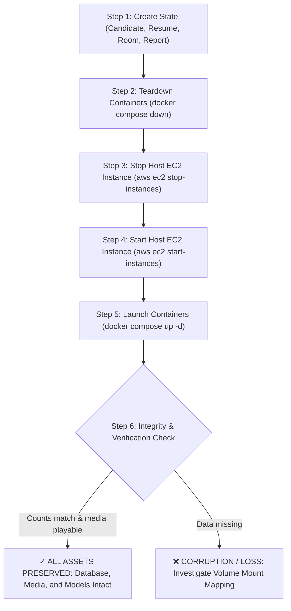

# PLUTO vProctor — Staging Backup, Storage Persistence & Recovery Procedures

**Document Version:** 1.1  
**Target Topology:** Option A — Single EC2 Instance (`g4dn.xlarge`) with Docker Compose  
**Platform Version:** 0.1.0 (Release Candidate 1)  
**Date:** November 2026  

---

## 1. Overview & Objectives

In Option A (single EC2 instance), all persistent state resides on a single machine across Docker volumes and the underlying AWS Elastic Block Store (EBS) volume. A disciplined backup strategy is essential to prevent data loss in the event of hardware degradation, accidental termination, or volume corruption.

### Recovery Targets for Staging:
- **Recovery Point Objective (RPO):** $\le 24\text{ hours}$ (maximum acceptable data loss window).
- **Recovery Time Objective (RTO):** $\le 2\text{ hours}$ (time required to provision a replacement instance and restore state).

---

## 2. Storage Persistence Tiers Breakdown

PLUTO vProctor interacts with four distinct storage tiers on AWS. Understanding the lifecycle and durability of each tier is critical:

| Storage Tier | Underlying Hardware / Technology | Persistence Across Container Recreation? | Persistence Across EC2 Stop / Start? | Persistence Across EC2 Termination? | Appropriate PLUTO Workload |
|---|---|---|---|---|---|
| **EBS Persistent Storage** | AWS Elastic Block Store (`gp3` SSD attached volume) | **YES** | **YES** | **YES** (if `DeleteOnTermination=false` or snapshotted) | **All Primary Data:** PostgreSQL tables (`pgdata`), Resumes & Video recordings (`storage_data`), Ollama model weights (`ollamadata`). |
| **S3 Object Storage** | AWS Simple Storage Service (Multi-AZ durable) | **YES** | **YES** | **YES** (Independently durable 99.999999999%) | **Offsite Backups:** Daily compressed `pg_dump` SQL archives and media volume sync. |
| **Local NVMe Instance Storage** | Physical host NVMe SSD (1x 125 GiB on `g4dn.xlarge`) | **YES** (while running) | **NO (DATA IS WIPED)** | **NO (DATA IS WIPED)** | **Ephemeral Scratch Only:** Temporary FFmpeg chunk transcoding (`/tmp/ffmpeg_scratch`) or swap. **ZERO application state.** |
| **Container Writable Layer** | Docker `overlay2` storage driver | **NO (WIPED on container recreation)** | **YES** (if container not recreated) | **NO** | **Stateless logs and transient execution cache only.** |

### 2.1 Confirmation of Persistence Guarantees
- **PostgreSQL Data:** Stored in the Docker named volume `pgdata`, which maps to `/var/lib/docker/volumes/pluto-vproctor_pgdata/_data` on the persistent EBS volume. Survives `docker compose down`, container rebuilds, and EC2 stops/starts.
- **Resumes and Recordings:** Stored in the Docker named volume `storage_data`, mapping to `/app/storage` inside the backend container and `/var/lib/docker/volumes/pluto-vproctor_storage_data/_data` on EBS. All candidate PDF resumes, audio chunks, and video recordings survive container teardown and EC2 reboot/stop cycles.
- **Ollama LLM Model Weights:** Stored in `ollamadata`, mapping to `/root/.ollama` on EBS. The 2.0 GB `qwen2.5:3b` model download is cached permanently and does not need to be re-downloaded when containers restart.
- **Zero Reliance on Ephemeral NVMe:** The 125 GiB instance store (`/dev/nvme1n1`) is strictly non-persistent across instance stop/start cycles. No Docker volumes or database paths are mounted to this drive.

---

## 3. Persistent Assets Inventory

```text
[ PLUTO Persistent State Assets on EBS ]
├── 1. Relational Database Records (PostgreSQL pgdata volume)
│   ├── Accounts, Hashed Credentials, Candidate Profiles
│   ├── Question Sets, Verified Questions (1,799 items)
│   ├── Interview Sessions (14 legacy + staging sessions)
│   └── Telemetry Metrics, Proctoring Events, and Audit Logs
│
├── 2. Filesystem Media & Document Storage (storage_data volume)
│   ├── Candidate Resumes (/app/storage/resumes/*.pdf)
│   ├── Video Recordings (/app/storage/recordings/*.webm)
│   ├── Audio Chunks (/app/storage/audio/*.wav)
│   └── Compiled PDF Reports (/app/storage/reports/*.pdf)
│
└── 3. AI Model Weights (ollamadata volume)
    └── Cached Qwen2.5:3b GGUF weights (~2.0 GB in /root/.ollama)
```

---

## 4. Automated Backup Procedures

### 4.1 Logical PostgreSQL Database Backup (`pg_dump`)
Execute daily automated database dumps compressed and synchronized to an Amazon S3 staging backup bucket:

```bash
#!/bin/bash
# /opt/scripts/backup_postgres.sh
set -euo pipefail

BACKUP_DIR="/opt/backups/postgres"
TIMESTAMP=$(date +"%Y%m%d_%H%M%S")
BACKUP_FILE="${BACKUP_DIR}/pluto_db_${TIMESTAMP}.sql.gz"
S3_BUCKET="s3://pluto-staging-backups"

mkdir -p "${BACKUP_DIR}"

echo "[$(date)] Starting PostgreSQL database backup..."
docker exec pluto-postgres pg_dump -U pluto_user -d pluto_db -Z 9 > "${BACKUP_FILE}"

echo "[$(date)] Uploading to S3: ${S3_BUCKET}/db/..."
aws s3 cp "${BACKUP_FILE}" "${S3_BUCKET}/db/pluto_db_${TIMESTAMP}.sql.gz"

# Retain local backups on EBS for 7 days
find "${BACKUP_DIR}" -type f -name "*.sql.gz" -mtime +7 -delete

echo "[$(date)] Database backup completed successfully."
```

### 4.2 Media & Storage Volume Backup
Synchronize uploaded resumes, recordings, and generated reports to S3:

```bash
#!/bin/bash
# /opt/scripts/backup_media.sh
set -euo pipefail

S3_BUCKET="s3://pluto-staging-backups"
STORAGE_DIR="/var/lib/docker/volumes/pluto-vproctor_storage_data/_data"

echo "[$(date)] Syncing media storage volume to S3..."
aws s3 sync "${STORAGE_DIR}" "${S3_BUCKET}/media_storage/" --delete

echo "[$(date)] Media storage sync completed."
```

### 4.3 EBS Block-Level Snapshots (AWS Data Lifecycle Manager)
Configure AWS Data Lifecycle Manager (DLM) to automatically snapshot the 100 GB EBS volume:
- **Policy Type:** EBS Snapshot Lifecycle Policy.
- **Target Volume Tag:** `Environment = Staging`, `Application = PLUTO-vProctor`.
- **Schedule:** Daily at 02:00 UTC.
- **Retention:** Keep 14 daily snapshots.

---

## 5. Practical Disaster Recovery & Verification Procedure

To verify storage persistence and validate recovery procedures in staging, execute the following empirical recovery drill:



### Step-by-Step Drill Execution:
1. **Generate State:** Register a test candidate account, upload a test PDF resume, complete an interview session, and confirm the evaluation report is generated.
2. **Stop Containers:**
   ```bash
   docker compose down
   ```
3. **Simulate Instance Stop:** Stop the instance via AWS CLI:
   ```bash
   aws ec2 stop-instances --instance-ids i-xxxxxxx
   ```
4. **Wait 5 Minutes & Start Instance:**
   ```bash
   aws ec2 start-instances --instance-ids i-xxxxxxx
   ```
5. **SSH & Relaunch Containers:**
   ```bash
   cd /opt/PLUTO-vProctor
   docker compose up -d
   ```
6. **Verify Data Persistence:**
   - Run SQL verification:
     ```bash
     docker exec -it pluto-postgres psql -U pluto_user -d pluto_db -c "SELECT count(*) FROM questions;"
     # Must return exactly 1799
     docker exec -it pluto-postgres psql -U pluto_user -d pluto_db -c "SELECT count(*) FROM sessions;"
     # Must return >= 15 (14 legacy + test session)
     ```
   - Verify media files exist on disk:
     ```bash
     ls -la /var/lib/docker/volumes/pluto-vproctor_storage_data/_data/resumes/
     ls -la /var/lib/docker/volumes/pluto-vproctor_storage_data/_data/recordings/
     ```
   - Verify Ollama model is cached without redownloading:
     ```bash
     docker exec -it pluto-ollama ollama list
     # Must show qwen2.5:3b immediately without network transfer
     ```

---

## 6. Disaster Recovery Runbook (Total Instance Loss)

If the EC2 instance is terminated or suffers unrecoverable hypervisor failure:

1. **Step 1: Launch Replacement EC2:** Launch a new `g4dn.xlarge` instance in the staging subnet. Attach the staging Elastic IP.
2. **Step 2: Install Runtime:** Run base setup (NVIDIA Driver 535+, Docker, NVIDIA Container Toolkit).
3. **Step 3: Clone Code & Configure:** Clone repo to `/opt/PLUTO-vProctor` and restore `.env`.
4. **Step 4: Restore Data Volumes from S3:**
   ```bash
   docker volume create pluto-vproctor_storage_data
   docker volume create pluto-vproctor_pgdata

   # Restore media files
   aws s3 sync s3://pluto-staging-backups/media_storage/ /var/lib/docker/volumes/pluto-vproctor_storage_data/_data/

   # Launch postgres and restore database
   docker compose up -d postgres
   sleep 10
   aws s3 cp s3://pluto-staging-backups/db/latest.sql.gz - | zcat | docker exec -i pluto-postgres psql -U pluto_user -d pluto_db
   ```
5. **Step 5: Pull Model & Start:**
   ```bash
   docker compose up -d ollama
   docker exec -it pluto-ollama ollama pull qwen2.5:3b
   docker compose up -d
   ```
6. **Step 6: Confirm Recovery:** Verify `/api/health` and verify 1,799 questions and candidate sessions are accessible.
