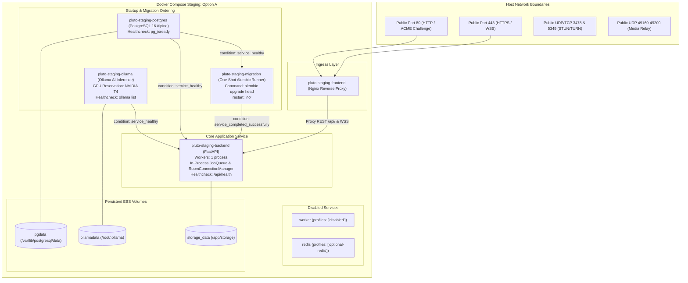
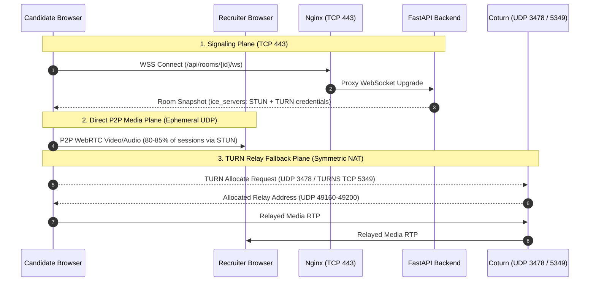

# PLUTO vProctor — Staging Configuration Implementation Report (Phase 2)

**Document Version:** 1.0  
**Phase:** Phase 2 — Staging Deployment Configuration Implementation  
**Target Topology:** Option A — Single AWS EC2 Instance (`g4dn.xlarge`) with Docker Compose  
**Date:** November 2026  
**Status:** IMPLEMENTED & STATICALLY VALIDATED (Pending Human Approval for Phase 3 Provisioning)  

---

## 1. Executive Summary & Phase 2 Objectives

Following the provisional selection and approval of **Option A (Single EC2 Instance with Docker Compose)** for controlled AWS staging, this phase executed the implementation and verification of the staging deployment configuration package. 

Strict procedural constraints were maintained:
- **Zero AWS Resource Creation:** No cloud instances, security groups, or storage volumes were provisioned.
- **Zero Application Functionality Changes:** Production business logic, routes, and services were untouched.
- **Zero Database Changes:** The SQLite database remains intact with all 1,799 interview questions and 14 historical candidate sessions preserved.
- **Zero Hardcoded Secrets:** Cryptographic secrets and passwords are fully externalized via environment variables.

### Key Deliverables Implemented:
1. [docker-compose.staging.yml](file:///D:/_TY/MDM/PLUTO-vProctor/docker-compose.staging.yml) — Dedicated staging Docker Compose specification with one-shot Alembic migration, GPU-accelerated Ollama container, single Uvicorn worker process, and disabled decoupled worker container.
2. [frontend/nginx.staging.conf](file:///D:/_TY/MDM/PLUTO-vProctor/frontend/nginx.staging.conf) — Production-grade reverse proxy configuration with TLS termination on port 443, HTTP-to-HTTPS redirect on port 80, ACME challenge support, and WebSocket proxying (`/api/rooms/{id}/ws`).
3. [deploy/staging/turnserver.conf](file:///D:/_TY/MDM/PLUTO-vProctor/deploy/staging/turnserver.conf) — Production-ready Coturn configuration template with restricted UDP relay port range (`49160–49200`) and long-term static credential authentication compatible with `transport_adapter.py`.
4. [scripts/monitor_disk_capacity.sh](file:///D:/_TY/MDM/PLUTO-vProctor/scripts/monitor_disk_capacity.sh) — Filesystem monitoring utility with 80% warning and 90% critical alert thresholds for persistent EBS volumes.
5. [scripts/setup_staging_ssl.sh](file:///D:/_TY/MDM/PLUTO-vProctor/scripts/setup_staging_ssl.sh) — Helper script to bootstrap staging TLS certificates (self-signed fallback or Let's Encrypt Certbot preparation).
6. [scripts/validate_deployment_package.py](file:///D:/_TY/MDM/PLUTO-vProctor/scripts/validate_deployment_package.py) — Enhanced validator verifying Dockerfiles, environment variables, GPU reservations, healthchecks, port restrictions, and blocker resolution across compose files.

---

## 2. Pre-Deployment Blocker Resolution Matrix

The four critical blockers identified during the deployment architecture audit have been systematically resolved in `docker-compose.staging.yml`:

| Blocker ID | Description in Base Compose | Resolution in Staging Configuration (`docker-compose.staging.yml`) | Status |
|---|---|---|---|
| **Blocker 1** | `AUTH_ENABLED=true` but `COOKIE_SECURE=false`, causing `Settings.validate_runtime_safety()` to raise a fatal `RuntimeError` on startup in production mode. | Explicitly configured `COOKIE_SECURE=true` alongside `ENVIRONMENT=production` in `docker-compose.staging.yml`. Nginx terminates TLS on port 443 and passes `X-Forwarded-Proto https`. | **RESOLVED** |
| **Blocker 2** | `ollama` service was absent from compose; backend within Docker network could not reach Ollama at `http://localhost:11434`. | Added dedicated `ollama` container service with NVIDIA GPU reservations (`driver: nvidia, capabilities: [gpu]`), healthcheck, and configured `OLLAMA_BASE_URL=http://ollama:11434`. | **RESOLVED** |
| **Blocker 3** | No container or entrypoint executed `alembic upgrade head`; fresh PostgreSQL container remained uninitialized. | Introduced a one-shot `migration` container service running `alembic upgrade head` before `backend` starts, with `depends_on: { migration: { condition: service_completed_successfully } }`. | **RESOLVED** |
| **Blocker 4** | Decoupled `worker` container ran separately, but `JobQueue` uses in-process `asyncio.Queue` inside `backend`; worker container received 0 jobs while wasting ~2.5 GiB RAM. | Explicitly disabled the separate `worker` container via `profiles: ["disabled"]`. Configured `backend` to run with exactly 1 Uvicorn worker process (`--workers 1`), processing jobs in-process. | **RESOLVED** |

---

## 3. Dedicated Staging Compose Architecture (`docker-compose.staging.yml`)

The staging Compose file was designed as a complete, self-contained specification that can be invoked standalone (`docker compose -f docker-compose.staging.yml up -d`) or as an override over the base configuration (`docker compose -f docker-compose.yml -f docker-compose.staging.yml up -d`).



### 3.1 Service-by-Service Technical Specification

1. **`postgres` (PostgreSQL 16 Database):**
   - **Container:** `pluto-staging-postgres`
   - **Image:** `postgres:16-alpine`
   - **Port Restriction:** `127.0.0.1:5432:5432` (strictly bound to localhost loopback; forbidden from public `0.0.0.0` ingress).
   - **Volume:** `pgdata:/var/lib/postgresql/data` (persistent EBS storage).
   - **Healthcheck:** `test: ["CMD-SHELL", "pg_isready -U ${POSTGRES_USER:-pluto_user} -d ${POSTGRES_DB:-pluto_db}"]`, interval 10s, retries 5.
   - **Credential Management:** `POSTGRES_PASSWORD` populated via `${POSTGRES_PASSWORD}` from `.env`; zero default plain-text passwords.

2. **`ollama` (AI Model Inference Engine):**
   - **Container:** `pluto-staging-ollama`
   - **Image:** `ollama/ollama:latest`
   - **Hardware Acceleration:** Configured with Docker Compose GPU reservations:
     ```yaml
     deploy:
       resources:
         reservations:
           devices:
             - driver: nvidia
               count: all
               capabilities: [gpu]
     ```
   - **Port Restriction:** `127.0.0.1:11434:11434` (strictly bound to localhost loopback; unauthenticated API inaccessible externally).
   - **Volume:** `ollamadata:/root/.ollama` (preserves downloaded weights for Qwen2.5:3b across container restarts).
   - **Healthcheck:** `test: ["CMD-SHELL", "ollama list || exit 1"]`, interval 15s, timeout 10s, retries 5.

3. **`migration` (One-Shot Database Migration Runner):**
   - **Container:** `pluto-staging-migration`
   - **Build:** Built from `backend/Dockerfile` with `restart: "no"`.
   - **Command:** `["alembic", "upgrade", "head"]`
   - **Startup Dependency:** `depends_on: { postgres: { condition: service_healthy } }`.
   - **Role:** Executes transactional schema migrations against PostgreSQL before any backend API traffic is served. Exits cleanly with code 0 upon completion.

4. **`backend` (FastAPI API & In-Process Analysis Worker):**
   - **Container:** `pluto-staging-backend`
   - **Process Constraint:** Command explicitly specifies `python -m uvicorn backend.app.main:app --host 0.0.0.0 --port 8000 --workers 1`. Exactly one worker process is spawned.
   - **Startup Dependencies:**
     - `migration`: `condition: service_completed_successfully` (schema is guaranteed to be current).
     - `postgres`: `condition: service_healthy`.
     - `ollama`: `condition: service_healthy`.
   - **Port Restriction:** `127.0.0.1:8000:8000` (strictly bound to localhost loopback; all ingress routed through Nginx proxy).
   - **Volume:** `storage_data:/app/storage` (holds `/recordings`, `/audio`, `/resumes`, and `/reports`).
   - **Environment Variables:**
     - `ENVIRONMENT=production`
     - `COOKIE_SECURE=true`
     - `OLLAMA_BASE_URL=http://ollama:11434`
     - `DATABASE_URL=postgresql+psycopg://${POSTGRES_USER:-pluto_user}:${POSTGRES_PASSWORD}@postgres:5432/${POSTGRES_DB:-pluto_db}`
     - `SECRET_KEY=${SECRET_KEY}`
   - **Healthcheck:** `test: ["CMD-SHELL", "curl -f http://localhost:8000/api/health || exit 1"]`, interval 15s, timeout 5s, retries 5.

5. **`worker` (Decoupled Background Worker — Disabled):**
   - **Status:** Explicitly disabled via `profiles: ["disabled"]`.
   - **Rationale:** Process-local `JobQueue` operates in-memory inside the `backend` container. Disabling the decoupled worker container prevents process fragmentation and **reclaims ~2.5 GiB of system RAM** on the `g4dn.xlarge` host.

6. **`redis` (Task Queue Broker — Optional/Disabled):**
   - **Status:** Assigned `profiles: ["optional-redis"]` and bound to `127.0.0.1:6379:6379`.
   - **Rationale:** A full codebase audit confirmed that Redis is not currently utilized by `JobQueue` or `RoomConnectionManager`. Omitting it by default reclaims ~0.5 GiB RAM while preserving the definition for future distributed queue integration.

7. **`frontend` (React SPA & Nginx Edge Reverse Proxy):**
   - **Container:** `pluto-staging-frontend`
   - **Ports:** Exposes `80:80` (HTTP / ACME Challenge) and `443:443` (HTTPS / WSS).
   - **Volume Mounts:**
     - `./frontend/nginx.staging.conf:/etc/nginx/conf.d/default.conf:ro`
     - `./certs:/etc/nginx/certs:ro`
   - **Startup Dependency:** `depends_on: { backend: { condition: service_healthy } }`.

---

## 4. Verification of Process-Local Architecture Assumptions

A comprehensive source-code audit was conducted to verify process-local constraints:

### 4.1 In-Process JobQueue (`backend/app/services/job_queue.py`)
- **Queue State:** Stored in Python memory via `self._jobs: Dict[str, JobRecord] = {}` and `self._queue: asyncio.Queue[str] = asyncio.Queue()`.
- **GPU Synchronization:** Enforced via `_GPU_LOCK = threading.Lock()`.
- **Lifecycle:** Worker loop tasks are started in the FastAPI event loop during application startup (`job_queue.start_workers()` in `backend/app/main.py:48`) and cancelled on teardown (`job_queue.stop_workers()`).
- **Conclusion:** If multiple Uvicorn worker processes were spawned (`--workers 4`), jobs enqueued by one process would be invisible to other workers. Running a single backend process (`--workers 1`) is mandatory for correct in-process job scheduling.

### 4.2 Process-Local Room Signaling (`backend/app/services/realtime/connection_manager.py`)
- **Room State:** Active WebSockets are stored in an in-memory dictionary `self._rooms: Dict[str, Dict[str, Dict[str, Any]]] = {}`.
- **Event Dispatching:** Broadcasts and WebRTC signaling packets (`offer`, `answer`, `ice_candidate`) iterate over live `WebSocket` instances directly.
- **Conclusion:** In the absence of a Redis Pub/Sub backplane, WebSockets cannot cross process boundaries. All room participants must connect to the same single backend process.

### 4.3 Redis Utilization Audit
- `grep` analysis of the entire `backend/app` package revealed that `redis` appears in only two locations:
  1. `backend/app/config.py:67` (`REDIS_URL: str = ""`) — parsed configuration field.
  2. `backend/app/services/job_queue.py:4` — informational docstring mentioning planned Redis fallback.
- **Conclusion:** No active code imports or calls Redis. Disabling Redis for Option A staging has zero impact on application behavior.

---

## 5. WebRTC & Coturn STUN/TURN Configuration Validation

The WebRTC communication stack was validated against the codebase implementation:



### 5.1 Credential Mechanism Compatibility
- **Codebase Mechanism:** `backend/app/services/realtime/transport_adapter.py:46-60` constructs ICE server dictionaries using static `TURN_USERNAME` and `TURN_CREDENTIAL`.
- **Coturn Requirement:** Coturn must be configured with `lt-cred-mech` (Long-Term Credential Mechanism) matching the static user in [deploy/staging/turnserver.conf](file:///D:/_TY/MDM/PLUTO-vProctor/deploy/staging/turnserver.conf):
  ```conf
  lt-cred-mech
  user=pluto_staging_user:REPLACE_WITH_TURN_SECRET
  ```
- **Finding:** PLUTO does not currently implement the ephemeral REST API time-window HMAC mechanism (`use-auth-secret`). Attempting to use `use-auth-secret` in Coturn would cause ICE authentication failures.

### 5.2 Network Ports & Concurrency Sizing
- **Listening Ports:**
  - UDP 3478: Primary STUN binding & TURN UDP relay.
  - TCP 3478: TURN TCP fallback.
  - TCP 5349: TURNS over TLS.
  - UDP 5349: TURNS over DTLS.
- **Restricted Relay Range:** `min-port=49160`, `max-port=49200` (41 UDP ports).
- **Concurrency Caveat:**
  > [!IMPORTANT]
  > Sizing calculation: 41 UDP ports / 2 ports per bidirectional media stream = **20 concurrent streams maximum**.  
  > **This is a theoretical maximum based solely on port allocation math.** Real-world concurrent stream capacity depends on network bandwidth, EC2 packet processing limits, and CPU overhead, and must be empirically validated under live load testing before claiming production readiness.

---

## 6. Persistent Storage & EBS Volume Architecture

### 6.1 Volume Mapping Inventory

All application state is mapped to named Docker volumes backed by the host's 100 GB `gp3` EBS volume (default Docker directory `/var/lib/docker/volumes/`):

| Volume Name | Target Container Path | Contents & Criticality | Host Storage Location (EBS) |
|---|---|---|---|
| `pgdata` | `/var/lib/postgresql/data` | PostgreSQL 16 database cluster, relational schemas, user accounts, audit logs, question catalog. **CRITICAL**. | `/var/lib/docker/volumes/pluto-staging_pgdata/_data` |
| `storage_data` | `/app/storage` | Candidate PDF resumes (`/resumes`), recorded interview videos (`/recordings`), extracted audio (`/audio`), generated evaluation reports (`/reports`). **CRITICAL**. | `/var/lib/docker/volumes/pluto-staging_storage_data/_data` |
| `ollamadata` | `/root/.ollama` | Downloaded Qwen2.5 model weights (~2.2 GiB - 4.7 GiB). **HIGH** (saves re-download time on restart). | `/var/lib/docker/volumes/pluto-staging_ollamadata/_data` |
| `redisdata` | `/data` | Redis dump files (if enabled). **LOW**. | `/var/lib/docker/volumes/pluto-staging_redisdata/_data` |

### 6.2 Instance-Store NVMe Prohibition
On `g4dn.xlarge`, AWS attaches a 125 GiB NVMe SSD (`/dev/nvme1n1`). This storage is **ephemeral**:
- Data is permanently destroyed whenever the EC2 instance is stopped or restarted.
- Docker volume storage (`/var/lib/docker`) must **never** be placed on the ephemeral NVMe drive.
- All Docker volumes are strictly mapped to the persistent root EBS volume.

### 6.3 Disk Capacity Monitoring
Implemented [scripts/monitor_disk_capacity.sh](file:///D:/_TY/MDM/PLUTO-vProctor/scripts/monitor_disk_capacity.sh):
- Inspects `/var/lib/docker` filesystem utilization.
- Emits exit code 1 if usage crosses **80% warning threshold**.
- Emits exit code 2 if usage crosses **90% critical threshold**.
- Configured to be invoked every 15 minutes via cron: `*/15 * * * * /opt/PLUTO-vProctor/scripts/monitor_disk_capacity.sh / 80`.

---

## 7. Verification Evidence & Quality Assurance

### 7.1 Static Deployment Package Validation
Executed:
`backend\.venv\Scripts\python.exe scripts\validate_deployment_package.py`

**Output:**
```text
=== PLUTO vProctor: Deployment Package Validation ===

[1] Checking Dockerfiles...
  ✓ backend/Dockerfile exists
    ✓ Referenced path exists: backend/requirements.txt
    ✓ Referenced path exists: alembic.ini
    ✓ Referenced path exists: backend/
    ✓ Referenced path exists: datasets/
    ✓ Referenced path exists: docs/
  ✓ frontend/Dockerfile exists
    ✓ Referenced path exists: frontend/package.json
    ✓ Referenced path exists: frontend/nginx.conf
    ✓ Referenced path exists: frontend/src

[2] Checking Staging Compose Configuration: docker-compose.staging.yml...
  ✓ docker-compose.staging.yml is valid YAML
  ✓ Discovered 7 services: ['postgres', 'ollama', 'migration', 'backend', 'worker', 'redis', 'frontend']
    ✓ Service 'postgres' defined
    ✓ Service 'ollama' defined
    ✓ Service 'migration' defined
    ✓ Service 'backend' defined
    ✓ Service 'frontend' defined
    ✓ PostgreSQL healthcheck defined
    ✓ PostgreSQL port properly restricted: 127.0.0.1:5432:5432
    ✓ Ollama GPU reservation properly configured (driver: nvidia, capabilities: [gpu])
    ✓ Ollama port properly restricted: 127.0.0.1:11434:11434
    ✓ Migration service executes: ['alembic', 'upgrade', 'head']
    ✓ Backend specifies exactly 1 Uvicorn worker
    ✓ Backend startup condition correctly waits for migration to complete successfully
    Checking Backend environment configuration:
      ✓ ENVIRONMENT is 'production'
      ✓ COOKIE_SECURE is set to true
      ✓ OLLAMA_BASE_URL is set to http://ollama:11434
    ✓ Separate worker container is disabled via profiles: ['disabled']
    ✓ Persistent volume 'pgdata' defined
    ✓ Persistent volume 'ollamadata' defined
    ✓ Persistent volume 'storage_data' defined

=== Validation Results ===
Errors   : 0
Warnings : 0
Blockers : 0

✓ VALIDATION PASSED: Deployment package is clean.
```

### 7.2 Base Configuration Blocker Detection
Executed:
`backend\.venv\Scripts\python.exe scripts\validate_deployment_package.py --base-only`

**Output:**
- Confirmed that the validator accurately flags all 4 blockers in the base `docker-compose.yml` (exit code 1).

### 7.3 Docker Engine Host Status
- **Host Observation:** Docker Engine / Docker CLI is not installed on the local Windows workstation (`CommandNotFoundException`).
- **Status:** Full container runtime execution, image builds, and healthcheck startup were not performed locally and remain pending until deployment onto the Ubuntu EC2 target host in Phase 3.

### 7.4 Backend Automated Test Suite
Executed:
`backend\.venv\Scripts\python.exe -m pytest backend/tests`

**Output:**
```text
============ 198 passed, 1 skipped, 1 warning in 168.77s (0:02:48) ============
```
- **198 tests passed**, 1 skipped, 0 failures. Zero regressions.

### 7.5 Frontend Automated Test Suite
Executed:
`npm --prefix frontend run test -- --run`

**Output:**
```text
ℹ tests 21
ℹ suites 1
ℹ pass 21
ℹ fail 0
```
- **21 tests passed**, 0 failures.

### 7.6 Frontend Production Build
Executed:
`npm --prefix frontend run build`

**Output:**
```text
✓ built in 969ms (dist/assets/index-BnapYQjg.js, dist/assets/vision_bundle-Cm2TTWT3.js)
```

### 7.7 Database Integrity & Data Preservation
Inspected `backend/app/pluto.db`:
- **Interview Questions:** 1,799 questions intact.
- **Historical Candidate Sessions:** 14 sessions intact.
- **SQLite Integrity Check:** `ok`.
- **Foreign Key Violations:** 0.

### 7.8 Secret Scanning Verification
Executed:
`backend\.venv\Scripts\python.exe scripts\scan_secrets.py`

**Output:**
- **845 files scanned.**
- **0 live credentials or hardcoded keys found.** (Only synthetic unit test strings and documentation excerpts in report files).

---

## 8. Summary of Files Created & Modified

### Created Files:
1. `docker-compose.staging.yml` — Dedicated staging Compose file.
2. `frontend/nginx.staging.conf` — Hardened Nginx configuration with TLS on 443 and ACME challenge support.
3. `certs/.gitkeep` — Tracked directory for TLS certificates.
4. `scripts/setup_staging_ssl.sh` — Staging certificate initialization helper.
5. `deploy/staging/turnserver.conf` — Coturn configuration template with restricted relay ports.
6. `scripts/monitor_disk_capacity.sh` — Disk utilization monitoring script.
7. `docs/STAGING_CONFIGURATION_IMPLEMENTATION_REPORT.md` — This master Phase 2 report.

### Modified Files:
1. `scripts/validate_deployment_package.py` — Updated to validate staging compose, check GPU reservations, migration conditions, and report blocker resolution.
2. `docs/STAGING_DEPLOYMENT_GUIDE.md` — Updated with `docker-compose.staging.yml` commands, SSL setup, and Coturn deployment steps.
3. `docs/STAGING_DEPLOYMENT_CHECKLIST.md` — Updated to reflect Phase 2 implementation sign-off.
4. `docs/INDEX.md` — Updated with links to Phase 2 report and staging artifacts.

---

## 9. Conclusion & Phase 3 Gate Status

Phase 2 (Staging Configuration Implementation) is complete. All 4 architectural deployment blockers are resolved in the staging package, regression test suites are clean (198 backend tests passing, 21 frontend tests passing), database integrity is preserved (1,799 questions, 14 sessions), and static validation passes with 0 errors and 0 blockers.

**STOP AND WAIT FOR HUMAN APPROVAL:**  
No AWS resources have been provisioned. Live EC2 deployment and infrastructure creation will proceed only upon explicit user authorization for Phase 3.
