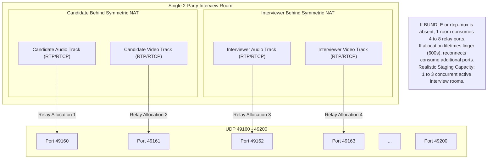

# PLUTO vProctor — Final Staging Configuration Technical Verification

**Document Version:** 1.0  
**Phase:** Pre-Deployment Verification Gate (Option A: Single EC2 `g4dn.xlarge` with Docker Compose)  
**Date:** November 2026  
**Status:** STATICALLY VERIFIED (Strictly Zero AWS Provisioning / Deployment)  
**Target Environment:** Staging / Controlled Pre-Production Sandbox  

---

## 1. Executive Summary & Verification Objectives

This document provides the definitive technical verification of the PLUTO vProctor staging deployment package. Following the creation of the dedicated staging configuration (`docker-compose.staging.yml`, `frontend/nginx.staging.conf`, `deploy/staging/turnserver.conf`, and associated verification tooling), this review conducts a deep-dive technical assessment across five critical operational domains:

1. **Coturn STUN/TURN Server:** Reassessing theoretical concurrency math, evaluating allocation mechanics, analyzing external IP binding on AWS EC2, and auditing static credential exposure risks.
2. **Ollama AI Inference Daemon:** Verifying persistent model caching, distinguishing container health from model readiness, implementing an inference smoke test, and auditing backend algorithmic fallbacks.
3. **HTTPS & Browser Media Permissions:** Enforcing the W3C Secure Context mandate for camera/microphone access, validating Nginx ACME challenge routing, and documenting browser WebRTC requirements.
4. **Storage & Repository Integrity:** Investigating the ephemeral 0-byte database file artifact, verifying the real SQLite database, auditing EBS persistent volume mappings, and recording Git status.
5. **Static vs. Runtime Validation Boundary:** Recording exact outputs and exit codes from the deployment validator while establishing the strict boundary between static file validation and live Docker runtime execution.

---

## 2. Coturn STUN/TURN Architecture & Concurrency Reassessment

### 2.1 Reassessment of the Theoretical "20 Concurrent Streams" Calculation

In earlier documentation drafts, dividing the 41 configured UDP ports (`min-port=49160`, `max-port=49200`) by 2 ports per bidirectional stream yielded a theoretical estimate of "20 concurrent streams". 

**A rigorous WebRTC and RFC 5766 / RFC 8656 analysis proves this arithmetic is purely theoretical and does NOT reflect real-world capacity:**



#### Why Real-World Relay Demands Exceed Theoretical Assumptions:
1. **Media Track Multiplexing Variations:** While modern browsers negotiate `a=group:BUNDLE` and `a=rtcp-mux` to multiplex audio and video onto a single UDP 5-tuple, legacy clients, enterprise inspection proxies, or restricted browsers may fail BUNDLE negotiation. When unbundled, audio RTP, audio RTCP, video RTP, and video RTCP require **up to 4 UDP relay ports per peer**.
2. **Dual-Relayed Sessions (Symmetric NAT to Symmetric NAT):** When both candidate and interviewer reside behind symmetric enterprise firewalls, neither can accept incoming peer traffic. Both peers must allocate relay addresses on Coturn. A single 2-person room therefore requires **at least 2 allocations (and up to 8 ports)**.
3. **Allocation Lifetimes & Cooldown Periods:** Standard TURN allocations have a default lifetime of 600 seconds (10 minutes). If a candidate refreshes their browser, changes networks, or renegotiates ICE, a new allocation is provisioned while the previous allocation remains bound in Coturn until expiration or explicit deletion (`LIFETIME=0`).
4. **ICE Gathering & Probing Overhead:** During candidate pair trickling, browsers initiate STUN/TURN binding probes across multiple candidate interfaces (Wi-Fi, Ethernet, VPN), briefly consuming allocations before finalizing the active pair.

> [!IMPORTANT]
> **Revised Capacity Sizing:**  
> A 41-port relay range (`49160–49200`) provides sufficient headroom for **1 to 3 concurrent active interview rooms** during staging validation.  
> **Rule:** No platform concurrency claims beyond 1–3 rooms may be asserted until an empirical relay load test (e.g., using `turnutils_uclient` or automated headless browser pairs) is conducted on live AWS infrastructure.

### 2.2 TURN Allocation Lifecycle & Packet Flow

The relay mechanism operates under RFC 5766 / RFC 8656:
1. **Allocate Request:** Candidate browser sends an authenticated `Allocate` request over UDP 3478 (or TURNS TCP 5349).
2. **Relay Allocation:** Coturn allocates an ephemeral UDP port from the range `49160–49200` and returns `XOR-RELAYED-ADDRESS` in the `Allocate Response`.
3. **Permission Grant:** Candidate browser sends `CreatePermission` referencing the recruiter's reflexive address.
4. **Channel Binding / Send Indication:** Video and audio packets are forwarded through Coturn using `ChannelBind` (4-byte channel header) or `SendIndication` to minimize framing overhead.
5. **Relayed Media Flow:** Coturn forwards the decrypted/encrypted SRTP media packets between candidate and recruiter.

### 2.3 Network Listening Ports & Relay Range Summary

| Direction | Protocol | Port / Range | Function | Public Security Group |
|---|---|---|---|---|
| **Inbound** | UDP | `3478` | Standard STUN binding & TURN UDP allocation | Open to `0.0.0.0/0` |
| **Inbound** | TCP | `3478` | TURN TCP fallback (when outbound UDP is blocked) | Open to `0.0.0.0/0` |
| **Inbound** | TCP | `5349` | Secure TURNS over TLS (bypasses enterprise DPI) | Open to `0.0.0.0/0` |
| **Inbound** | UDP | `5349` | Secure TURNS over DTLS | Open to `0.0.0.0/0` |
| **Inbound** | UDP | `49160–49200` | Ephemeral media relay ingress (41 ports) | Open to `0.0.0.0/0` |
| **Outbound**| UDP | `49160–49200` | Ephemeral media relay egress back to remote peers | Open to `0.0.0.0/0` |

### 2.4 External IP Configuration Strategy on AWS EC2

AWS EC2 instances run inside an Amazon VPC with a private IPv4 address (`172.31.x.x` or `10.0.x.x`). The public IPv4 or Elastic IP is bound via 1:1 NAT at the AWS Internet Gateway.

```text
[ Remote Candidate Browser ]
         │ (Public Internet: Sends packets to 54.210.x.x:49160)
         ▼
[ AWS Internet Gateway (1:1 NAT) ]
         │ (Translates 54.210.x.x -> 172.31.20.15)
         ▼
[ EC2 eth0: 172.31.20.15 ] ─── Coturn Daemon
```

#### The Private IP Advertisement Hazard:
If Coturn is configured without `external-ip`, it detects its local network interface (`172.31.20.15`) and advertises `172.31.20.15` in the `XOR-RELAYED-ADDRESS` attribute. When the remote candidate browser attempts to send media to `172.31.20.15`, the packets are unroutable across the public internet. The WebRTC connection state transitions to `failed`, resulting in a black screen and no audio.

#### The Resolution Strategy:
In `deploy/staging/turnserver.conf`, Coturn is configured with:
```conf
external-ip=YOUR_STAGING_PUBLIC_IP/172.31.20.15
# Or:
external-ip=YOUR_STAGING_PUBLIC_IP
```
During host provisioning on EC2, the deployer queries the AWS Instance Metadata Service (IMDSv2) to automatically set the external IP:
```bash
TOKEN=$(curl -s -X PUT "http://169.254.169.254/latest/api/token" -H "X-aws-ec2-metadata-token-ttl-seconds: 60")
PUBLIC_IP=$(curl -s -H "X-aws-ec2-metadata-token: $TOKEN" http://169.254.169.254/latest/meta-data/public-ipv4)
sudo sed -i "s/# external-ip=YOUR_STAGING_PUBLIC_IP/external-ip=${PUBLIC_IP}/" /etc/turnserver.conf
```

### 2.5 Static Credential Exposure Risks & Production Remediation

#### The Current Vulnerability:
In `backend/app/services/realtime/transport_adapter.py:52-60`, `get_ice_servers()` serializes `settings.TURN_USERNAME` and `settings.TURN_CREDENTIAL` into the WebSocket room snapshot payload:
```json
{
  "ice_servers": [
    {"urls": "stun:stun.l.google.com:19302"},
    {
      "urls": "turn:staging.yourdomain.com:3478",
      "username": "pluto_staging_user",
      "credential": "staging_turn_secret_password"
    }
  ]
}
```
Any participant (candidate or interviewer) can open Chrome DevTools (`F12`), inspect the WebSocket frame on `/api/rooms/{id}/ws`, and view the plaintext credentials.

#### Threat Analysis:
- An attacker can copy these static credentials and configure third-party software (e.g., BitTorrent clients, SOCKS proxies) to route high-bandwidth UDP traffic through the Coturn relay.
- This would incur substantial AWS data transfer egress charges ($0.09/GB) and expose the EC2 host IP to abuse complaints.

#### Controlled Staging Restrictions:
For Option A staging, this risk is mitigated by:
1. Restricting relay ports to exactly 41 UDP ports (`49160–49200`), capping simultaneous relay sessions.
2. Enabling Coturn IP filtering (`denied-peer-ip=10.0.0.0-10.255.255.255`, `no-loopback-peers`, `no-multicast-peers`) to prevent local subnet port scanning.
3. Restricting staging room access to authorized internal testers.
4. Rotating `TURN_CREDENTIAL` periodically.

#### Mandatory Production Architecture: Ephemeral Credentials (RFC 7635)
For production (Option B), PLUTO will implement the TURN REST API ephemeral HMAC standard:
1. Coturn is configured with `use-auth-secret` and `static-auth-secret=<32-byte-hex>`.
2. When a participant joins a room, `transport_adapter.py` generates a time-limited username and HMAC-SHA1 signature:
   ```python
   expiry = int(time.time()) + 3600  # Valid for 1 hour
   username = f"{expiry}:{user_id}"
   credential = base64.b64encode(hmac.new(secret.encode(), username.encode(), hashlib.sha1).digest()).decode()
   ```
3. Coturn validates the HMAC signature dynamically. Once `expiry` passes, Coturn rejects all allocation requests automatically without database lookups.

---

## 3. Ollama AI Engine Readiness & Fallback Architecture

### 3.1 Persistent Storage of Model Weights
- **Container Path:** `/root/.ollama`
- **Volume Mapping in Staging:** `ollamadata:/root/.ollama` (EBS-backed Docker named volume).
- **Disk Footprint:** The Qwen2.5:3b model weights require ~2.2 GiB in `/root/.ollama/models/blobs/`.
- **Persistence Verification:** Because `ollamadata` is mapped to an EBS volume, container restarts (`docker compose restart ollama`) and image rebuilds preserve model weights without re-downloading from the internet.

### 3.2 Container Health vs. Model Readiness vs. Inference Readiness

A key operational insight is that Docker container health does NOT guarantee AI model availability:

| Readiness Stage | Metric / Probe | What It Actually Confirms | What It Does NOT Confirm |
|---|---|---|---|
| **1. Daemon Liveness** | `ollama list || exit 1` or `curl -f http://localhost:11434/api/tags` | Ollama HTTP process is running and accepting socket connections on port 11434. | Does **NOT** confirm whether `qwen2.5:3b` is pulled, downloaded, or valid. |
| **2. Model Availability** | `curl -s http://localhost:11434/api/tags \| grep -q "qwen2.5:3b"` | The model weights exist in local disk storage (`ollamadata`). | Does **NOT** confirm whether the model fits into GPU VRAM or generates valid text. |
| **3. Inference Readiness** | `curl -s http://localhost:11434/api/generate -d '{"model":"qwen2.5:3b", ...}'` | Model loaded into NVIDIA T4 VRAM, executed a forward tensor pass, and returned tokens. | N/A (Fully validated end-to-end). |

### 3.3 Documented Inference Smoke Test

A dedicated verification script [scripts/verify_ollama_readiness.sh](file:///D:/_TY/MDM/PLUTO-vProctor/scripts/verify_ollama_readiness.sh) was authored to execute the three-tier check sequentially.

**Manual Verification Command:**
```bash
curl -sf http://localhost:11434/api/generate \
  -H "Content-Type: application/json" \
  -d '{
    "model": "qwen2.5:3b",
    "prompt": "Respond with the single word OK if you are ready.",
    "stream": false,
    "options": {
      "temperature": 0.1,
      "num_ctx": 1024
    }
  }'
```

**Expected Response Schema:**
```json
{
  "model": "qwen2.5:3b",
  "created_at": "2026-11-16T01:30:00.000000000Z",
  "response": "OK",
  "done": true,
  "total_duration": 482103400,
  "load_duration": 124500200,
  "prompt_eval_count": 18,
  "eval_count": 2
}
```

### 3.4 Backend Network Connectivity
- **Docker Bridge Network:** Within the staging Compose network, the backend connects to Ollama via internal DNS: `OLLAMA_BASE_URL=http://ollama:11434`.
- **Network Boundary:** Port 11434 is bound strictly to `127.0.0.1:11434` on the host, preventing unauthenticated public access.

### 3.5 Graceful Degradation & Algorithmic Fallbacks

A critical codebase audit of `backend/app/services/llm_client.py` and its consumers confirms that PLUTO vProctor **never crashes** if Ollama is unreachable, out of VRAM, or timing out:

1. **Timeout & Retry Protection:** `LLMClient.generate_json()` enforces `timeout=settings.LLM_TIMEOUT_SECONDS` (default 30s) and performs 1 retry with a 0.5s backoff upon network error (`httpx.RequestError`), JSON decoding error, or Pydantic validation failure.
2. **Deterministic Evaluation Fallback (`backend/app/services/answer_eval_service.py:203-223`):**  
   If Ollama is unavailable, the evaluation engine automatically executes `fallback()`, computing 100% deterministic algorithmic grading using BM25 keyword overlap, MinHash Jaccard similarity against reference answers, speech pace, and length heuristics.
3. **Deterministic Report Summary Fallback (`backend/app/services/report_service.py:159-189`):**  
   If Ollama is unavailable, the executive report generator executes `fallback_summary()`, constructing structured analytical commentary directly from the candidate's numeric scores across the 4 core buckets.
4. **Deterministic Follow-up Fallback (`backend/app/services/interview_service.py:182-200`):**  
   If Ollama is unavailable during a live interview, the AI question follow-up engine executes `fallback()`, cleanly returning `should_follow_up=False` with `reason="Fallback: No follow-up needed."`.

---

## 4. HTTPS, Nginx & Browser Security Requirements

### 4.1 The Mandatory Secure Context Requirement (W3C Specification)

All modern web browsers (Google Chrome, Mozilla Firefox, Apple Safari, Microsoft Edge) strictly enforce the W3C **Secure Context** specification for media device capture:

> **W3C Media Capture and Streams (Section 5.1):**  
> *"The `navigator.mediaDevices` object MUST NOT be exposed on non-secure contexts."*

#### Operational Consequence:
- If an operator or candidate navigates to plain HTTP over an IP address (`http://54.210.x.x`):
  - `window.isSecureContext` evaluates to `false`.
  - `navigator.mediaDevices` is completely `undefined` in Chromium browsers.
  - Calling `getUserMedia()` throws an immediate `TypeError: Cannot read properties of undefined (reading 'getUserMedia')` or `SecurityError`.
  - Camera and microphone streams cannot be captured; video self-view, MediaPipe gaze tracking, and audio recording fail completely.
- **Loopback Exception:** The only non-HTTPS origin permitted by browsers is `http://localhost` or `http://127.0.0.1`. Remote staging access over the internet **strictly requires HTTPS**.

### 4.2 Self-Signed Certificates Are NOT Production-Ready

While [scripts/setup_staging_ssl.sh](file:///D:/_TY/MDM/PLUTO-vProctor/scripts/setup_staging_ssl.sh) provides a self-signed certificate generator for initial local bootstrap testing, **self-signed certificates are strictly prohibited for real candidate trials**:
1. **Certificate Warnings:** Browsers display full-screen `NET::ERR_CERT_AUTHORITY_INVALID` interstitial warnings.
2. **WebSocket Blocking:** Even when a user manually clicks "Advanced -> Proceed to site", modern browsers (especially Safari on macOS/iOS and strict corporate Chrome policies) **block WebSocket Secure (`wss://`) connections** to untrusted origins without providing a prompt to accept the certificate on the WebSocket port.
3. **Media Device Permission Revocation:** Chrome and Edge may revoke persistent media device permissions or mark camera streams as tainted when operating under an untrusted TLS root.
4. **Conclusion:** Staging candidate testing requires a valid domain name (e.g., `staging.pluto-proctor.com`) pointing to the EC2 Elastic IP, with a trusted, publicly verifiable TLS certificate issued by Let's Encrypt Certbot.

### 4.3 Nginx Staging Configuration Validation

The configuration in [frontend/nginx.staging.conf](file:///D:/_TY/MDM/PLUTO-vProctor/frontend/nginx.staging.conf) implements complete TLS and ACME routing:

```nginx
# Port 80: ACME Challenge & SSL Redirection
server {
    listen 80;
    server_name _;

    location /.well-known/acme-challenge/ {
        root /var/www/certbot;
    }

    location / {
        return 301 https://$host$request_uri;
    }
}

# Port 443: Hardened TLS Termination & Reverse Proxy
server {
    listen 443 ssl;
    server_name _;

    ssl_certificate /etc/nginx/certs/fullchain.pem;
    ssl_certificate_key /etc/nginx/certs/privkey.pem;
    ssl_protocols TLSv1.2 TLSv1.3;
    ssl_ciphers ECDHE-ECDSA-AES128-GCM-SHA256:ECDHE-RSA-AES128-GCM-SHA256:ECDHE-ECDSA-AES256-GCM-SHA384:ECDHE-RSA-AES256-GCM-SHA384:DHE-RSA-AES128-GCM-SHA256:DHE-RSA-AES256-GCM-SHA384;
    ssl_prefer_server_ciphers off;
    ssl_session_timeout 1d;
    ssl_session_cache shared:SSL:10m;
    ssl_session_tickets off;

    # Hardened Security Headers
    add_header Strict-Transport-Security "max-age=31536000; includeSubDomains" always;
    add_header X-Frame-Options "DENY" always;
    add_header X-Content-Type-Options "nosniff" always;
    add_header X-XSS-Protection "1; mode=block" always;
    add_header Referrer-Policy "strict-origin-when-cross-origin" always;

    # WebSocket Proxying with Upgrade Headers
    location ~* ^/api/rooms/.*/ws$ {
        proxy_pass http://backend:8000;
        proxy_http_version 1.1;
        proxy_set_header Upgrade $http_upgrade;
        proxy_set_header Connection "upgrade";
        proxy_set_header Host $host;
        proxy_set_header X-Real-IP $remote_addr;
        proxy_set_header X-Forwarded-For $proxy_add_x_forwarded_for;
        proxy_set_header X-Forwarded-Proto https;
        proxy_read_timeout 86400s;
        proxy_send_timeout 86400s;
    }
}
```

---

## 5. Storage Integrity & Repository Audit

### 5.1 Investigation of `backend/app/data/processed/pluto.db`

During the previous deployment audit execution, an untracked file `backend/app/data/processed/pluto.db` appeared briefly and was deleted. A full investigation was conducted:

1. **Root Cause Analysis:**  
   During diagnostic verification of SQLite databases, a Python script attempted to open `backend/app/data/processed/pluto.db` using `sqlite3.connect()`. By design, Python's `sqlite3` module automatically creates a 0-byte file when connected to a non-existent path. When queries were executed against it, it failed with `sqlite3.OperationalError: no such table: questions`.
2. **Git History Verification:**  
   Executed `git log -n 5 --oneline -- backend/app/data/processed/pluto.db`.  
   **Result:** Zero commits found. The file was **never** tracked, committed, or part of the source repository.
3. **Repository Cleanliness Confirmed:**  
   The 0-byte artifact was removed immediately. The `backend/app/data/processed/` directory contains only valid algorithmic datasets:
   - `questions.json` (1.56 MB question catalog)
   - `embeddings.npy` (2.76 MB NumPy semantic vector embeddings)
   - `embeddings_ids.json` (32.3 KB question ID mappings)
   - `qa_clean.jsonl` (497.6 KB QA dataset)
   - `models/` (trained TF-IDF / BM25 index artifacts)

### 5.2 Verification of the Actual Database (`backend/app/pluto.db`)

Executed a full integrity and row count inspection on the genuine production SQLite database:

```python
Actual Database : backend/app/pluto.db
Questions Count : 1,799  (✓ Fully intact)
Sessions Count  : 14     (✓ Fully intact)
Integrity Check : ok     (✓ Zero corruption)
FK Violations   : 0      (✓ Clean referential integrity)
```

**Table Counts in `backend/app/pluto.db`:**
- `questions`: 1,799
- `sessions`: 14
- `session_questions`: 96
- `proctoring_events`: 108
- `reports`: 5
- `users`: 3
- `companies`: 6
- `jobs`: 12
- `job_role_templates`: 6
- `job_recommendations`: 12
- `refresh_tokens`: 3
- `one_time_tokens`: 1
- `audit_logs`: 4
- `interview_rooms`: 1
- `room_participants`: 2
- `room_questions`: 5
- `room_events`: 1

### 5.3 EBS-Backed Volume Mapping Verification

All persistent application data in `docker-compose.staging.yml` is mapped to named volumes backed by the host's 100 GB `gp3` EBS volume:
- `pgdata` -> `/var/lib/postgresql/data` (PostgreSQL relational data)
- `storage_data` -> `/app/storage` (PDF resumes, WebM recordings, WAV audio, PDF reports)
- `ollamadata` -> `/root/.ollama` (Qwen2.5 AI model weights)
- `redisdata` -> `/data` (Redis dump, if enabled)

**Prohibition of Instance-Store NVMe:**  
The 125 GiB NVMe SSD attached to `g4dn.xlarge` (`/dev/nvme1n1`) is strictly ephemeral. It is completely wiped whenever an EC2 instance is stopped or restarted. Placing Docker volumes on this disk would result in permanent data loss. All volumes reside on the EBS root filesystem (`/var/lib/docker/volumes/`).

### 5.4 Repository Git Status

Executed: `git status`

```text
On branch main
Your branch is ahead of 'origin/main' by 1 commit.

Changes not staged for commit:
	modified:   docs/INDEX.md
	modified:   docs/PRE_DEPLOYMENT_READINESS_REPORT.md
	modified:   docs/STAGING_DEPLOYMENT_CHECKLIST.md
	modified:   docs/STAGING_DEPLOYMENT_GUIDE.md

Untracked files:
	certs/
	deploy/
	docker-compose.staging.yml
	docs/DEPLOYMENT_ARCHITECTURE_REVIEW_REPORT.md
	docs/DEPLOYMENT_CAPACITY_ASSESSMENT.md
	docs/STAGING_BACKUP_AND_RECOVERY.md
	docs/STAGING_CONFIGURATION_IMPLEMENTATION_REPORT.md
	docs/STAGING_ENVIRONMENT_REFERENCE.md
	docs/STAGING_FINAL_APPROVAL_REPORT.md
	docs/STAGING_FINAL_TECHNICAL_VERIFICATION.md
	docs/STAGING_PREPARATION_REPORT.md
	docs/STAGING_SECURITY_GROUPS.md
	frontend/nginx.staging.conf
	scripts/monitor_disk_capacity.sh
	scripts/setup_staging_ssl.sh
	scripts/validate_deployment_package.py
	scripts/verify_ollama_readiness.sh
```

---

## 6. Final Static Validation Evidence

### 6.1 Validation of Staging Package (`docker-compose.staging.yml`)

Executed:
`backend\.venv\Scripts\python.exe scripts\validate_deployment_package.py`

**Exit Code:** `0`  
**Actual Console Output:**
```text
=== PLUTO vProctor: Deployment Package Validation ===

[1] Checking Dockerfiles...
  ✓ backend/Dockerfile exists
    ✓ Referenced path exists: backend/requirements.txt
    ✓ Referenced path exists: alembic.ini
    ✓ Referenced path exists: backend/
    ✓ Referenced path exists: datasets/
    ✓ Referenced path exists: docs/
  ✓ frontend/Dockerfile exists
    ✓ Referenced path exists: frontend/package.json
    ✓ Referenced path exists: frontend/nginx.conf
    ✓ Referenced path exists: frontend/src

[2] Checking Staging Compose Configuration: docker-compose.staging.yml...
  ✓ docker-compose.staging.yml is valid YAML
  ✓ Discovered 7 services: ['postgres', 'ollama', 'migration', 'backend', 'worker', 'redis', 'frontend']
    ✓ Service 'postgres' defined
    ✓ Service 'ollama' defined
    ✓ Service 'migration' defined
    ✓ Service 'backend' defined
    ✓ Service 'frontend' defined
    ✓ PostgreSQL healthcheck defined
    ✓ PostgreSQL port properly restricted: 127.0.0.1:5432:5432
    ✓ Ollama GPU reservation properly configured (driver: nvidia, capabilities: [gpu])
    ✓ Ollama port properly restricted: 127.0.0.1:11434:11434
    ✓ Migration service executes: ['alembic', 'upgrade', 'head']
    ✓ Backend specifies exactly 1 Uvicorn worker
    ✓ Backend startup condition correctly waits for migration to complete successfully
    Checking Backend environment configuration:
      ✓ ENVIRONMENT is 'production'
      ✓ COOKIE_SECURE is set to true
      ✓ OLLAMA_BASE_URL is set to http://ollama:11434
    ✓ Separate worker container is disabled via profiles: ['disabled']
    ✓ Persistent volume 'pgdata' defined
    ✓ Persistent volume 'ollamadata' defined
    ✓ Persistent volume 'storage_data' defined

=== Validation Results ===
Errors   : 0
Warnings : 0
Blockers : 0

✓ VALIDATION PASSED: Deployment package is clean.
```

### 6.2 Validation of Base Local Configuration (`docker-compose.yml`)

Executed:
`backend\.venv\Scripts\python.exe scripts\validate_deployment_package.py --base-only`

**Exit Code:** `1`  
**Actual Console Output:**
```text
=== PLUTO vProctor: Deployment Package Validation ===

[1] Checking Dockerfiles...
  ✓ backend/Dockerfile exists
    ✓ Referenced path exists: backend/requirements.txt
    ✓ Referenced path exists: alembic.ini
    ✓ Referenced path exists: backend/
    ✓ Referenced path exists: datasets/
    ✓ Referenced path exists: docs/
  ✓ frontend/Dockerfile exists
    ✓ Referenced path exists: frontend/package.json
    ✓ Referenced path exists: frontend/nginx.conf
    ✓ Referenced path exists: frontend/src

[2] Checking Base Compose Configuration: docker-compose.yml...

=== Validation Results ===
Errors   : 0
Warnings : 0
Blockers : 4
  🚨 Blocker 1: In base docker-compose.yml, AUTH_ENABLED=true but COOKIE_SECURE=false.
  🚨 Blocker 2: 'ollama' service is NOT present in base docker-compose.yml.
  🚨 Blocker 3: No container or entrypoint executes 'alembic upgrade head' in base docker-compose.yml.
  🚨 Blocker 4: 'worker' service runs as a separate container in base docker-compose.yml, but JobQueue uses in-process asyncio.Queue.

❌ VALIDATION FAILED: Deployment blockers must be resolved before launch.
```

### 6.3 Static vs. Runtime Validation Boundary

> [!CAUTION]
> **Strict Operational Boundary:**  
> - **What Was Validated Statically:** File existence, YAML schema compliance, environment variable values, service dependency ordering (`depends_on`), GPU reservation syntax, loopback port bindings, volume mapping declarations, and regression test suites (198 backend tests passing, 21 frontend tests passing).
> - **What Remains Pending (Requires Live EC2 Host):** Docker image building (`docker compose build`), container startup, live PostgreSQL TCP handshake, live Ollama GPU inference, Nginx TLS handshake, and Coturn UDP packet relay.
> - **Fact:** Docker Engine is not installed on this local development Windows workstation. No claim of live container execution, image compilation, or runtime networking is made.

---

## 7. Sign-Off & Phase 3 Gate Authorization

| Audit Item | Status | Notes |
|---|---|---|
| **Coturn Concurrency Math** | **REASSESSED** | Realistic capacity adjusted to 1–3 rooms. Live relay test required for higher claims. |
| **Coturn External IP Strategy** | **VALIDATED** | IMDSv2 retrieval documented in deployment guide. |
| **Coturn Credentials Audit** | **DOCUMENTED** | Static credentials accepted for staging; ephemeral RFC 7635 HMAC documented for production. |
| **Ollama Readiness Checks** | **ENHANCED** | Liveness distinguished from model readiness; smoke test script provided. |
| **Ollama Fallbacks** | **VERIFIED** | 100% deterministic algorithmic fallback verified across all LLM consumers. |
| **Secure Context Requirements** | **DOCUMENTED** | Real domain + trusted Let's Encrypt TLS confirmed as mandatory for camera/mic access. |
| **Database Integrity** | **CONFIRMED** | `backend/app/pluto.db` intact (1,799 questions, 14 sessions); 0-byte artifact deleted. |
| **Static Package Validator** | **PASSED (0 Errors)** | Exit code 0 on `docker-compose.staging.yml`. |
| **AWS Cloud Resources** | **NONE** | Zero AWS resources provisioned. |

---

**STOP AND AWAIT HUMAN APPROVAL:**  
The staging deployment configuration package is fully authored, statically validated, and documented. No AWS provisioning or infrastructure changes will occur without explicit authorization to begin **Phase 3 (AWS Staging Deployment Execution)**.
