# PLUTO vProctor — Staging Deployment Preparation Report (Phase 1)

**Document Version:** 1.1  
**Phase:** Phase 1 — Staging Deployment Preparation  
**Target Architecture:** Option A — Single AWS EC2 Instance with Docker Compose  
**Intended Production Target:** Option B — Split AWS Architecture  
**Platform Version:** 0.1.0 (Release Candidate 1)  
**Date:** November 2026  
**Auditor / DevOps Engineer:** Autonomous Verification & Cloud Architecture Agent  

---

## 1. Executive Summary & Review Scope

This report documents the finalized findings of **Phase 1: Staging Deployment Preparation** for PLUTO vProctor following the provisional selection of **Option A (Single EC2 instance with Docker Compose)** for controlled staging validation.

In strict compliance with project directives:
- **Zero AWS or Zoho cloud resources were provisioned.**
- **Zero deployments were executed.**
- **Zero application or frontend functionality was modified.**
- **Zero user data, database records, or configuration dependencies were altered.**
- **Zero secrets were exposed.**
- **198/198 backend tests and 21/21 frontend tests verified passing.**
- **All 1,799 technical interview questions and 14 legacy candidate sessions were verified intact.**

This report establishes the technical inspection of the current deployment implementation, uncovers four critical deployment blockers in the existing Docker Compose assets, clarifies key distributed architecture and WebRTC contracts, provides an exact multi-region AWS cost comparison between `us-east-1` and `ap-south-1` (Mumbai), analyzes storage persistence across all four AWS storage tiers, investigates Docker CLI tooling boundaries, and defines the stakeholder approval gate.

---

## 2. Verification of Existing Deployment Implementation

An audit of all container, orchestration, and configuration files in the repository revealed the following implementation state:

### 2.1 Container Definitions (Dockerfiles)
- **`backend/Dockerfile`:**
  - Base Image: `python:3.12-slim`.
  - System Dependencies: Installs `ffmpeg`, `libgl1`, `libglib2.0-0`, `curl`, `build-essential`.
  - User Privileges: Runs under unprivileged non-root user `pluto:pluto` (UID/GID 1000).
  - Storage Paths: Pre-creates `/app/storage/recordings`, `/app/storage/audio`, `/app/storage/resumes`, `/app/storage/reports`.
  - Healthcheck: Configured with `curl -f http://localhost:8000/api/health`.
  - Verdict: **Production-ready and syntactically valid.**
- **`frontend/Dockerfile`:**
  - Multi-stage build using `node:22-alpine` for Vite compilation, and `nginx:alpine` for runtime.
  - Custom Nginx configuration (`frontend/nginx.conf`) with security headers and reverse-proxy directives for `/api/` and WebSocket signaling (`/api/rooms/.*/ws`).
  - Healthcheck: Configured with `wget -qO- http://localhost:80/index.html`.
  - Verdict: **Production-ready and verified.**

### 2.2 Docker Compose Configuration (`docker-compose.yml`)
- Contains 5 services: `postgres` (16-alpine), `redis` (7-alpine), `backend` (FastAPI), `worker` (Python job queue), `frontend` (Nginx static + proxy).
- Persistent named volumes defined: `pgdata`, `redisdata`, `storage_data`.
- Critical finding: **Ollama is completely omitted from `docker-compose.yml`!**

### 2.3 Environment Variables & Safety Assertions
- In `backend/app/config.py`: `validate_runtime_safety()` executes on startup when `ENVIRONMENT=production`.
- It enforces:
  1. `SECRET_KEY` must be at least 32 characters and not match placeholder strings.
  2. `COOKIE_SECURE` must be `True` when `AUTH_ENABLED=True`.
- In `docker-compose.yml`, lines 51 and 56 configure:
  `AUTH_ENABLED=true` alongside `COOKIE_SECURE=false`.
- **Fatal Blocker:** When `backend` starts up with `ENVIRONMENT=production`, `validate_runtime_safety()` will throw:
  `RuntimeError: Unsafe production config: COOKIE_SECURE must be True in production when AUTH_ENABLED=True.`
  The container will crash immediately upon launch.

### 2.4 Database & Cache Runtime Connections
- `backend/app/db/database.py` normalizes `postgresql://` to `postgresql+psycopg://` and establishes SQLAlchemy engine connection cleanly.
- Redis: `backend/app/config.py` defines `REDIS_URL`. However, as proven in code inspection, `backend/app/services/job_queue.py` and `backend/app/services/realtime/connection_manager.py` currently utilize Python in-process `asyncio.Queue` and local memory dictionaries. Redis is not actively polled by the worker.

### 2.5 Ollama & Qwen Model Initialization
- `backend/app/config.py` defaults `OLLAMA_BASE_URL` to `http://localhost:11434`.
- Inside Docker containers, `localhost` refers to the container itself. Without an `ollama` container in the compose network, the backend cannot reach Ollama, causing all AI operations to time out.

### 2.6 Alembic Migrations & Startup Sequence
- Migration scripts exist in `backend/alembic/versions`:
  1. `866ba5fa0eae_initial_schema.py`
  2. `0002_add_core_indexes.py`
  3. `0003_phase2_auth_profiles_rbac.py`
  4. `0004_phase3_rooms_signaling.py`
- Neither `backend/Dockerfile`, `docker-compose.yml`, nor `backend/app/main.py` executes `alembic upgrade head` upon boot.
- In a fresh PostgreSQL container, the database starts completely empty. Any incoming API request will fail immediately with table-not-found errors unless migrations are explicitly executed.

---

## 3. Identified Deployment Blockers & Missing Configurations

The inspection identified four (4) concrete deployment blockers that must be resolved in staging configuration before launch:

| # | Severity | Identified Blocker | Technical Root Cause | Impact | Staging Resolution |
|---|---|---|---|---|---|
| **B1** | **FATAL** | **`COOKIE_SECURE` Contradiction in Production Mode** | `docker-compose.yml` sets `ENVIRONMENT=production`, `AUTH_ENABLED=true`, and `COOKIE_SECURE=false`. | `Settings.validate_runtime_safety()` raises `RuntimeError`, crashing the container on startup. | If staging on domain with TLS: set `COOKIE_SECURE=true`. If staging on raw HTTP IP: set `ENVIRONMENT=staging` and `COOKIE_SECURE=false`. |
| **B2** | **FATAL** | **Ollama Container Missing from Compose** | `ollama` is not defined in `docker-compose.yml`; backend targets `http://localhost:11434`. | Backend cannot reach host Ollama; all question generation and evaluations time out. | Add `ollama` service to `docker-compose.yml` with NVIDIA GPU reservation and set `OLLAMA_BASE_URL=http://ollama:11434`. |
| **B3** | **FATAL** | **No Automated Alembic Migration on Container Startup** | No entrypoint or compose hook runs `alembic upgrade head`. | Fresh PostgreSQL database starts with 0 tables; API queries crash. | Mandate running `docker compose run --rm backend alembic upgrade head` after `postgres` container reaches `healthy`. |
| **B4** | **HIGH** | **Worker Container Process Decoupled from In-Memory Queue** | `JobQueue` uses in-process `asyncio.Queue` inside `backend`. The `worker` container runs a separate Python process with its own empty memory queue. | The separate `worker` container receives 0 jobs; all jobs run in-process inside `backend`. Wastes ~2.5 GiB RAM. | For staging Option A, disable the redundant `worker` container service in compose and run jobs in-process inside `backend`. |

---

## 4. WebRTC Architecture, Security & Port Reconciliation

PLUTO vProctor's real-time interview architecture utilizes three distinct network communication planes:

```mermaid
flowchart TD
    subgraph Candidate Device [Remote Candidate Device]
        C_Browser["Candidate Browser (React SPA + WebRTC Client)"]
    end

    subgraph Recruiter Device [Remote Recruiter Device]
        R_Browser["Recruiter Browser (Admin Console + WebRTC Client)"]
    end

    subgraph AWS Security Group: sg-pluto-staging
        subgraph Signaling Plane [WSS via Nginx Proxy]
            P443["TCP 443: HTTPS & WSS Signaling (/api/rooms/{id}/ws)"]
            P80["TCP 80: HTTP Redirect & ACME Challenge"]
        end

        subgraph Management Plane [Restricted Access]
            P22["TCP 22: SSH (Strictly Admin /32 CIDR)"]
        end

        subgraph Media Relay Plane: Coturn [Fallback for Symmetric NAT]
            P3478_UDP["UDP 3478: STUN & TURN Binding"]
            P3478_TCP["TCP 3478: TURN TCP Fallback"]
            P5349_TCP["TCP 5349: TURNS (TLS) Secure Relay"]
            P5349_UDP["UDP 5349: TURNS (DTLS) Secure Relay"]
            P_RELAY["UDP 49160-49200: Ephemeral Media Relay"]
        end

        subgraph Isolated Internal Subsystem [STRICTLY FORBIDDEN FROM PUBLIC INGRESS]
            BL_PG["TCP 5432: PostgreSQL (Docker Bridge Only)"]
            BL_REDIS["TCP 6379: Redis (Docker Bridge Only)"]
            BL_API["TCP 8000: FastAPI Backend (Docker Bridge Only)"]
            BL_AI["TCP 11434: Ollama Daemon (Docker Bridge Only)"]
        end
    end

    C_Browser -->|WSS Signaling (JSON)| P443
    R_Browser -->|WSS Signaling (JSON)| P443

    C_Browser <-->|Direct P2P Media (80-85% of Sessions - Zero Server Ingress)| R_Browser

    C_Browser -.->|Relay Media Stream (Symmetric NAT Fallback)| P3478_UDP
    C_Browser -.->|Strict Enterprise TLS Relay| P5349_TCP
    P_RELAY -.->|Relayed Media Packets| R_Browser
```

### 4.1 Traffic Separation & Port Map:
1. **Signaling (Control Plane):** Routes over WebSocket Secure (`WSS`) on **TCP port 443** through Nginx to FastAPI `RoomConnectionManager` (`/api/rooms/{id}/ws`). Exchanges SDP offers/answers, ICE candidates, chat, and proctoring telemetry (~2 kbps per user).
2. **Direct Peer-to-Peer Media (Data Plane):** Video/audio flows directly between candidate and recruiter browsers via encrypted UDP on dynamic ports negotiated by ICE. **Zero bytes of media touch the EC2 server or Security Group.**
3. **Coturn TURN Relay (Data Plane Fallback):**
   - **UDP 3478 & TCP 3478:** Standard STUN/TURN binding.
   - **TCP 5349 & UDP 5349:** Secure TURNS (TLS/DTLS). Mandatory for remote candidates behind strict enterprise firewalls blocking unencrypted UDP.
   - **UDP 49160–49200:** Restricted ephemeral UDP relay port range in `turnserver.conf` (allocates 2 ports per active relayed interview stream, supporting up to 20 concurrent streams).
4. **Forbidden Ports (Must NEVER be in Security Group Ingress):**
   - TCP 5432 (PostgreSQL)
   - TCP 6379 (Redis)
   - TCP 8000 (FastAPI Uvicorn)
   - TCP 11434 (Ollama LLM)

---

## 5. Distributed Architecture Limitations & Option B Readiness

An inspection of the codebase establishes the following architectural boundaries:

### 5.1 Current In-Process Limitations:
- **`JobQueue` (`backend/app/services/job_queue.py`):** Uses Python in-process `asyncio.Queue` and local thread pool. Workers run inside the FastAPI event loop in `main.py`. It does not connect to Redis.
- **`RoomConnectionManager` (`backend/app/services/realtime/connection_manager.py`):** Manages active WebSockets in a process-local memory dictionary (`self._rooms`).
- **Separate Worker Container Decoupling:** In `docker-compose.yml`, the `worker` service runs in a separate container with its own empty memory queue. It receives zero jobs from `backend`.
- **Multiple API Instances Limitation:** If multiple API instances run behind a load balancer, WebSocket connections in Instance 1 cannot communicate with connections in Instance 2 without a shared message bus.

### 5.2 Staging Solution (Option A):
- Run ONE single `backend` container with its in-process worker queue initialized inside `backend/app/main.py`.
- **Disable the redundant `worker` container service in `docker-compose.yml` for staging.** This eliminates process decoupling, guarantees reliable job execution, and **reclaims ~2.5 GiB of system RAM** on `g4dn.xlarge`.
- **Redis Usage:** Redis is currently idle (unutilized by `job_queue` and `connection_manager`). It can remain running as a placeholder or be omitted to save another ~0.5 GiB RAM.

### 5.3 Production Roadmap (Prerequisites Before Option B Can Be Declared Production-Ready):
Option B **cannot be claimed production-ready** until the following application engineering changes are implemented and tested:
1. **Distributed Task Queue:** Refactor `JobQueue` to use a persistent distributed broker (e.g. Celery with Redis/RabbitMQ, ARQ, or Redis Streams).
2. **Distributed Room State & WebSocket Pub/Sub:** Refactor `RoomConnectionManager` to publish room events to Redis Pub/Sub channels (`room:{room_id}:events`) so events broadcast across all backend instances.
3. **Distributed Rate Limiting:** Replace in-memory sliding-window IP rate limiting with Redis-backed atomic sliding counters.
4. **Integration Testing:** Multi-process and multi-node test suite verifying cross-instance WebSocket signaling and task execution.

---

## 6. Multi-Region AWS Pricing & Cost Estimation (`us-east-1` vs. `ap-south-1`)

The cost model compares **`us-east-1` (N. Virginia)** and **`ap-south-1` (Mumbai)** using identical instance sizing (`g4dn.xlarge`), operating system (Ubuntu 22.04 LTS), storage (100 GB `gp3`), and usage assumptions.

*Pricing verified via AWS Pricing Calculator and published AWS pricing as of November 2026.*

### 6.1 Unit Pricing Comparison
| Cloud Resource | Pricing Metric | `us-east-1` Rate | `ap-south-1` (Mumbai) Rate | Notes & Regional Differences |
|---|---|---|---|---|
| **EC2 `g4dn.xlarge`** | On-Demand Compute | **$0.526 / hr** | **$0.618 / hr** | ap-south-1 is ~17.5% higher due to local infrastructure costs. |
| **EC2 `g4dn.xlarge`** | 1-Yr Savings Plan (No Upfront) | **~$0.330 / hr** | **~$0.395 / hr** | ~37% discount vs On-Demand in both regions. |
| **Public IPv4 Address** | Per allocated public IPv4 | **$0.005 / hr** | **$0.005 / hr** | AWS global fee (effective Feb 1, 2024). |
| **EBS Storage (`gp3`)** | General Purpose SSD | **$0.080 / GB-mo** | **$0.0912 / GB-mo** | Includes 3,000 IOPS and 125 MB/s baseline. |
| **EBS Snapshots** | Differential backup storage | **$0.050 / GB-mo** | **$0.055 / GB-mo** | Assumes ~20 GB differential snapshot data. |
| **S3 Storage (Standard)** | Object Storage (first 50 TB) | **$0.023 / GB-mo** | **$0.025 / GB-mo** | Assumes 50 GB backup archive. |
| **Internet Data Transfer** | Internet Egress | First 100 GB/mo Free | First 100 GB/mo Free | Staging traffic (< 50 GB) is 100% Free Tier. |
| **Route 53 DNS** | Hosted Zone | **$0.50 / mo** | **$0.50 / mo** | Global fixed rate. |
| **Taxes & Surcharges** | Government Taxes | **$0.00 (Exempt)** | **18% GST (India)** | Indian billing accounts incur 18% GST on all AWS charges. |

### 6.2 Elastic IP vs. Auto-Assigned Public IPv4 Accounting
- **Elastic IP (Recommended for Staging):** AWS charges **$0.005/hr continuously** ($3.65/month) whether the instance is running or stopped. This guarantees the public IP never changes, keeping DNS records (`staging.yourdomain.com`) and CORS origins constant across instance stop/start cycles.
- **Auto-Assigned Public IPv4:** Charged only while running ($0.80 for 160h, $0.40 for 80h). However, the IP address is released whenever the instance stops. Every reboot requires manually updating DNS and `.env` CORS origins.
- *Accounting Rule:* In the calculations below, **Elastic IP ($3.65/mo constant)** is assumed for stable staging domain operation.

---

### 6.3 Itemized Monthly Cost Projections Across 3 Usage Schedules

```mermaid
xychart-beta
    title "Monthly Staging Cost: us-east-1 vs ap-south-1 (USD, Incl. Taxes)"
    x-axis ["4h/day (80h)", "8h/day (160h)", "24/7 (730h)"]
    y-axis "Total Monthly Cost ($)" 0 --> 550
    bar [57, 103, 403]
    bar [78, 140, 558]
```



#### Detailed Itemized Breakdown Table:

| Usage Schedule | Cloud Resource Line Item | `us-east-1` (USD) | `ap-south-1` (USD) |
|---|---|---|---|
| **24/7 Operation**<br>*(730 hours/month)* | EC2 `g4dn.xlarge` Compute ($0.526 vs $0.618/hr) | $383.98 | $451.14 |
| | Elastic IPv4 Address ($0.005/hr continuous) | $3.65 | $3.65 |
| | 100 GB EBS `gp3` Storage | $8.00 | $9.12 |
| | 20 GB EBS Snapshots | $1.00 | $1.10 |
| | 50 GB S3 Standard Storage | $1.15 | $1.25 |
| | Route 53 DNS & CloudWatch Logs | $3.50 | $3.50 |
| | Internet Data Transfer Out (50 GB) | $0.00 (Free Tier) | $0.00 (Free Tier) |
| | Coturn WebRTC Relay (Colocated EC2) | $0.00 (Included) | $0.00 (Included) |
| | Subtotal (Before Tax) | **$401.28** | **$469.76** |
| | Applicable Taxes (0% US vs. 18% GST India) | $0.00 | $84.56 |
| | **TOTAL MONTHLY COST (24/7 Staging)** | **$401.28 / mo** | **$554.32 / mo** |
| | *(With 1-Year Compute Savings Plan)* | *~$258.10 / mo* | *~$361.90 / mo* |
|---|---|---|---|
| **8 Hours/Day**<br>*(20 Days = 160 hours/mo)* | EC2 `g4dn.xlarge` Compute (160 hours) | $84.16 | $98.88 |
| | Elastic IPv4 Address (Continuous 730h) | $3.65 | $3.65 |
| | 100 GB EBS `gp3` Storage (Continuous 730h) | $8.00 | $9.12 |
| | 20 GB EBS Snapshots | $1.00 | $1.10 |
| | 50 GB S3 Standard Storage | $1.15 | $1.25 |
| | Route 53 DNS & CloudWatch Logs | $3.00 | $3.00 |
| | Data Transfer & Coturn | $0.00 (Free Tier) | $0.00 (Free Tier) |
| | Subtotal (Before Tax) | **$100.96** | **$117.00** |
| | Applicable Taxes (0% US vs. 18% GST India) | $0.00 | $21.06 |
| | **TOTAL MONTHLY COST (8h/day Staging)** | **$100.96 / mo** | **$138.06 / mo** |
|---|---|---|---|
| **4 Hours/Day**<br>*(20 Days = 80 hours/mo)* | EC2 `g4dn.xlarge` Compute (80 hours) | $42.08 | $49.44 |
| | Elastic IPv4 Address (Continuous 730h) | $3.65 | $3.65 |
| | 100 GB EBS `gp3` Storage (Continuous 730h) | $8.00 | $9.12 |
| | 20 GB EBS Snapshots | $1.00 | $1.10 |
| | 50 GB S3 Standard Storage | $1.15 | $1.25 |
| | Route 53 DNS & CloudWatch Logs | $2.50 | $2.50 |
| | Data Transfer & Coturn | $0.00 (Free Tier) | $0.00 (Free Tier) |
| | Subtotal (Before Tax) | **$58.38** | **$67.06** |
| | Applicable Taxes (0% US vs. 18% GST India) | $0.00 | $12.07 |
| | **TOTAL MONTHLY COST (4h/day Staging)** | **$58.38 / mo** | **$79.13 / mo** |

> [!WARNING]
> **EC2 G-Instance Service Quota Notice:**  
> Do not assume instance capacity is immediately available. In all new AWS accounts, the service quota for **Running On-Demand G and VT instances (`L-DB2E3D59`) is set to 0 vCPUs by default**. You must request an increase to at least 4 vCPUs via the AWS Service Quotas console before launching in either region.

---

## 7. Storage Persistence Tiers & Zero NVMe Reliance

PLUTO vProctor interacts with four distinct storage tiers:

1. **EBS Persistent Storage (`gp3` 100 GB):** Formatted with ext4; hosts `/var/lib/docker/volumes`. Named volumes `pgdata` (PostgreSQL), `storage_data` (resumes, recordings, reports), and `ollamadata` (`qwen2.5:3b` weights) reside entirely here. All data persists across container teardown, reboot, and EC2 stop/start cycles.
2. **S3 Object Storage:** Stores offsite daily `pg_dump` database dumps and media archives. Highly durable across total EC2 termination.
3. **Local NVMe Instance Storage (1x 125 GiB on `g4dn.xlarge`):** Physically attached to host hypervisor. **ALL DATA IS WIPED when the instance is stopped or terminated.** Zero application data relies on this drive. Only used as an optional scratch space for FFmpeg audio slicing.
4. **Container Writable Layer (`overlay2`):** Ephemeral filesystem wiped on container recreation. Only transient logs reside here.

---

## 8. Docker Tooling Investigation & Migration Execution Validation

### 8.1 Investigation of `docker compose config` Exit Code 1
- **Command Output:**
  ```text
  docker : The term 'docker' is not recognized as the name of a cmdlet, function, script file, or operable program.
  ```
- **Error Category:** `CommandNotFoundException` (Shell executable lookup failure).
- **Cause:** Docker Desktop / Docker Engine is **not installed** in the local Windows development environment.
- **Python Validator Scope (`scripts/validate_deployment_package.py`):**
  - Parses YAML syntax of `docker-compose.yml`.
  - Verifies presence of referenced paths (`backend/Dockerfile`, `frontend/Dockerfile`, `requirements.txt`, `nginx.conf`, `alembic.ini`).
  - Verifies environment variable safety assertions.
  - **What Remains Unverified Locally:** Full Docker Compose runtime semantics (such as network driver creation, port collision detection with host OS, container capability grants, volume permission inheritance, and container runtime execution) cannot be verified without Docker Engine installed on the host. These can only be verified once deployed onto the Linux EC2 staging instance.

### 8.2 Validation of Alembic Migration Execution
- **Target Command:**
  ```bash
  docker compose run --rm backend alembic upgrade head
  ```
- **Directory & Working Directory Alignment:**
  - `backend/Dockerfile` establishes `WORKDIR /app`, `COPY alembic.ini ./alembic.ini`, `COPY backend/ ./backend/`, and `ENV PYTHONPATH=/app`.
  - `alembic.ini` establishes `script_location = %(here)s/backend/alembic`.
  - `backend/alembic/versions/` contains all 4 migration files.
- **Prerequisites for Successful Execution:**
  1. The `postgres` container must be running and in `healthy` status.
  2. The `pluto_db` database and `pluto_user` user must exist.
  3. The `psycopg` driver must be present in the Python image (verified in `backend/requirements.txt`).
  4. Network connectivity on the internal Docker bridge network (`backend` -> `postgres:5432`).
- *Execution Order:* As codified in [docs/STAGING_DEPLOYMENT_GUIDE.md](file:///D:/_TY/MDM/PLUTO-vProctor/docs/STAGING_DEPLOYMENT_GUIDE.md), `postgres` must be started first with health checks passing before `alembic upgrade head` is invoked.

---

## 9. Deployment Package Validator Audit & Reconciliation

In `scripts/validate_deployment_package.py`, the validator was updated to accurately enforce deployment gates:

### Execution Output:
```text
=== PLUTO vProctor: Deployment Package Validation ===
[1] Checking Dockerfiles...
  ✓ backend/Dockerfile exists (all 5 referenced paths exist)
  ✓ frontend/Dockerfile exists (all 3 referenced paths exist)
[2] Checking docker-compose.yml...
  ✓ docker-compose.yml is valid YAML
  ✓ Discovered 5 services: ['postgres', 'redis', 'backend', 'worker', 'frontend']
  ✓ Named volumes defined: ['pgdata', 'redisdata', 'storage_data']
Validation Results:
Errors   : 0
Warnings : 3 (backend, worker, frontend have no compose healthcheck defined)
Blockers : 4
  🚨 Blocker 1: In docker-compose.yml, AUTH_ENABLED=true but COOKIE_SECURE=false.
  🚨 Blocker 2: 'ollama' service is NOT present in docker-compose.yml.
  🚨 Blocker 3: No container or entrypoint executes 'alembic upgrade head' upon startup.
  🚨 Blocker 4: 'worker' service runs as a separate container with separate in-memory queue.
❌ VALIDATION FAILED: Deployment blockers must be resolved before launch.
Exit Code: 1
```

### Reconciliation of Blockers & Warnings:
1. **Blocker 1 (`COOKIE_SECURE`):** Resolved in staging `.env` specification by setting `COOKIE_SECURE=True` for HTTPS domain, or `ENVIRONMENT=staging` for raw HTTP IP.
2. **Blocker 2 (Ollama Missing):** Resolved in staging `docker-compose.yml` specification by adding the `ollama` container with GPU device reservation.
3. **Blocker 3 (Alembic Migration):** Resolved in deployment guide by establishing Step 6.4 (`docker compose run --rm backend alembic upgrade head`).
4. **Blocker 4 (Worker Process Decoupling):** Resolved in staging specification by disabling the separate `worker` service in compose and running the job queue in-process inside `backend`.
5. **Warnings 1–3 (Compose Healthchecks):** Non-fatal. Compose services inherit healthchecks from `Dockerfile` or rely on container start order.

---

## 10. Summary of Regression Evidence

1. **Backend Tests:** 198 passed, 1 skipped, 0 failed in 146.57s.
2. **Frontend Tests:** 21 passed, 0 failed in 191.4 ms.
3. **Frontend Build:** `vite build` completed cleanly in 726ms with 1,961 modules transformed.
4. **Linter:** `oxlint` completed with 84 warnings, 0 errors.
5. **SQLite Integrity:** `ok` with 0 foreign key violations.
6. **Data Preservation:** 1,799 questions and 14 candidate sessions verified intact.
7. **Secret Scan:** 828 files scanned with 0 live credentials.

---

## 11. Staging Documentation Suite Index

| Document | File Path | Scope |
|---|---|---|
| **Staging Final Approval Report** | [docs/STAGING_FINAL_APPROVAL_REPORT.md](file:///D:/_TY/MDM/PLUTO-vProctor/docs/STAGING_FINAL_APPROVAL_REPORT.md) | **Definitive pre-deployment gate document** with facts vs assumptions, blockers, and sign-offs. |
| **Staging Preparation Report** | [docs/STAGING_PREPARATION_REPORT.md](file:///D:/_TY/MDM/PLUTO-vProctor/docs/STAGING_PREPARATION_REPORT.md) | Master Phase 1 report with full technical analysis. |
| **Staging Deployment Guide** | [docs/STAGING_DEPLOYMENT_GUIDE.md](file:///D:/_TY/MDM/PLUTO-vProctor/docs/STAGING_DEPLOYMENT_GUIDE.md) | Step-by-step deployment runbook for Option A. |
| **Staging Environment Reference** | [docs/STAGING_ENVIRONMENT_REFERENCE.md](file:///D:/_TY/MDM/PLUTO-vProctor/docs/STAGING_ENVIRONMENT_REFERENCE.md) | Configuration matrix and `.env` template. |
| **Staging Security Groups** | [docs/STAGING_SECURITY_GROUPS.md](file:///D:/_TY/MDM/PLUTO-vProctor/docs/STAGING_SECURITY_GROUPS.md) | WebRTC Coturn and Nginx firewall specifications. |
| **Staging Backup & Recovery** | [docs/STAGING_BACKUP_AND_RECOVERY.md](file:///D:/_TY/MDM/PLUTO-vProctor/docs/STAGING_BACKUP_AND_RECOVERY.md) | Storage tiers, persistence guarantees, and recovery drills. |
| **Staging Deployment Checklist** | [docs/STAGING_DEPLOYMENT_CHECKLIST.md](file:///D:/_TY/MDM/PLUTO-vProctor/docs/STAGING_DEPLOYMENT_CHECKLIST.md) | Chronological verification checklist. |
