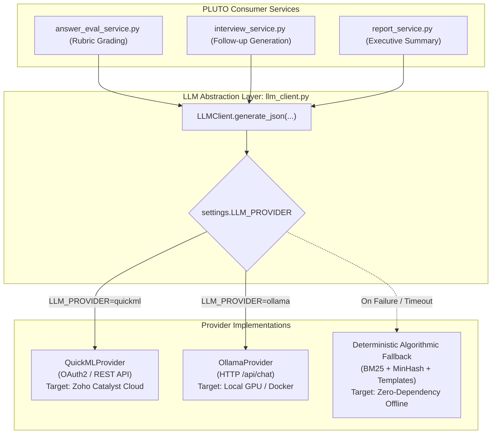
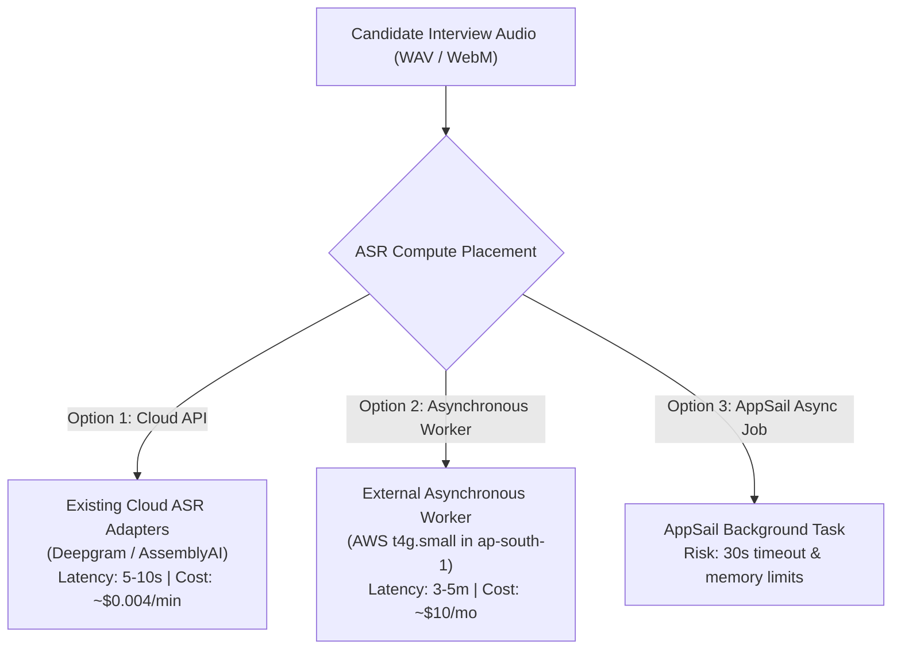

# PLUTO vProctor — Zoho AI & Multimodal Pipeline Integration Assessment

**Document Version:** 1.0  
**Target Platform:** Zoho Catalyst (QuickML & CloudScale) + Dual-Mode Offline Architecture  
**Date Checked:** November 16, 2026  
**Status:** TECHNICAL ASSESSMENT & DESIGN SPECIFICATION (Zero Application Code Modified)  

---

## 1. Executive Summary

PLUTO vProctor relies on a sophisticated multimodal AI pipeline spanning three primary modalities:
1. **Large Language Model (LLM):** Semantic rubric evaluation, intelligent follow-up question generation, and analytical report commentary.
2. **Automatic Speech Recognition (ASR):** Video audio extraction, speech disfluency analysis (filler words, pauses), and speech-to-text transcription.
3. **Computer Vision (CV):** Real-time gaze tracking, iris displacement vectors, head pose (yaw/pitch), and attention scoring.

This assessment evaluates replacing local GPU-dependent Ollama execution with **Zoho Catalyst QuickML Foundation Models** for cloud staging, designs a pluggable dual-mode adapter architecture that preserves offline Ollama operation, and determines the optimal compute placement for Faster-Whisper, MediaPipe, precomputed embeddings, and video storage.

---

## 2. QuickML Foundation Model Evaluation

### 2.1 Supported Models & Alignment with PLUTO
Zoho Catalyst QuickML provides managed, serverless endpoints for leading open-weight Foundation Large Language Models:
- **Qwen Family (Qwen 2.5):** Fully supported in QuickML. This matches PLUTO's existing model family (`qwen2.5:3b` and `qwen2.5:7b-instruct-q4_K_M`).
- **Pixtral / Vision Models:** Supported for multimodal image and document understanding.
- **RAG & Context Windows:** Native knowledge base integration and 4k–32k context token support.

### 2.2 QuickML Pricing & Staging Workload Economics

| Cost Component | QuickML Free Tier Allowance (Monthly) | Pay-As-You-Go Rate | Estimated Staging Demand (50 Interviews / mo) | Monthly Staging Cost |
|---|---|---|---|---|
| **Input Tokens** | **1,000,000 tokens free** | $0.20 per 1M tokens | ~150,000 tokens (prompts + rubrics) | **$0.00** (Within Free Tier) |
| **Output Tokens**| **500,000 tokens free** | $0.40 per 1M tokens | ~50,000 tokens (JSON evaluations) | **$0.00** (Within Free Tier) |
| **Model Hosting**| Included (Serverless) | $0.00 (Zero idle cost) | On-demand inference | **$0.00** |
| **Total LLM Cost**| — | — | — | **$0.00 / month** |

> [!TIP]
> **Massive Cost Reduction:**  
> On AWS, running a dedicated `g4dn.xlarge` instance for Ollama GPU inference costs **~$101/month** (for 8h/day schedule) or **~$401/month** (for 24/7 schedule).  
> Migrating cloud LLM inference to Zoho QuickML reduces LLM compute costs to **$0.00** during staging, fully covered by Catalyst's monthly free tier allowance.

---

## 3. Pluggable Dual-Mode LLM Adapter Architecture

To deploy on Zoho Catalyst without breaking local development or offline capability, PLUTO's `llm_client.py` will adopt a **Provider Strategy Pattern**:



### 3.1 Interface Specification

```python
# Conceptual design for backend/app/services/llm_client.py
from abc import ABC, abstractmethod
from typing import Any, Dict, Optional, Type, TypeVar
from pydantic import BaseModel

T = TypeVar("T", bound=BaseModel)

class LLMProvider(ABC):
    @abstractmethod
    async def generate_json(
        self,
        system_prompt: str,
        user_prompt: str,
        response_model: Optional[Type[T]] = None,
    ) -> Optional[Any]:
        """Execute inference and return validated Pydantic model or parsed dictionary."""
        raise NotImplementedError
```

### 3.2 QuickML Provider Implementation Blueprint

```python
class QuickMLProvider(LLMProvider):
    """Catalyst QuickML Foundation Model adapter using OAuth2 token authentication."""

    def __init__(self):
        self.endpoint = settings.QUICKML_ENDPOINT
        self.client_id = settings.ZOHO_CLIENT_ID
        self.client_secret = settings.ZOHO_CLIENT_SECRET
        self.model_name = settings.QUICKML_MODEL_NAME or "qwen2.5:3b"
        self.timeout = settings.LLM_TIMEOUT_SECONDS

    async def _get_access_token(self) -> str:
        # Fetch or refresh OAuth2 token from Zoho Accounts server
        ...

    async def generate_json(
        self,
        system_prompt: str,
        user_prompt: str,
        response_model: Optional[Type[T]] = None,
    ) -> Optional[Any]:
        token = await self._get_access_token()
        headers = {"Authorization": f"Zoho-oauthtoken {token}", "Content-Type": "application/json"}
        payload = {
            "model": self.model_name,
            "messages": [
                {"role": "system", "content": system_prompt + "\nOUTPUT ONLY RAW JSON."},
                {"role": "user", "content": user_prompt},
            ],
            "temperature": settings.LLM_TEMPERATURE,
            "format": "json",
        }
        async with httpx.AsyncClient(timeout=self.timeout) as client:
            resp = await client.post(self.endpoint, headers=headers, json=payload)
            # Parse response, validate with response_model, and return
            ...
```

### 3.3 Offline Capability & Deterministic Algorithmic Fallback
- **Local Development:** Developers set `LLM_PROVIDER=ollama` and `OLLAMA_BASE_URL=http://localhost:11434` in `.env`. The codebase behaves identically to the current implementation.
- **Zoho Cloud Staging:** Set `LLM_PROVIDER=quickml` in Catalyst AppSail environment configuration.
- **Fail-Safe Fallback:** If QuickML encounters a network partition or OAuth expiration, the system automatically triggers `fallback_factory()`, falling back 100% to deterministic BM25 keyword matching and MinHash Jaccard similarity without interrupting the user.

---

## 4. Faster-Whisper ASR Execution Analysis

### 4.1 The Technical Challenge on Catalyst AppSail
Faster-Whisper (`faster-whisper` with model `base.en`) has the following profile:
- **Memory Footprint:** ~1.0 GiB RAM during model initialization and audio inference.
- **Compute Intensity:** Employs CTranslate2 C++ engine and requires FFmpeg for audio decoding.
- **Inference Time:** Real-Time Factor (RTF) on CPU is ~0.25x–0.35x.
  - A 5-minute candidate response takes ~75–100 seconds of CPU time.
  - A full 15-minute interview audio track takes **3.5 to 5 minutes** to transcribe.
- **The AppSail Dilemma:** Catalyst AppSail enforces a **strict 30-second HTTP request timeout**. Any synchronous API request attempting to transcribe interview audio will immediately abort with an HTTP 504 Gateway Timeout error.

### 4.2 Evaluation of Architectural Options for ASR



#### Option 1: Existing Cloud ASR Adapter (Recommended for Catalyst Staging)
PLUTO's codebase already includes a fully pluggable ASR provider registry in `backend/app/pipelines/asr/registry.py`:
- `AssemblyAIProvider` (`backend/app/pipelines/asr/assemblyai_provider.py`)
- `DeepgramProvider` (`backend/app/pipelines/asr/deepgram_provider.py`)
- `FasterWhisperProvider` (`backend/app/pipelines/asr/faster_whisper_provider.py`)

**Evaluation:**
- Switching to `ASR_PROVIDER=deepgram` or `ASR_PROVIDER=assemblyai` requires **zero code changes**—only setting `DEEPGRAM_API_KEY` in `.env`.
- Audio transcription executes via remote API in 5–10 seconds (well within AppSail limits).
- Cost: Deepgram Nova-2 costs ~$0.0043/minute ($0.065 per 15-minute interview). For 50 staging interviews, total monthly cost is **~$3.25/month**.

#### Option 2: Dedicated Asynchronous Worker VM (ap-south-1)
- Deploy an AWS `t4g.small` instance ($0.0168/hr, ~$4.03/mo for 8h/day schedule) running the existing `FasterWhisperProvider` and polling jobs from the PostgreSQL database.
- Completely avoids third-party API fees, preserves local Whisper execution, but introduces external infrastructure management.

---

## 5. MediaPipe FaceLandmarker Compute Placement

### 5.1 Architecture & Performance
- **Implementation:** `frontend/src/utils/liveGazeDetector.js` imports `@mediapipe/tasks-vision`.
- **Execution Target:** **100% Client-Side in the Candidate's Web Browser**.
- **Hardware Acceleration:** Uses client-side WebAssembly (WASM) and WebGL/WebGPU shaders directly on the candidate's laptop or desktop GPU.
- **Frame Rate:** Delivers sustained 15–30 FPS attention and gaze tracking with zero server load.
- **Telemetry Ingestion:** The browser transmits only 2 lightweight numeric JSON packets per second over WebSocket to `/api/rooms/{id}/ws`:
  ```json
  {
    "type": "gaze_telemetry",
    "yaw": -3.2,
    "pitch": 4.1,
    "eye_contact_score": 0.94,
    "timestamp": 1731720000.12
  }
  ```
- **Conclusion:** MediaPipe requires **zero server compute resources on Zoho Catalyst**. It is completely decoupled from cloud hosting constraints.

---

## 6. Precomputed Embeddings & Algorithmic Search

### 6.1 Memory & Execution Characteristics
- **Embeddings File:** `backend/app/data/processed/embeddings.npy` (2.76 MB, 384-dimensional dense vectors for 1,799 questions).
- **Index Files:** `questions.json` (1.56 MB), `embeddings_ids.json` (32.3 KB).
- **Algorithms:**
  - Trie prefix search (`backend/app/algorithms/trie.py`): < 1 ms.
  - Knapsack MMR duration optimizer (`backend/app/algorithms/knapsack.py`, `mmr.py`): < 5 ms.
  - BM25 and MinHash candidate filtering (`bm25.py`, `minhash.py`): < 10 ms.
- **Execution Placement:** **Runs in-process inside Catalyst AppSail**.
- **Resource Footprint:** Consumes < 60 MB of system RAM on container startup. Well within AppSail's 1 GB or 2 GB memory tiers.

---

## 7. Media Storage Placement (Resumes, Recordings, Reports)

### 7.1 Catalyst Stratus S3-Compatible Storage
All non-ephemeral media assets must be stored outside AppSail's ephemeral container disk:

```mermaid
flowchart LR
    Candidate["Candidate Browser"] -->|Upload Resume / Video Chunks| AppSail["FastAPI on AppSail"]
    AppSail -->|Boto3 S3 Client (PutObject)| Stratus[("Catalyst Stratus Object Storage<br>(S3 Compatible, Zero Egress)")]
    Stratus -->|Bucket: /resumes| B_Resumes["Candidate Resumes (PDF)"]
    Stratus -->|Bucket: /recordings| B_Videos["Session Videos (WebM)"]
    Stratus -->|Bucket: /reports| B_Reports["Evaluation Dossiers (PDF)"]
    Recruiter["Recruiter Admin Console"] -->|Stream Video / Download Report (Zero Egress)| Stratus
```

- **Candidate Resumes:** Uploaded PDFs stored in `pluto-resumes` bucket.
- **Interview Recordings:** Assembled WebM interview videos stored in `pluto-recordings` bucket.
- **Evaluation Reports:** Generated PDF dossiers stored in `pluto-reports` bucket.
- **Zero Egress Advantage:** When recruiters review completed interviews in the Admin Console, video playback streams directly from Catalyst Stratus with **$0.00 bandwidth charges**.

---

## 8. Summary of Component Compute Placement

| Pipeline Component | Execution Location | Compute Type | Cloud Cost Impact |
|---|---|---|---|
| **Large Language Model** | Zoho Catalyst QuickML (`qwen2.5:3b`) | Serverless API | **$0.00** (Covered by monthly free tier) |
| **Speech-to-Text (ASR)** | Cloud API (Deepgram) or External Worker | Cloud API / Asynchronous VM | **~$3.25/mo** (Deepgram) or **~$4.00/mo** (VM) |
| **Gaze & Attention Tracking** | Candidate Web Browser (WASM/WebGL) | Client GPU / CPU | **$0.00** (Zero server impact) |
| **Semantic Question Search** | Catalyst AppSail (`embeddings.npy`) | In-Memory CPU (< 60 MB RAM) | Included in AppSail compute |
| **Media Files (Videos, Resumes)** | Zoho Catalyst Stratus | Object Storage (S3-compatible) | **<$0.50/mo** (Zero egress fees) |
